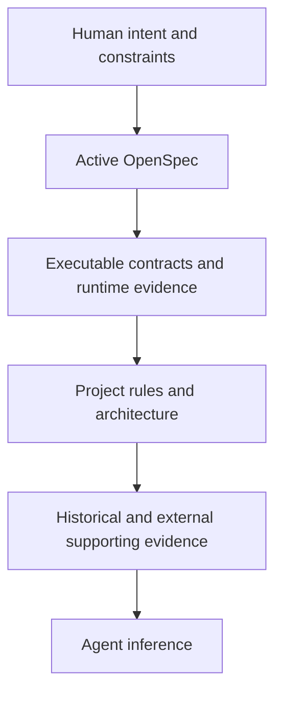

# Principles

## Core Principles

| Principle | 의미 | 실행 규칙 |
| --- | --- | --- |
| **Human First** | 사람이 이해하고 개입하기 쉬워야 한다 | verdict·risk·decision을 detail보다 먼저 둔다 |
| **OpenSpec First** | 하나의 authoritative change만 유지한다 | 경쟁하는 proposal·design·task plan을 만들지 않는다 |
| **OpenSpec Owns Planning** | P는 설치된 OpenSpec workflow를 실행하는 phase다 | OpenSpec의 entry condition, schema, lifecycle, command, 완료 기준을 바꾸거나 추가 gate를 만들지 않는다 |
| **Decorate, Do Not Replace** | OpenSpec schema를 fork하지 않고 보강한다 | Research와 Review를 `openspec/changes/` 밖에 두고, OpenSpec에 선택적 evidence를 연결한다 |
| **Evidence over Confidence** | agent의 확신은 증거가 아니다 | 코드·테스트·실행 결과·공식 자료를 우선한다 |
| **Progressive Rigor** | 불확실성과 위험에 비례해 절차를 강화한다 | 명확한 저위험 변경은 가볍게 처리한다 |
| **Durable over Exhaustive** | 다음 phase가 필요한 정보만 보존한다 | 숨은 추론과 장황한 activity log를 저장하지 않는다 |
| **Durable Evidence Handoff** | phase 간 추론 오염을 줄인다 | transcript가 아니라 artifact와 observed evidence를 전달한다 |

## Decision Order

낮은 우선순위의 근거가 높은 우선순위를 조용히 덮어쓰면 안 된다. 충돌을 기록하고 해당 owner로 route한다.

## OpenSpec Boundary

RPI는 OpenSpec의 확장이다. P는 별도 planning system이 아니라 repository에 설치된
OpenSpec workflow를 그대로 실행한다. OpenSpec이 허용하는 직접 change 시작, artifact
형식, 명령, lifecycle, archive 절차를 RPI가 수정하거나 제한하지 않는다.

Research와 Review는 OpenSpec change와 연결할 수 있는 외부 decorator artifact다. RPI는
OpenSpec이 요구하지 않는 Research, Review, front matter, directory를 change의 필수
입력이나 완료 조건으로 만들지 않는다.

## Evidence Classes

| Class | 역할 | 예시 |
| --- | --- | --- |
| **Authoritative** | 원하는 동작을 정의 | 명시적 사용자 결정, 활성 OpenSpec, 외부 contract |
| **Observed** | 현재 동작을 보여줌 | 코드, 테스트, 설정, runtime output |
| **Supporting** | 배경과 맥락 제공 | Git history, issue, architecture note, 공식 문서 |
| **Assumption** | 불확실성을 드러냄 | 확인되지 않은 환경·의도 추론 |

## Artifact Quality

| Prefer | Avoid |
| --- | --- |
| 비교와 상태는 table | 같은 내용을 반복하는 prose |
| 관계와 loop는 Mermaid | 복잡한 흐름을 긴 문장으로 설명 |
| 근거는 file·line·command reference | 출처 없는 결론 |
| 명확한 status와 next action | “아마 완료” 같은 모호한 표현 |
| 작은 phase별 artifact | 하나의 거대한 작업 일지 |

## Boundary Test

field·file·phase·automation을 추가하기 전에 확인한다.

| 질문 | 유지 조건 |
| --- | --- |
| 이후 결정에 도움이 되는가? | consumer와 decision을 식별할 수 있음 |
| OpenSpec이 이미 소유하는가? | 중복되지 않음 |
| 결과를 검증할 수 있는가? | evidence 또는 deterministic check가 있음 |
| 비용이 위험에 비례하는가? | workflow가 작업보다 가벼움 |
