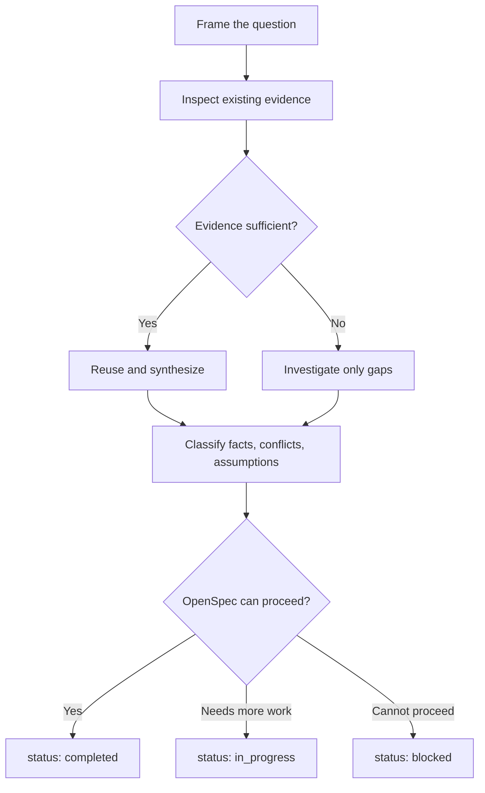

# Research

## Purpose

OpenSpec이 change를 정의할 수 있을 만큼의 verified context를 확보한다. Research는 단순 web search가 아니며 최종 solution을 소유하지 않는다.

Research는 OpenSpec change와 독립적인 `{research-id}`를 가진다. ID는 repository
전체에서 재사용하지 않는 kebab-case 값이며 artifact는
`openspec/research/{research-id}/research.md`에 둔다. dashboard title과 description,
status, tags, 연결 artifact는 `openspec-rpi` front matter가 소유한다.

## Flow

## 1. Frame the Question

다섯 질문으로 scope를 고정한다.

| Dimension | Question |
| --- | --- |
| Goal | 무엇을 왜 변경해야 하는가? |
| Current state | 관련 system은 지금 어떻게 동작하는가? |
| Scope | 어떤 component가 포함되고 제외되는가? |
| Impact | 누구 또는 무엇이 영향을 받는가? |
| Validation | 무엇이 완료를 입증하는가? |

인접한 개선은 별도 candidate로 기록한다. active change에 자동으로 포함하지 않는다.

## 2. Inspect Existing Evidence

다음 순서로 확인하고 충분하면 멈춘다.

| Order | Source | 확인 내용 |
| ---: | --- | --- |
| 1 | Human request | intent, constraints, success criteria |
| 2 | Active OpenSpec | 기존 intended behavior와 change state |
| 3 | Project rules and durable decisions | architecture, conventions, accepted choices |
| 4 | Code and configuration | 현재 구현과 dependency version |
| 5 | Tests and contracts | executable expectation과 edge case |
| 6 | Runtime evidence | reproduction, logs, command output |
| 7 | Git, issues, pull requests | 역사적 이유와 실패한 시도 |
| 8 | Official external sources | project 내부에서 확인되지 않는 사실 |

외부 검색은 조건부다. primary documentation을 우선하고 version·date·environment를 확인한다.

## 3. Assess Sufficiency

다음을 모두 지원하면 근거가 충분하다.

| Required answer | Minimum evidence |
| --- | --- |
| 무엇을 변경하는가? | bounded scope와 affected surface |
| 왜 변경하는가? | 구체적인 문제 또는 의도한 outcome |
| 현재는 어떤가? | observed current-state evidence |
| 무엇이 깨질 수 있는가? | material dependency와 risk |
| 성공을 어떻게 검증하는가? | executable 또는 directly observable criteria |

완벽한 확신은 필요하지 않다. unknown은 명시되고 진행을 막지 않아야 한다.

## 4. Investigate Gaps

| Gap | Preferred action |
| --- | --- |
| 현재 동작을 모름 | code trace, focused check, reproduction |
| blast radius를 모름 | reference, caller, data flow, contract 추적 |
| intent가 모호함 | bounded human decision 요청 |
| design이 경쟁함 | material trade-off만 비교 |
| API·tool 동작이 불확실 | 실제 version의 공식 문서 확인 |
| failure 원인이 불명확 | minimal reproduction과 runtime evidence 확인 |

강한 근거로 이미 확인한 사실을 반복 조사하지 않는다.

## 5. Handle Conflicts

| Conflict | 처리 |
| --- | --- |
| Human intent vs active OpenSpec | `in_progress`; 명시적 change decision 필요 |
| OpenSpec vs implementation | implementation drift로 기록 |
| Documentation vs code | 코드를 current state로 사용하고 문서 stale 가능성 표시 |
| Tests vs intended behavior | contract conflict로 기록하고 조용히 수정하지 않음 |
| Official docs vs installed version | 설치된 version과 일치하는 문서 재확인 |

## 6. Decide Status

| Status | 조건 | Next action |
| --- | --- | --- |
| **completed** | OpenSpec이 goal·scope·impact·validation을 정의 가능 | OpenSpec handoff |
| **in_progress** | bounded investigation 또는 human decision이 남음 | 지정된 gap만 해결 |
| **blocked** | 필수 access·environment·evidence·decision이 없어 안전하게 진행 불가 | blocker와 resume condition 보고 |

## Handoff

Research는 evidence를 전달하며 spec을 중복 작성하지 않는다.

| Field | OpenSpec use |
| --- | --- |
| Problem | proposal context |
| Findings | current-state constraints |
| Evidence | traceability |
| Impact | scope와 risk |
| Options | design input |
| Open questions | human 또는 specification decision |
| Validation candidates | requirements와 task checks |

[Research template](../templates/research.md)을 사용한다. 모든 placeholder를 교체하고 빈 optional section은 삭제한다.
OpenSpec change가 생성되거나 연결되면 front matter의 `relatedArtifacts`를 갱신한다.
