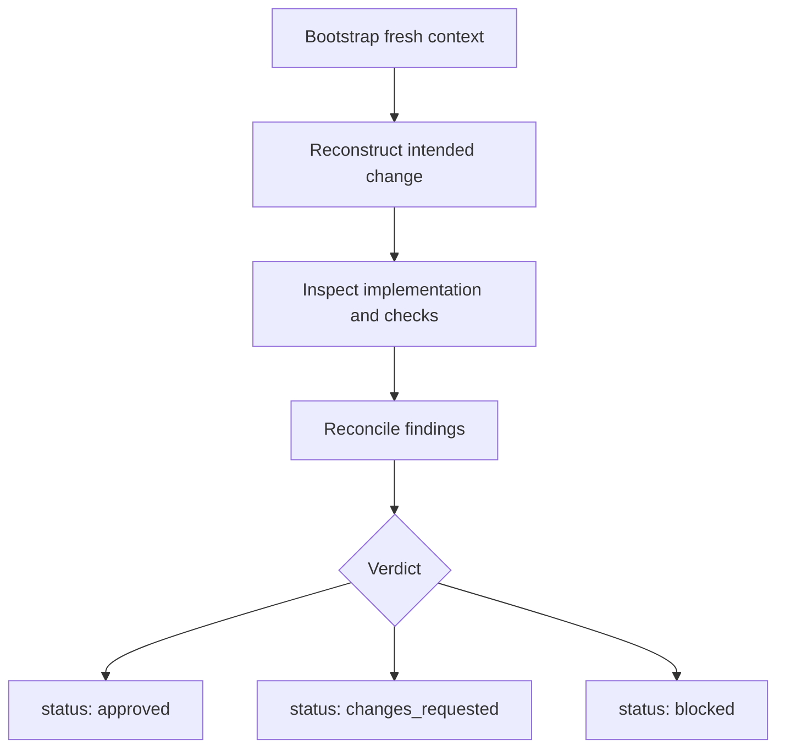
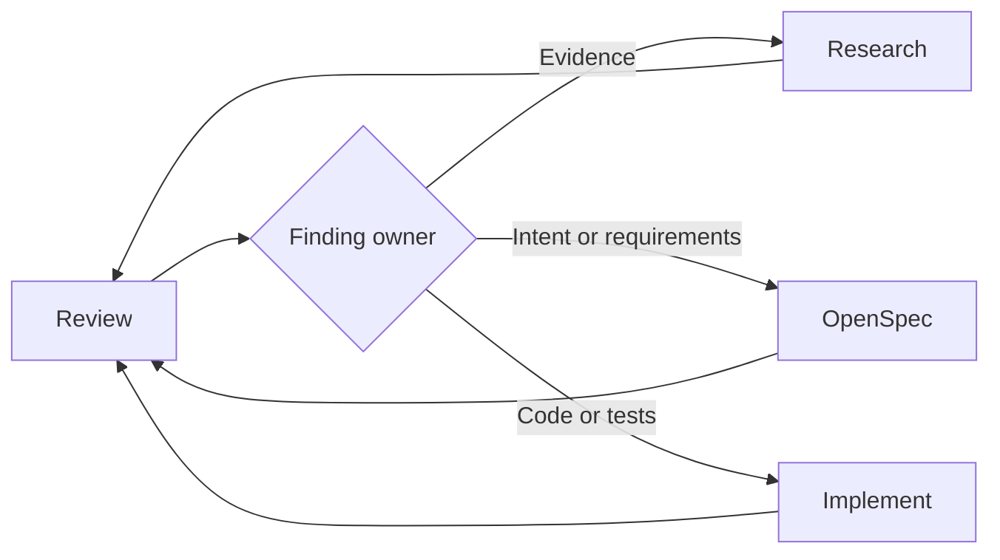

# Review

## Purpose

구현이 active OpenSpec change를 충족하는지 독립적으로 판단하고 근거의 신뢰성을 확인한다.

Review는 구현 summary를 기본적으로 신뢰하지 않으며 finding을 조용히 수정하지 않는다.

## Inputs

| Required | Content |
| --- | --- |
| Active OpenSpec change | proposal, requirements, design, tasks |
| Implementation | diff와 관련 current files |
| Validation evidence | 실제 test·build·lint·runtime 결과 |
| Research | 원래 evidence, assumptions, risks, open questions |
| Amendments | 구현 중 발생한 scope 또는 design 변경 |

필수 input을 사용할 수 없고 재구성할 수도 없으면 status는 `blocked`다.

## Flow

지원되는 환경에서는 fresh 또는 forked context를 사용한다. 구현자의 결론이 아니라 artifact와 file을 제공한다.

## Review Axes

| Axis | Question |
| --- | --- |
| **Completeness** | 모든 required behavior와 task가 반영되었는가? |
| **Correctness** | 구현이 각 requirement를 충족하는가? |
| **Coherence** | proposal·specs·design·tasks·code·tests가 일치하는가? |
| **Regression** | 기존 contract와 인접 behavior가 보호되는가? |
| **Evidence** | 관련 check가 실제로 실행되고 결과가 관찰되는가? |
| **Risk** | 주요 assumption·edge case·residual risk가 보이는가? |

## Finding Levels

| Level | 의미 | Verdict 영향 |
| --- | --- | --- |
| **Blocker** | 안전하게 계속할 수 없거나 검증 불가 | `blocked` 또는 `changes_requested` |
| **Major** | requirement·correctness·regression·evidence 실패 | `changes_requested` |
| **Minor** | 비차단 clarity 또는 maintainability 문제 | 명시적으로 수용하면 `approved` 가능 |
| **Note** | active change 밖의 follow-up | 직접 영향 없음 |

모든 Blocker와 Major finding은 구체적 evidence와 owner인 Research, OpenSpec, Implement를 표시한다.

## Verdict

| Status | 조건 | Route |
| --- | --- | --- |
| **approved** | unresolved Blocker·Major가 없고 필수 validation이 신뢰 가능 | OpenSpec archive |
| **changes_requested** | 수정 가능한 evidence·specification·implementation·validation gap이 남음 | 지정 phase로 돌아간 후 재Review |
| **blocked** | 필수 access·environment·dependency·human decision을 사용할 수 없음 | blocker 해결 후 재Review |

plausibility, task checkmark, 구현자 summary만으로 `approved`로 판정하지 않는다.

## Review Loop

수정된 change는 fresh Review status를 받아야 한다. 기존 `approved` artifact를 새 구현에 맞게 수정하지 않는다.
Review는 `openspec/reviews/{change-id}/{sequence}-{review-title}.md`에 저장한다.
`sequence`는 `001`부터 증가하는 세 자리 attempt 번호이며, 같은 attempt의 보조
artifact만 `-{extension}` suffix를 붙여 같은 directory에 저장한다.

## Output

[Review template](../templates/review.md)을 사용한다. status를 먼저 두고, finding은 evidence-linked로 작성하며, next route를 명확히 한다.
