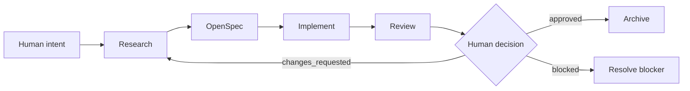

# Vision

## One Sentence

**ROR는 AI agent가 필요한 근거를 조사하고, 명시적인 OpenSpec change에 따라 구현하며, 결과를 사람이 검토할 수 있는 증거로 입증하도록 돕는다.**

## Why

| 반복되는 실패 | ROR의 대응 |
| --- | --- |
| 시스템을 이해하기 전에 구현을 시작한다 | Research가 기존 근거를 먼저 검증한다 |
| 요구사항과 코드가 서로 달라진다 | OpenSpec을 Source of Truth로 유지한다 |
| 여러 도구가 같은 plan을 중복 작성한다 | proposal·design·tasks는 OpenSpec이 소유한다 |
| 구현자가 자신의 가정을 스스로 검증한다 | Review가 독립적으로 근거를 대조한다 |
| 변경보다 절차가 더 무거워진다 | 불확실성과 위험에 따라 rigor를 조절한다 |
| 사람이 긴 agent transcript를 읽어야 한다 | durable artifact에 결정·근거·상태만 남긴다 |

## Target Flow

## Responsibilities

| Actor or system | 책임 |
| --- | --- |
| Human | 의도 설정, 중요한 선택, 위험 수용 |
| ROR | phase 조율과 책임 경계 유지 |
| Research | 충분한 근거와 불확실성 확립 |
| OpenSpec | 의도한 변경 정의와 구현 task 추적 |
| Implementer | 코드와 실행 가능한 검증 생성 |
| Reviewer | 의도·spec·구현·근거 대조 |

## Scope

| Included | Not now |
| --- | --- |
| Research 충분성 판단 | 자산 사용 analytics |
| OpenSpec handoff와 lifecycle 조율 | token·cost dashboard |
| 근거 기반 구현 Review | 전체 agent action logging |
| Windows·WSL 적용 지침 | Custom OpenSpec schema fork |
| 재사용 template과 static validation | IDE 전용 plugin 개발 |

## Direction

ROR가 성공하면 사람은 다음 질문에 빠르게 답할 수 있다.

1. 무엇을 왜 변경했는가?
1. 어떤 근거가 변경을 정당화하는가?
1. 구현이 OpenSpec과 일치하는가?
1. 실제로 무엇을 검증했는가?
1. Review status가 `approved`, `changes_requested`, `blocked` 중 무엇인가?
