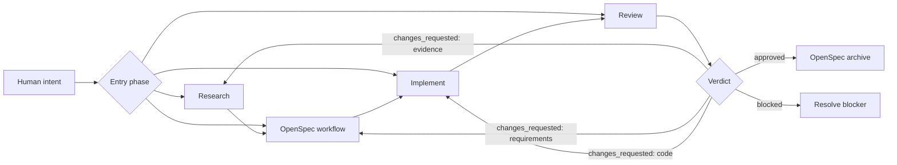

# Workflow

## Lifecycle



각 phase는 독립적으로 시작할 수 있다. 시작 전에 선택한 phase의 입력 artifact가 존재하고 신뢰할 수 있는지만 확인한다. 부족하거나 충돌하는 artifact는 해당 owner phase에서 보완한 뒤 선택한 phase로 돌아온다.

Research는 추가 조사 필요 여부 판정을 내부에 포함한다. Research에서 시작하거나 Research로 route된 경우, 기존 근거가 충분하면 추가 조사 없이 끝날 수 있다.

P는 repository에 설치된 OpenSpec workflow 자체다. RPI는 OpenSpec의 entry condition,
artifact schema, lifecycle, command, 완료·archive 조건을 정의하거나 변경하지 않는다.
Research와 Review는 OpenSpec이 허용하는 범위에서 선택적으로 연결하는 외부 artifact다.

## Stage Contract

| Stage | Input | Exit condition | Output |
| --- | --- | --- | --- |
| Research | Human intent와 기존 project evidence | OpenSpec이 목표·범위·영향·검증을 정의 가능 | `draft`, `in_progress`, `completed`, `blocked`, `superseded` artifact |
| OpenSpec | 설치된 OpenSpec workflow가 요구하는 input과 human decision | 설치된 OpenSpec workflow의 exit condition 충족 | Active OpenSpec change |
| Implement | 승인된 OpenSpec tasks | task 구현과 필수 check 완료 | 코드, 테스트, task state, amendment |
| Review | OpenSpec change, diff, checks, Research | 구현을 독립적으로 대조 완료 | `pending`, `in_progress`, `approved`, `changes_requested`, `blocked` artifact |
| Archive | Review `approved` | OpenSpec archive 성공 | Durable project specification |

## Rigor

| Level | 대표 변경 | Research | Review |
| --- | --- | --- | --- |
| **Lite** | 명확하고 국소적인 저위험 변경 | 현재 코드와 테스트 재사용 | focused spec·test 대조 |
| **Standard** | 여러 file 또는 behavior 변경 | dependency와 대안 추적 | completeness·correctness·coherence·regression |
| **Strict** | 보안·데이터 손실·호환성·architecture | 외부 사실과 주요 trade-off 검증 | 독립적 deep review와 전체 필수 validation |

불확실성, blast radius, reversibility, 외부 dependency가 요구하는 가장 높은 level을 선택한다.

## Artifact Locations

```text
openspec/
├── changes/                 # OpenSpec 소유
├── specs/                   # OpenSpec 소유
├── research/
│   └── {research-id}/
│       └── research.md      # ROR decorator artifact
└── reviews/
    └── {change-id}/
        └── {sequence}-{review-title}[-{extension}].md # ROR decorator artifact
```

ROR artifact를 OpenSpec change directory 안에 넣거나 OpenSpec schema의 필수 artifact로 만들지 않는다.
RPI Research와 Review도 OpenSpec change의 entry·completion·archive gate가 아니다.
Research와 Review는 `openspec-rpi` front matter의 `relatedArtifacts`로 Research,
OpenSpec change, Review ID를 연결한다. Review는 구현된 change 하나를 검증하므로
`{change-id}` directory를 identity로 유지하고, 각 Review attempt는 세 자리
sequence로 구분한다. 같은 attempt의 보조 artifact는 filename suffix를 사용한다.

## Report Ownership

phase의 상세 보고는 채팅이 아니라 아래 canonical artifact에 기록한다. 채팅은
status, artifact link, next route를 전달하는 handoff로만 사용한다.

| Phase | Canonical report source | Report content |
| --- | --- | --- |
| Research | `openspec/research/{research-id}/research.md`와 연결된 하위 artifact | 질문, scope, findings, evidence, assumptions, risks, open questions, handoff |
| OpenSpec | active change의 `proposal.md`, `design.md`, `specs/`, `tasks.md` | 의도, 요구사항, 설계, task, 결정과 변경 범위 |
| Implement | 변경된 코드·테스트, `tasks.md`, amendment와 validation evidence | 구현 결과, 실행한 check, 남은 구현 risk |
| Review | `openspec/reviews/{change-id}/{sequence}-{review-title}.md`와 연결된 보조 artifact | verdict, findings, evidence, validation, route |

phase에 전용 report artifact가 없는 경우 기존 canonical artifact를 사용한다. 별도
chat transcript를 durable evidence로 취급하지 않으며, 같은 내용을 반복하는 report
파일도 만들지 않는다.

## Entry Contract

| 시작 phase | 시작 전 확인 | 부족할 때 route |
| --- | --- | --- |
| Research | 목표, 제약, 알려진 성공 기준 | Human 또는 Environment |
| OpenSpec | 설치된 OpenSpec workflow의 entry contract | OpenSpec workflow 또는 Human |
| Implement | 승인된 OpenSpec task | OpenSpec |
| Review | active OpenSpec change, diff, 실제 검증 결과, 관련 Research | Research, OpenSpec, Implement |

시작 phase가 이전 phase의 artifact를 소비하는 것은 phase 독립성을 해치지 않는다. 해당 artifact가 이미 유효하면 이전 phase를 다시 실행하지 않는다.

## Handoffs

| From → To | 필수 handoff |
| --- | --- |
| Human → Research | 목표, 제약, 알려진 성공 기준 |
| Research → OpenSpec | 선택적 findings, evidence, impact, risks, open questions |
| OpenSpec → Implement | 승인된 requirements, design decisions, tasks |
| Implement → Review | diff, task state, 실행한 checks, amendments |
| Review → Human/OpenSpec | verdict, findings, evidence, 정확한 next route |

handoff는 phase artifact와 observed evidence를 사용한다. transcript나 private reasoning은
handoff 근거로 취급하지 않는다. 채팅 handoff는 artifact path와 status를 가리키는
짧은 전달만 제공한다.

## Feedback Routing

| Finding | 돌아갈 단계 |
| --- | --- |
| 근거 부족 또는 충돌 | Research |
| 의도한 동작이 틀리거나 불완전 | OpenSpec |
| 구현 defect 또는 테스트 누락 | Implement |
| 외부 접근 또는 결정 불가 | `blocked` |
| 모든 필수 근거가 일치 | Archive |

## Completion

change는 다음을 모두 만족해야 완료다.

- OpenSpec이 의도한 변경을 정확히 표현한다.
- 필수 task와 validation이 완료되었다.
- Review status가 `approved`다.
- 알려진 residual risk와 follow-up이 보인다.
- archive가 성공했거나 보류 이유가 명시되었다.
