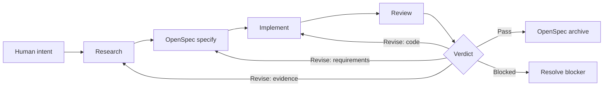

# Workflow

## Lifecycle



Research는 추가 조사 필요 여부 판정을 내부에 포함한다. Research phase는 항상 거치지만, 기존 근거가 충분하면 추가 조사 없이 끝날 수 있다.

## Stage Contract

| Stage | Input | Exit condition | Output |
| --- | --- | --- | --- |
| Research | Human intent와 기존 project evidence | OpenSpec이 목표·범위·영향·검증을 정의 가능 | `Ready`, `Revise`, `Blocked` artifact |
| OpenSpec | Ready Research와 human decision | proposal·requirements·design·tasks가 coherent | Active OpenSpec change |
| Implement | 승인된 OpenSpec tasks | task 구현과 필수 check 완료 | 코드, 테스트, task state, amendment |
| Review | OpenSpec change, diff, checks, Research | 구현을 독립적으로 대조 완료 | `Pass`, `Revise`, `Blocked` artifact |
| Archive | Review `Pass` | OpenSpec archive 성공 | Durable project specification |

## Rigor

| Level | 대표 변경 | Research | Review |
| --- | --- | --- | --- |
| **Lite** | 명확하고 국소적인 저위험 변경 | 현재 코드와 테스트 재사용 | focused spec·test 대조 |
| **Standard** | 여러 file 또는 behavior 변경 | dependency와 대안 추적 | completeness·correctness·coherence·regression |
| **Strict** | 보안·데이터 손실·호환성·architecture | 외부 사실과 주요 trade-off 검증 | 독립적 deep review와 전체 필수 validation |

불확실성, blast radius, reversibility, 외부 dependency가 요구하는 가장 높은 level을 선택한다.

## Artifact Locations

```text
openspec/
├── changes/                 # OpenSpec 소유
├── specs/                   # OpenSpec 소유
├── research/
│   └── {research-id}/
│       └── research.md      # ROR decorator artifact
└── reviews/
    └── {change-id}/
        └── {sequence}-{review-title}[-{extension}].md # ROR decorator artifact
```

ROR artifact를 OpenSpec change directory 안에 넣거나 OpenSpec schema의 필수 artifact로 만들지 않는다.
Research와 Review는 `openspec-rpi` front matter의 `relatedArtifacts`로 Research,
OpenSpec change, Review ID를 연결한다. Review는 구현된 change 하나를 검증하므로
`{change-id}` directory를 identity로 유지하고, 각 Review attempt는 세 자리
`{sequence}`로 구분한다. 같은 attempt의 보조 artifact는 filename suffix를 사용한다.

## Handoffs

| From → To | 필수 handoff |
| --- | --- |
| Human → Research | 목표, 제약, 알려진 성공 기준 |
| Research → OpenSpec | findings, evidence, impact, risks, open questions |
| OpenSpec → Implement | 승인된 requirements, design decisions, tasks |
| Implement → Review | diff, task state, 실행한 checks, amendments |
| Review → Human/OpenSpec | verdict, findings, evidence, 정확한 next route |

handoff가 agent 또는 context 경계를 넘으면 [Subagents](subagents.md)와 [Handoff template](../templates/handoff.yaml)을 사용한다.

## Feedback Routing

| Finding | 돌아갈 단계 |
| --- | --- |
| 근거 부족 또는 충돌 | Research |
| 의도한 동작이 틀리거나 불완전 | OpenSpec |
| 구현 defect 또는 테스트 누락 | Implement |
| 외부 접근 또는 결정 불가 | Blocked |
| 모든 필수 근거가 일치 | Archive |

## Completion

change는 다음을 모두 만족해야 완료다.

- Research가 `Ready`다.
- OpenSpec이 의도한 변경을 정확히 표현한다.
- 필수 task와 validation이 완료되었다.
- Review가 `Pass`다.
- 알려진 residual risk와 follow-up이 보인다.
- archive가 성공했거나 보류 이유가 명시되었다.
