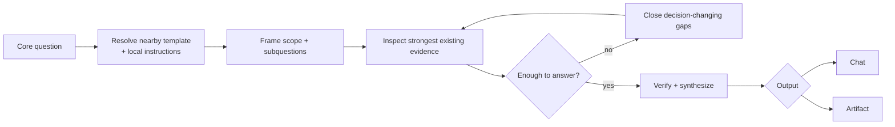

# Workflow

질문 설정, 템플릿 탐색·해석, 범위 설정, 엄밀도 선택 또는 조사 종료 판단이 필요할 때 읽습니다.

## Flow

## Question

- Research가 지원할 판단 또는 사용 목적을 확인합니다.
- 핵심 질문을 하나의 명확한 목표로 정합니다.
- 사용자 요청이나 활성 명세와 충돌하는 해석은 조용히 선택하지 않습니다.

## Inspect Template

핵심 질문을 정한 다음 사용할 Research 템플릿과 관련 지침을 확인합니다.

### Discovery

`--template`에 경로가 지정되면 해당 파일을 사용합니다.

`template: auto`는 다음 후보를 순서대로 얕게 확인하며, 적절한 템플릿을 찾으면 탐색을 중단합니다. 예상 보고서 저장 폴더는 `output: artifact`가 명시되었거나 프로젝트 계약에서 Artifact 저장 위치를 식별할 수 있을 때만 후보로 사용합니다.

1. 프로젝트 설정이나 활성 workflow가 가리키는 템플릿
1. 관련된 기존 Research Artifact가 사용하거나 참조한 템플릿
1. 예상 보고서 저장 폴더와 그 가까운 상위 폴더의 템플릿·지침
1. 위 위치에 인접한 `templates/`, `template/`, `.templates/` 폴더
1. 프로젝트 루트의 명확한 Research 템플릿 후보

저장소 전체를 재귀적으로 검색하거나 여러 유사 후보를 장시간 비교하지 않습니다. 가까운 후보에서 찾지 못하면 템플릿 없이 Research를 계속합니다.

### Local Instructions

템플릿 파일뿐 아니라 다음 위치의 로컬 지침도 필요한 만큼 확인합니다.

- 템플릿이 있는 폴더와 가까운 상위 폴더
- 예상 보고서 저장 폴더와 가까운 상위 폴더
- 해당 위치의 명확한 지침, 설정 또는 schema 파일

로컬 지침은 템플릿 선택, 작성 규칙, 저장 위치, 이름, front matter, 상태 또는 생략 조건을 정의할 수 있습니다.

### Interpretation

템플릿과 로컬 지침에서 다음을 파악합니다.

- 반드시 다뤄야 하는 항목
- 핵심 질문과 관련된 항목
- 조건에 따라 필요한 항목
- 각 항목이 기대하는 사실, 비교, 영향, 위험 또는 검증 정보
- front matter, 상태, 저장 위치와 보관 규칙
- 생략, `N/A` 또는 미확인으로 표시할 수 있는 조건

다음 요소에는 작성 지침이나 채울 값의 의미가 포함될 수 있습니다.

- `<...>` 플레이스홀더
- `{...}` 또는 `{{...}}` 플레이스홀더
- 플레이스홀더 내부의 설명과 제약
- HTML, Markdown, YAML 등의 주석
- 예시 값, 고정 문구와 조건부 블록

플레이스홀더와 주석은 문맥을 확인하여 작성 지침, 예시, 실제 출력 문자열을 구분합니다. 확인하지 않은 값을 추측해 채우지 않으며, 작성 지침이나 내부 주석을 최종 Artifact에 그대로 남기지 않습니다. 문법 표현이나 코드처럼 실제 내용인 괄호 표기는 임의로 치환하지 않습니다.

템플릿은 단순 서식이 아니라 기대되는 정보 구조입니다. 확인한 기대 내용은 하위 질문, 조사 범위와 완료 기준에 반영합니다. 다만 템플릿이나 로컬 지침이 핵심 질문과 사용자 의도를 대체하지는 않습니다.

적용할 템플릿이 없으면 핵심 질문을 기준으로 Research를 계속합니다. 템플릿 부재만으로 Research나 Artifact 작성을 차단하지 않습니다.

## Frame Scope

질문과 발견된 템플릿이 기대하는 내용을 바탕으로 다음을 정합니다.

- 필요한 하위 질문
- 포함·제외 범위
- 템플릿의 필수·관련 항목을 채우는 데 필요한 근거
- 최소 완료 근거

`scope: auto`는 질문에서 직접 관련된 대상으로 시작하고, 결론 검증과 발견된 템플릿의 필수·관련 항목을 처리하는 데 필요한 관계까지만 확장합니다.

인접한 개선, 새 기능 또는 무관한 선택 항목은 현재 범위에 자동 포함하지 않습니다.

## Inspect Existing Evidence

가장 직접적이고 신뢰할 수 있는 근거부터 필요한 만큼 확인합니다. 모든 출처를 기계적인 순서로 읽지 않습니다.

- 사용자 요청과 명시적 제약
- 활성 명세와 지속되는 결정(Durable Decision)
- 프로젝트 문서, 코드, 설정과 테스트
- 실제 실행 결과와 오류
- Git history, issue와 pull request
- 현재 환경과 일치하는 공식 문서·표준·연구 등 1차 자료

강한 근거로 이미 확인된 사실은 반복 조사하지 않습니다.

## Close Gaps

답, 주요 불확실성 또는 발견된 템플릿의 필수·관련 항목을 바꿀 수 있는 근거만 추가로 조사합니다.

| Gap | Preferred check |
| --- | --- |
| 현재 동작이 불명확함 | 코드, 설정, 테스트와 실제 실행 결과 |
| 영향 범위가 불명확함 | 참조, 호출 관계, 데이터 흐름과 계약 |
| 외부 사실이 불명확함 | 현재 버전과 환경에 맞는 1차 자료 |
| 오류 원인이 불명확함 | 가장 작은 재현과 실제 실행 결과 |
| 템플릿 필수 항목의 정보가 부족함 | 해당 항목을 채우는 데 직접 필요한 근거 |

실행하지 않은 명령의 예상 결과나 확인하지 않은 내용을 근거로 기록하지 않습니다.

## Rigor

| Level | 사용 기준 | 조사 행동 |
| --- | --- | --- |
| `lite` | 국소적인 사실이나 현재 상태만 확인합니다. | 가장 직접적인 근거로 핵심 사실을 확인하고 추가 교차검증은 필요한 경우에만 수행합니다. |
| `standard` | 여러 대상의 동작, 관계 또는 대안을 함께 확인합니다. | 결론에 영향을 주는 관계, 대안 또는 주요 가정을 필요한 만큼 교차 확인합니다. |
| `strict` | 데이터 손실, 호환성, 보안, 아키텍처 또는 외부 계약 위험을 다룹니다. | 중요 결론을 뒤집을 수 있는 반례, 충돌 근거와 실패·위험 경계를 추가로 검증합니다. |

`rigor: auto`는 위험과 발견된 템플릿이 요구하는 근거 수준을 다루기에 충분한 가장 낮은 수준을 선택합니다. 높은 수준은 조사량 자체가 아니라 결론을 검증하는 강도를 높입니다.

## Stop Condition

다음을 만족하면 조사를 중단합니다.

- 핵심 질문에 근거 있는 답을 제시할 수 있습니다.
- 발견된 템플릿의 필수 항목과 조사 목표에 관련된 항목을 처리했습니다.
- 중요한 충돌과 미확인 사항이 드러나 있습니다.
- 새로운 조사가 답이나 주요 불확실성을 실질적으로 바꿀 가능성이 낮습니다.

템플릿을 찾지 못한 경우에는 템플릿 관련 조건을 적용하지 않습니다. 완벽한 확신이나 모든 선택 항목의 수집은 필요하지 않습니다.
