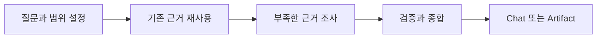

# Pivot Research

필요한 근거를 조사하고 다음 판단에 사용할 수 있는 형태로 정리한다.

Research는 단순 검색이 아니다. 현재 상태와 불확실성을 확인하는 단계이며, 요구사항·설계·구현을 대신 결정하지 않는다.

## Arguments

```yaml
question: auto
scope: auto
exclude: []
rigor: auto
output: auto
research_id: auto
artifact_path: auto
template: auto
```

| Argument | 의미 | `auto` 동작 |
| --- | --- | --- |
| `--question <text\|auto>` | 이번 Research가 답할 하나의 질문 | 사용자 요청에서 가장 작은 핵심 질문을 도출한다. |
| `--scope <path,...\|auto>` | 직접 조사할 경로 또는 영역 | 질문과 직접 관련된 영역과 근거 검증에 필요한 관계까지만 포함한다. |
| `--exclude <path,...>` | 조사에서 제외할 경로 또는 영역 | 지정한 대상을 읽거나 근거로 사용하지 않는다. |
| `--rigor <auto\|lite\|standard\|strict>` | 조사 엄밀도(Rigor) | 불확실성, 영향 범위, 복구 가능성과 외부 의존성을 기준으로 선택한다. |
| `--output <auto\|chat\|artifact>` | 결과를 남길 방식 | 다음 작업에 지속적인 전달이 필요하면 artifact, 아니면 chat을 사용한다. |
| `--research-id <id\|auto>` | Research 식별자 | artifact를 만들 때 질문을 나타내는 케밥 표기(kebab-case) ID를 만든다. |
| `--artifact-path <path\|auto>` | Research artifact 저장 위치 | 활성 프로젝트의 설정, 관례 또는 기존 Research 위치를 따른다. |
| `--template <path\|auto\|none>` | 사용할 Research 템플릿 | 프로젝트에 이미 있는 Research 템플릿을 찾아 재사용한다. |

명시된 argument를 가장 먼저 적용한다. 사용자 의도나 기존 artifact와 충돌하면 조용히 덮어쓰지 않는다.

```text
--question "현재 EDA 실행 경계는 무엇인가?" --scope src/,tests/ --rigor standard --output artifact
```

### Rigor

| Level | 사용 기준 |
| --- | --- |
| `lite` | 한두 파일의 국소적인 현재 상태만 확인하면 된다. |
| `standard` | 여러 파일, 동작 또는 주요 의존 관계를 함께 확인해야 한다. |
| `strict` | 데이터 손실, 호환성, 보안, 아키텍처 또는 외부 계약 위험이 있다. |

## Portability

이 스킬은 특정 workflow, schema 또는 directory를 필수로 요구하지 않는다.

| Integration | 처리 |
| --- | --- |
| 프로젝트 Research 템플릿 | 있으면 그대로 사용하며 이 스킬 안에 복제하지 않는다. |
| 프로젝트 artifact 규칙 | 있으면 저장 위치, front matter와 상태 규칙을 따른다. |
| 프로젝트 규칙이 없음 | Chat 결과는 계속 작성할 수 있다. Artifact가 반드시 필요하면 경로와 형식을 임의로 만들지 않고 `blocked`로 보고한다. |

자동 탐색 순서는 다음과 같다.

1. 명시된 argument
2. 활성 workflow 또는 프로젝트 설정
3. 기존 Research artifact와 템플릿
4. 일반적인 chat 보고

## Research



### Frame

다음을 먼저 고정한다.

- 답해야 할 하나의 질문
- 이 답이 지원할 다음 판단
- 포함 및 제외 범위
- 완료를 판단할 최소 근거

인접한 개선이나 새로운 기능은 별도 후보로 남기고 현재 범위에 자동 포함하지 않는다.

### Reuse Evidence

새 조사를 시작하기 전에 다음 근거를 필요한 만큼 확인한다.

1. 사용자 요청과 명시적 제약
2. 활성 명세와 지속되는 결정(Durable Decision)
3. 프로젝트 문서와 규칙
4. 코드와 설정
5. 테스트와 실행 계약(Executable Contract)
6. 실제 실행 결과와 오류
7. Git history, issue, pull request
8. 현재 환경과 일치하는 공식 외부 자료

강한 근거로 이미 확인된 사실은 반복 조사하지 않는다.

### Investigate Gaps

부족한 근거만 조사한다.

- 현재 동작이 불명확하면 코드, 설정, 테스트와 실행 결과를 확인한다.
- 영향 범위가 불명확하면 참조, 호출 관계, 데이터 흐름과 계약을 추적한다.
- 외부 사실이 필요하면 현재 버전과 환경에 맞는 공식 자료를 우선한다.
- 오류 원인이 불명확하면 가장 작은 재현과 실제 실행 결과를 확보한다.
- 실행하지 않은 명령의 예상 결과는 근거로 기록하지 않는다.

### Synthesize

| 근거 종류 | 의미 |
| --- | --- |
| **권위 근거(Authoritative)** | 원하는 동작이나 제약을 정의한다. |
| **관찰 근거(Observed)** | 코드, 설정, 테스트 또는 실행 결과에서 직접 확인했다. |
| **보조 근거(Supporting)** | 역사와 외부 맥락을 제공한다. |
| **가정(Assumption)** | 아직 검증되지 않은 해석이다. |

충돌하는 근거는 임의로 합치지 않는다. 충돌 내용, 영향과 해결 주체를 기록한다.

## Completion

| Status | 조건 |
| --- | --- |
| `completed` | 다음 판단이 목표, 현재 상태, 범위, 영향과 검증 기준을 정의할 수 있다. |
| `in_progress` | 제한된 추가 조사 또는 중대한 사용자 결정이 남아 있다. |
| `blocked` | 필수 접근, 환경, 근거 또는 결정이 없어 안전하게 계속할 수 없다. |

완벽한 확신은 필요하지 않다. 남은 미확인 사항(Unknown)이 다음 판단을 막는지가 기준이다.

## Output

### Chat

결론, 주요 근거, 불확실성과 다음 행동만 간결하게 보고한다.

### Artifact

- `--template`으로 선택된 기존 템플릿을 그대로 사용한다.
- 저장 위치, front matter, 상태와 보관 규칙은 활성 프로젝트의 계약을 따른다.
- 이 스킬은 별도 템플릿이나 artifact schema를 정의하지 않는다.
- 상세 활동 로그, 비공개 추론(Private Reasoning), cache, secret과 대용량 raw output은 저장하지 않는다.

`template: auto` 또는 `artifact_path: auto`를 하나로 결정할 수 없고 artifact가 반드시 필요하면 후보를 임의 선택하지 않는다.

## Boundaries

- 요구사항, 설계 또는 구현 계획을 Research 결과로 확정하지 않는다.
- 코드, 테스트 또는 설정을 구현 목적으로 수정하지 않는다.
- 근거 없는 확신으로 `completed` 처리하지 않는다.
- 질문과 무관한 저장소 전체 조사나 링크 수집을 하지 않는다.
- 사용자 의도와 활성 명세의 충돌을 조용히 해결하지 않는다.

## Maintenance

수정 전 `docs/DIRECTIVE.md`와 `docs/WORKING.md`를 읽는다. 의미 있는 수정 후 `docs/WORKING.md`를 현재 상태 중심으로 갱신한다.
