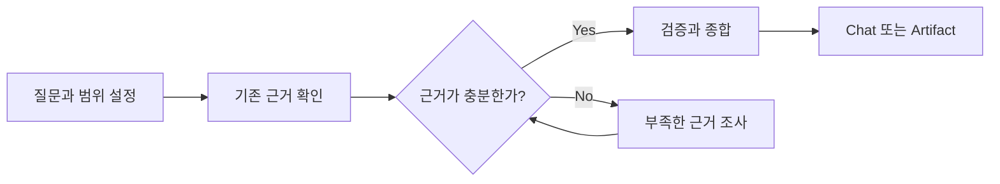

# Pivot Research

필요한 근거를 조사하고 다음 판단에 사용할 수 있는 형태로 정리한다.

Research는 단순 검색이 아니다. 현재 상태와 불확실성을 확인하는 단계이며, 요구사항·설계·구현을 대신 결정하지 않는다.

## Arguments

```yaml
question: auto
scope: auto
exclude: []
rigor: auto
output: auto
```

| Argument | 의미 | `auto` 동작 |
| --- | --- | --- |
| `--question <text|auto>` | Research의 핵심 질문 또는 목표 | 사용자 요청에서 가장 작은 핵심 목표를 도출하고 필요한 하위 질문만 포함한다. |
| `--scope <value,...|auto>` | 조사할 경로, 시스템, 버전 또는 주제 | 질문에 직접 관련된 대상과 근거 검증에 필요한 관계까지만 포함한다. |
| `--exclude <value,...>` | 조사에서 제외할 대상 | 지정한 대상을 조사하거나 근거로 사용하지 않는다. |
| `--rigor <auto|lite|standard|strict>` | 조사 엄밀도(Rigor) | 위험을 다루기에 충분한 가장 낮은 수준을 선택한다. |
| `--output <auto|chat|artifact>` | 결과를 남길 방식 | 사용자가 요청했거나 활성 작업이 지속 가능한 Research 기록을 필요로 할 때만 artifact를 사용한다. |

명시된 argument를 우선한다. 사용자 의도나 기존 artifact와 충돌하면 조용히 덮어쓰지 않는다.

```text
--question "현재 EDA 실행 경계는 무엇인가?" --scope src/,tests/ --rigor standard --output artifact
```

### Rigor

| Level | 사용 기준 |
| --- | --- |
| `lite` | 국소적인 현재 상태만 확인하면 된다. |
| `standard` | 여러 대상의 동작이나 주요 의존 관계를 함께 확인해야 한다. |
| `strict` | 데이터 손실, 호환성, 보안, 아키텍처 또는 외부 계약 위험이 있다. |

## Portability

특정 workflow, schema 또는 directory를 필수로 요구하지 않는다.

- Chat 결과는 프로젝트별 Research 자산이 없어도 작성한다.
- Artifact는 프로젝트에 이미 존재하는 Research 템플릿과 저장 규칙을 사용한다.
- 템플릿, front matter, 상태와 저장 경로를 이 스킬 안에 복제하거나 새로 정의하지 않는다.
- Artifact 계약을 하나로 결정할 수 없으면 Artifact 작성만 중단하고, 확인된 내용과 모호성을 Chat으로 보고한다.

적용 우선순위는 **명시된 argument → 프로젝트 규칙과 기존 템플릿 → 기존 Research artifact → Chat**이다.

## Research



### Frame

다음을 고정한다.

- Research가 지원할 다음 판단
- 핵심 질문과 필요한 하위 질문
- 포함 및 제외 범위
- 완료를 판단할 최소 근거

인접한 개선이나 새로운 기능은 별도 후보로 남기고 현재 범위에 자동 포함하지 않는다.

### Reuse Evidence

가장 직접적이고 신뢰할 수 있는 기존 근거부터 확인한다. 모든 출처를 기계적인 순서로 읽을 필요는 없다.

- 사용자 요청과 명시적 제약
- 활성 명세와 지속되는 결정(Durable Decision)
- 프로젝트 문서, 코드, 설정과 테스트
- 실제 실행 결과와 오류
- Git history, issue와 pull request
- 현재 환경과 일치하는 공식 문서·표준·연구 등 1차 자료

강한 근거로 이미 확인된 사실은 반복 조사하지 않는다.

### Investigate Gaps

다음 판단을 막는 근거만 추가로 조사한다.

- 현재 동작이 불명확하면 코드, 설정, 테스트와 실행 결과를 확인한다.
- 영향 범위가 불명확하면 참조, 호출 관계, 데이터 흐름과 계약을 추적한다.
- 외부 사실이 필요하면 현재 버전과 환경에 맞는 1차 자료를 우선한다.
- 오류 원인이 불명확하면 가장 작은 재현과 실제 실행 결과를 확보한다.
- 실행하지 않은 명령의 예상 결과는 근거로 기록하지 않는다.

새로운 조사가 결론이나 불확실성을 실질적으로 바꾸지 않으면 중단한다.

### Synthesize

| 근거 종류 | 의미 |
| --- | --- |
| **권위 근거(Authoritative)** | 원하는 동작이나 제약을 정의한다. |
| **관찰 근거(Observed)** | 코드, 설정, 테스트 또는 실행 결과에서 직접 확인했다. |
| **보조 근거(Supporting)** | 역사와 외부 맥락을 제공한다. |
| **가정(Assumption)** | 아직 검증되지 않은 해석이다. |

중요한 결론에는 파일·기호·명령 결과·URL 등 다시 확인할 수 있는 근거 위치를 남긴다. 충돌하는 근거는 임의로 합치지 않고 충돌 내용, 영향과 해결 주체를 기록한다.

## Completion

| 결과 | 조건 |
| --- | --- |
| 완료(Completed) | 다음 판단이 목표, 현재 상태, 범위, 영향과 검증 기준을 정의할 수 있다. |
| 진행 중(In Progress) | 결론을 바꿀 수 있는 제한된 추가 조사 또는 중대한 사용자 결정이 남아 있다. |
| 차단(Blocked) | 필수 접근, 환경, 근거 또는 결정이 없어 Research 자체를 계속할 수 없다. |

Artifact의 실제 상태 값은 프로젝트 계약을 따른다. 완벽한 확신보다 남은 미확인 사항이 다음 판단을 막는지가 중요하다.

## Output

### Chat

다음만 간결하게 보고한다.

- 현재 답 또는 결론
- 결론을 지지하는 주요 근거
- 남은 충돌과 미확인 사항
- 다음 판단 또는 행동

### Artifact

- 프로젝트의 기존 Research 템플릿을 그대로 사용한다.
- 저장 위치, front matter, 상태와 보관 규칙은 프로젝트 계약을 따른다.
- 중요한 결론은 다시 확인할 수 있는 근거 위치와 연결한다.
- 상세 활동 로그, 비공개 추론(Private Reasoning), cache, secret과 대용량 raw output은 저장하지 않는다.

## Boundaries

- 요구사항, 설계 또는 구현 계획을 Research 결과로 확정하지 않는다.
- 코드, 테스트 또는 설정을 구현 목적으로 수정하지 않는다.
- 근거 없는 확신으로 완료 처리하지 않는다.
- 질문과 무관한 저장소 전체 조사나 링크 수집을 하지 않는다.
- 사용자 의도와 활성 명세의 충돌을 조용히 해결하지 않는다.

## Maintenance

수정 전 `docs/DIRECTIVE.md`와 `docs/WORKING.md`를 읽는다. 의미 있는 수정 후 `docs/WORKING.md`를 현재 상태 중심으로 갱신한다.
