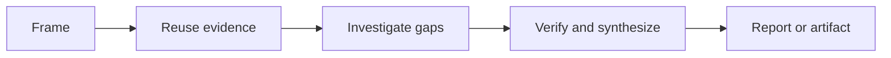

# Pivot Research

Project Pivot의 메인 agent가 필요한 근거를 직접 조사하고, 다음 판단에 사용할 수 있는 형태로 정리한다.

Research는 단순 검색이 아니다. 현재 상태와 불확실성을 확인하는 단계이며, 최종 요구사항이나 구현을 소유하지 않는다.

## Arguments

```yaml
question: auto
scope: auto
exclude: []
rigor: auto
research_id: auto
output: auto
```

| Argument | Meaning | `auto` behavior |
| --- | --- | --- |
| `--question <text\|auto>` | 이번 Research가 답할 하나의 질문 | 사용자 요청과 현재 phase에서 가장 작은 질문을 도출한다. |
| `--scope <path,...\|auto>` | 직접 조사할 경로 또는 영역 | 직접 관련 surface와 finding 검증에 필요한 관계까지만 포함한다. |
| `--exclude <path,...>` | 조사에서 제외할 경로 또는 영역 | 지정된 대상을 읽거나 근거로 사용하지 않는다. |
| `--rigor <auto\|lite\|standard\|strict>` | 조사 엄밀도(Rigor) | 불확실성, 영향 범위, 되돌리기 어려움, 외부 의존성을 기준으로 선택한다. |
| `--research-id <id\|auto>` | Research artifact 식별자 | artifact가 필요할 때 질문을 나타내는 repository-unique kebab-case ID를 만든다. |
| `--output <auto\|chat\|artifact>` | 결과를 남길 위치 | 다음 phase의 durable handoff가 필요하면 artifact, 단순 조사면 chat을 사용한다. |

명시된 argument가 사용자 요청이나 기존 artifact와 충돌하면 조용히 덮어쓰지 않는다.

## Research



### Frame

다음을 먼저 고정한다.

- 답해야 할 하나의 질문
- 이 답이 지원할 다음 판단
- 포함 및 제외 범위
- 완료를 판단할 최소 근거

인접한 개선이나 새로운 기능은 별도 후보로 남기고 현재 범위에 자동 포함하지 않는다.

### Reuse Evidence

새 조사를 시작하기 전에 기존 근거를 확인한다.

1. 사용자 요청과 명시적 제약
2. 관련 OpenSpec 및 durable decision
3. 프로젝트 문서와 규칙
4. 코드와 설정
5. 테스트와 실행 가능한 contract
6. 실제 실행 결과와 오류
7. Git history, issue, pull request
8. 현재 환경과 일치하는 공식 외부 자료

강한 근거로 이미 확인된 사실은 반복 조사하지 않는다.

### Investigate Gaps

메인 agent가 Research를 소유하고 최종 판단과 artifact 작성을 직접 수행한다.

다음 경우에만 specialist를 도구처럼 사용한다.

| Specialist | Use when |
| --- | --- |
| `explorer` | 관련 코드 surface, symbol, 호출 관계 탐색이 메인 context를 크게 소모할 때 |
| `web-researcher` | 외부 API, 버전, 표준 또는 공식 문서의 사실 확인이 필요할 때 |

위임은 한 번에 하나의 제한된 질문만 포함한다. specialist의 답은 근거 후보이며, 메인 agent가 locator와 적용 범위를 확인한 뒤 사용한다.

다음은 위임하지 않는다.

- Research 질문과 범위 결정
- source 충돌의 최종 해석
- material product 또는 architecture 선택
- Research status 결정
- canonical Research artifact 작성

필요하면 안전한 read-only command로 현재 동작을 재현한다. 실행하지 않은 command의 예상 결과는 근거로 기록하지 않는다.

### Synthesize

확인한 내용을 다음처럼 구분한다.

| Class | Meaning |
| --- | --- |
| **Authoritative** | 원하는 동작이나 제약을 정의하는 근거 |
| **Observed** | 코드, 설정, 테스트, 실행 결과에서 직접 확인한 사실 |
| **Supporting** | 역사와 외부 맥락을 제공하는 자료 |
| **Assumption** | 아직 검증되지 않은 해석 |

서로 충돌하는 근거는 임의로 합치지 않는다. 충돌 내용, 영향, 해결 주체를 남긴다.

## Completion

| Status | Condition |
| --- | --- |
| `completed` | 다음 판단이 목표, 현재 상태, 범위, 영향, 검증 기준을 정의할 수 있다. |
| `in_progress` | 제한된 추가 조사 또는 material human decision이 남아 있다. |
| `blocked` | 필수 접근, 환경, 근거 또는 결정이 없어 안전하게 계속할 수 없다. |

완벽한 확신은 필요하지 않다. 남은 unknown이 다음 판단을 막는지가 기준이다.

## Output

### Chat

단순 조사에서는 결론, 주요 근거, 불확실성, 다음 행동만 간결하게 보고한다.

### Artifact

RPI handoff가 필요하면 다음 기존 계약을 따른다. 관련 파일은 artifact를 만들 때만 읽는다.

- 원칙: `../pivot-openspec-rpi/references/principles.md`
- 저장 및 수명주기: `../pivot-openspec-rpi/references/artifacts.md`
- 작성 템플릿: `../pivot-openspec-rpi/templates/research.md`

Canonical entry는 `openspec/research/{research-id}/research.md`다. 상세 활동 로그, private reasoning, cache, secret, 대용량 raw output은 저장하지 않는다.

임시 Research를 보관하거나 Git 추적 대상으로 바꾸는 작업은 사용자 승인이 필요하다.

## Boundaries

- OpenSpec proposal, requirement, design, task를 대신 작성하지 않는다.
- 코드, 테스트 또는 설정을 구현 목적으로 수정하지 않는다.
- 근거가 없는 확신으로 status를 완료 처리하지 않는다.
- 질문과 무관한 repository 전체 조사나 링크 수집을 하지 않는다.
- 기존 OpenSpec 또는 사용자 의도와의 충돌을 조용히 해결하지 않는다.

## Maintenance

이 스킬을 수정할 때는 먼저 `docs/DIRECTIVE.md`, `docs/WORKING.md`를 읽는다. 의미 있는 수정 후 `docs/WORKING.md`를 현재 상태 중심으로 갱신한다.
