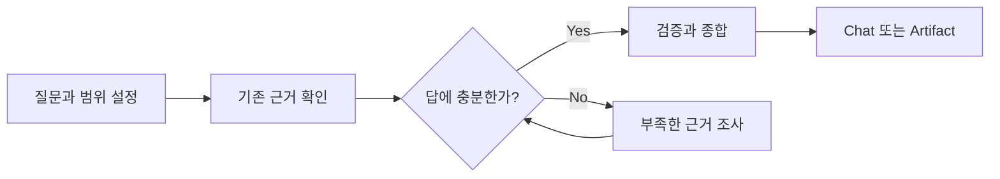

# Workflow

복잡한 범위 설정, 엄밀도 선택 또는 조사 종료 판단이 필요할 때 읽습니다.

## Flow

## Frame

- Research가 지원할 판단 또는 사용 목적을 확인합니다.
- 핵심 목표와 필요한 하위 질문을 정합니다.
- 포함·제외 범위와 최소 완료 근거를 정합니다.
- 인접한 개선이나 새 기능은 현재 범위에 자동 포함하지 않습니다.

`scope: auto`는 질문과 직접 관련된 대상에서 시작하여 결론 검증에 필요한 관계까지만 확장합니다.

## Inspect Existing Evidence

가장 직접적이고 신뢰할 수 있는 근거부터 필요한 만큼 확인합니다. 모든 출처를 기계적인 순서로 읽지 않습니다.

- 사용자 요청과 명시적 제약
- 활성 명세와 지속되는 결정(Durable Decision)
- 프로젝트 문서, 코드, 설정과 테스트
- 실제 실행 결과와 오류
- Git history, issue와 pull request
- 현재 환경과 일치하는 공식 문서·표준·연구 등 1차 자료

강한 근거로 이미 확인된 사실은 반복 조사하지 않습니다.

## Close Gaps

답이나 주요 불확실성을 바꿀 수 있는 근거만 추가로 조사합니다.

| Gap | Preferred check |
| --- | --- |
| 현재 동작이 불명확함 | 코드, 설정, 테스트와 실제 실행 결과 |
| 영향 범위가 불명확함 | 참조, 호출 관계, 데이터 흐름과 계약 |
| 외부 사실이 불명확함 | 현재 버전과 환경에 맞는 1차 자료 |
| 오류 원인이 불명확함 | 가장 작은 재현과 실제 실행 결과 |

실행하지 않은 명령의 예상 결과는 근거로 기록하지 않습니다.

## Rigor

| Level | 사용 기준 |
| --- | --- |
| `lite` | 국소적인 사실이나 현재 상태만 확인합니다. |
| `standard` | 여러 대상의 동작, 관계 또는 대안을 함께 확인합니다. |
| `strict` | 데이터 손실, 호환성, 보안, 아키텍처 또는 외부 계약 위험을 다룹니다. |

`rigor: auto`는 위험을 다루기에 충분한 가장 낮은 수준을 선택합니다.

## Stop Condition

다음을 만족하면 조사를 중단합니다.

- 핵심 질문에 근거 있는 답을 제시할 수 있습니다.
- 중요한 충돌과 미확인 사항이 드러나 있습니다.
- 새로운 조사가 답이나 주요 불확실성을 실질적으로 바꿀 가능성이 낮습니다.

완벽한 확신이나 모든 인접 사실의 수집은 필요하지 않습니다.
