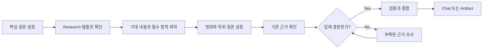

# Workflow

질문 설정, 템플릿 해석, 범위 설정, 엄밀도 선택 또는 조사 종료 판단이 필요할 때 읽습니다.

## Flow

## Question

- Research가 지원할 판단 또는 사용 목적을 확인합니다.
- 핵심 질문을 하나의 명확한 목표로 정합니다.
- 사용자 요청이나 활성 명세와 충돌하는 해석은 조용히 선택하지 않습니다.

## Inspect Template

핵심 질문을 정한 다음 프로젝트의 기존 Research 템플릿과 Artifact 계약을 확인합니다.

템플릿에서 다음을 파악합니다.

- 필수 항목과 선택 항목
- 각 항목이 기대하는 사실, 비교, 영향, 위험 또는 검증 정보
- front matter, 상태, 저장 위치와 보관 규칙
- 생략, `N/A` 또는 미확인 표시가 허용되는 조건

템플릿은 단순 서식이 아니라 기대되는 정보 구조입니다. 다만 템플릿이 핵심 질문이나 사용자 의도를 대체하지는 않습니다.

템플릿이 없거나 찾을 수 없으면 일반 Research로 계속 진행합니다. Artifact가 필요하지만 계약이 불명확하면 확인된 결과를 Chat으로 보존하고 Artifact 작성만 보류합니다.

## Frame Scope

질문과 템플릿이 기대하는 내용을 바탕으로 다음을 정합니다.

- 필요한 하위 질문
- 포함·제외 범위
- 템플릿의 필수·관련 항목을 채우는 데 필요한 근거
- 최소 완료 근거

`scope: auto`는 질문에서 직접 관련된 대상으로 시작하고, 결론 검증과 템플릿의 필수·관련 항목을 처리하는 데 필요한 관계까지만 확장합니다.

인접한 개선, 새 기능 또는 무관한 선택 항목은 현재 범위에 자동 포함하지 않습니다.

## Inspect Existing Evidence

가장 직접적이고 신뢰할 수 있는 근거부터 필요한 만큼 확인합니다. 모든 출처를 기계적인 순서로 읽지 않습니다.

- 사용자 요청과 명시적 제약
- 활성 명세와 지속되는 결정(Durable Decision)
- 프로젝트 문서, 코드, 설정과 테스트
- 실제 실행 결과와 오류
- Git history, issue와 pull request
- 현재 환경과 일치하는 공식 문서·표준·연구 등 1차 자료

강한 근거로 이미 확인된 사실은 반복 조사하지 않습니다.

## Close Gaps

답, 주요 불확실성 또는 템플릿의 필수·관련 항목을 바꿀 수 있는 근거만 추가로 조사합니다.

| Gap | Preferred check |
| --- | --- |
| 현재 동작이 불명확함 | 코드, 설정, 테스트와 실제 실행 결과 |
| 영향 범위가 불명확함 | 참조, 호출 관계, 데이터 흐름과 계약 |
| 외부 사실이 불명확함 | 현재 버전과 환경에 맞는 1차 자료 |
| 오류 원인이 불명확함 | 가장 작은 재현과 실제 실행 결과 |
| 템플릿 필수 항목의 정보가 부족함 | 해당 항목을 채우는 데 직접 필요한 근거 |

실행하지 않은 명령의 예상 결과나 확인하지 않은 내용을 근거로 기록하지 않습니다.

## Rigor

| Level | 사용 기준 |
| --- | --- |
| `lite` | 국소적인 사실이나 현재 상태만 확인합니다. |
| `standard` | 여러 대상의 동작, 관계 또는 대안을 함께 확인합니다. |
| `strict` | 데이터 손실, 호환성, 보안, 아키텍처 또는 외부 계약 위험을 다룹니다. |

`rigor: auto`는 위험과 템플릿이 요구하는 근거 수준을 다루기에 충분한 가장 낮은 수준을 선택합니다.

## Stop Condition

다음을 만족하면 조사를 중단합니다.

- 핵심 질문에 근거 있는 답을 제시할 수 있습니다.
- 템플릿의 필수 항목과 조사 목표에 관련된 항목을 처리했습니다.
- 중요한 충돌과 미확인 사항이 드러나 있습니다.
- 새로운 조사가 답이나 주요 불확실성을 실질적으로 바꿀 가능성이 낮습니다.

완벽한 확신이나 모든 선택 항목의 수집은 필요하지 않습니다.
