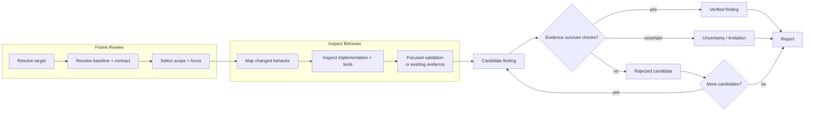

# Workflow

대상, baseline, contract, scope 또는 validation 해석이 필요할 때 읽습니다.

## Flow

## Resolve Target

검토 대상은 변경 형식에 종속되지 않습니다.

- diff 또는 patch
- file이나 directory
- commit, branch 또는 pull request
- working tree 변경
- 변경 없이 현재 상태만 검토하는 code 영역

`target: auto`는 사용자가 지정한 대상과 현재 변경 context를 우선합니다. 여러 후보가 있으면 질문과 가장 직접적으로 연결된 가장 작은 대상을 선택합니다.

## Resolve Baseline

Baseline은 변경으로 무엇이 달라졌는지 판단하기 위한 비교 기준입니다.

`baseline: auto`는 다음 순서로 합리적인 기준을 사용합니다.

1. 사용자가 지정하거나 Review 대상이 명시한 base revision
1. diff, commit 또는 pull request의 실제 parent·base
1. repository에서 명확히 지속되는 이전 behavior
1. 비교 가능한 기준 없음

Baseline이 없으면 현재 코드의 자체 correctness는 검토할 수 있지만 변경으로 도입되었다고 단정하지 않습니다. 임의의 branch나 과거 revision을 기준으로 만들지 않습니다.

## Reconstruct Contract

Contract는 코드가 충족해야 하는 기대 동작과 제약입니다.

다음을 적용 범위와 권위에 따라 확인합니다.

- 사용자 요청과 명시적 acceptance condition
- 활성 spec, design, task와 지속되는 decision
- public API, schema, protocol과 compatibility rule
- repository instruction과 domain documentation
- 기존 externally observable behavior
- test와 implementation에서 관찰되는 현재 behavior

기존 code와 test는 현재 behavior의 evidence일 수 있지만, 명시적 requirement를 조용히 바꾸는 authority로 사용하지 않습니다.

Contract가 충돌하거나 모호하면 하나를 임의로 선택하지 않고 Review 제한 또는 별도 finding candidate로 보존합니다.

## Map Change And Scope

변경된 line만 읽지 않고 실제로 달라질 수 있는 behavior를 추적합니다.

- caller와 callee
- public boundary와 data contract
- state transition과 persisted state
- dependency, configuration과 feature flag
- error propagation, retry와 recovery
- 대응 test, fixture와 validation

`scope: auto`는 대상과 이 관계 중 finding의 reachability와 impact를 검증하는 데 필요한 범위까지만 확장합니다.

무관한 기존 defect, 인접 redesign과 일반적인 architecture 비평은 포함하지 않습니다.

## Select Focus

| Focus | 적용 기준 |
| --- | --- |
| `implementation` | production source와 runtime behavior만 검토합니다. |
| `tests` | test code, fixture, oracle와 검증 신뢰성만 검토합니다. |
| `all` | 구현과 테스트의 일치 및 양쪽 defect를 함께 검토합니다. |
| `auto` | 대상에 포함된 code 종류를 기준으로 필요한 lens를 선택합니다. |

구현과 테스트가 함께 변경되었으면 기본적으로 둘을 함께 봅니다. 구현 없이 테스트만 변경되었거나 테스트 자체의 품질이 질문이면 test lens만 사용할 수 있습니다.

## Validation

`validation: auto`는 이미 존재하고 허용된 검증 중 finding을 확인하는 가장 작은 신뢰 가능한 범위를 선택합니다.

1. 변경된 test 또는 가장 가까운 focused check
1. 관련 module, package 또는 component check
1. broader suite는 결과가 실제 판단을 바꿀 때만 실행

다음은 자동으로 수행하지 않습니다.

- dependency 설치 또는 환경 재구성
- fixture, snapshot 또는 generated file 갱신
- auto-fix command
- 외부 shared environment의 state 변경
- 비용이 큰 전체 suite의 관성적 실행

명시된 command도 실행 권한과 안전 경계를 우선합니다. 실행하지 못하면 이유와 영향만 보고합니다.

## Verify Candidates

Candidate finding을 확정하기 전에 다음을 확인합니다.

- 실제 in-scope path에서 도달 가능한가
- 기존 safeguard 또는 validation이 이미 방지하는가
- baseline에도 동일하게 존재하는가
- contract 또는 observable behavior를 실질적으로 위반하는가
- impact가 구체적이며 과장되지 않았는가
- 다른 candidate와 같은 root cause인가

반례가 무효화되거나 evidence가 부족하면 기각하거나 불확실성으로 낮춥니다.

## Stop Condition

다음을 만족하면 검토를 중단합니다.

- 요청된 대상과 직접 영향을 받는 behavior를 확인했습니다.
- 중요한 candidate를 검증하거나 기각했습니다.
- 실행한 validation의 실제 범위와 결과를 기록했습니다.
- 추가 탐색이 finding이나 불확실성을 실질적으로 바꿀 가능성이 낮습니다.

모든 code path의 완전한 증명이나 finding 개수 채우기는 필요하지 않습니다.
