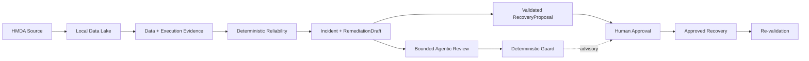

# Project Pivot

**Evidence-first data reliability with recoverability-bounded AI delegation.**

Project Pivot은 데이터 상태와 신뢰성 판단을 결정론적 근거에 고정하고, 실패를 탐지·제한·복구할 수 있는 범위에서 AI에 유용한 작업을 위임하는 프로젝트다. 로컬 HMDA Data Lake를 첫 증명 환경으로 사용해 신뢰 가능한 데이터 상태부터 사고 대응과 재검증까지 하나의 완결된 흐름으로 증명한다.

> [!NOTE]
> **Status: Active MVP.** 현재 목표와 완료 기준은 [`docs/mvp.md`](docs/mvp.md)가 소유한다.

## Problem

이 프로젝트는 세 가지 간극을 다룬다.

- **Pipeline success ≠ trusted data** — 실행 성공만으로 downstream data의 신뢰성을 증명할 수 없다.
- **Anomaly detected ≠ recoverable incident** — 이상 신호만으로 원인, 영향과 안전한 복구를 설명할 수 없다.
- **Plausible AI output ≠ safe delegation** — 자연스러운 AI 응답은 근거, 권한과 복구 가능성을 보장하지 않는다.

## Proof Model

Project Pivot이 증명하려는 핵심은 다음 네 가지다.

- **Trusted data state** — 어떤 데이터 상태를 채택했고 왜 신뢰했는지 다시 설명할 수 있다.
- **Deterministic reliability** — incident detection과 핵심 safety 판단을 재현 가능한 evidence에 고정한다.
- **Evidence-bound AI** — AI는 확인 가능한 incident evidence와 deterministic 결과를 해석·검토하며 스스로 recovery authority를 얻지 않는다.
- **Controlled recovery** — state mutation은 검증된 proposal과 human approval 뒤에만 수행하고 같은 기준으로 다시 검증한다.

## Current MVP

현재 MVP는 기능 수를 늘리는 것이 아니라 다음 end-to-end proof를 닫는 데 집중한다.



Agentic review는 human decision을 보조하지만 approval이나 recovery의 authority를 대체하지 않는다.

## Toolchain

`Python 3.13` · `uv` · `DuckDB` · `dbt Core` · `Dagster` · `Polars` · `PyArrow` · `Pydantic` · `LangGraph`

세부 layer별 tool choice와 책임은 [`DEVELOPMENT.md`](DEVELOPMENT.md)가 소유한다.

## Validate Locally

Repository root에서 dependency를 동기화하고 CI와 같은 unit-test 범위를 실행할 수 있다.

```bash
uv sync --locked
uv run pytest -m "unit and not memory and not stress"
```

전체 test 선택법과 validation evidence는 [Testing Guide](docs/development/testing.md)를 따른다. 실행하지 않은 command의 성공을 README에서 전제하지 않는다.

## Documentation

| Need | Document |
| --- | --- |
| 프로젝트의 장기 방향과 AI delegation boundary | [Vision](docs/VISION.md) |
| 현재 증명할 MVP scope와 acceptance | [MVP](docs/mvp.md) |
| 시스템 구조와 execution boundary | [Architecture](docs/ARCHITECTURE.md) |
| 구현된 capability의 canonical contract | [OpenSpec Specs](openspec/specs) |
| domain별 책임과 공개 surface | [Domain Guides](docs/domains/OVERVIEW.md) |
| 개발 환경과 workflow | [Development Guides](docs/development/README.md) |
| 사람이 보는 현재 상태 snapshot — canonical evidence 아님 | [Development Dashboard](docs/development/dashboard.md) |
