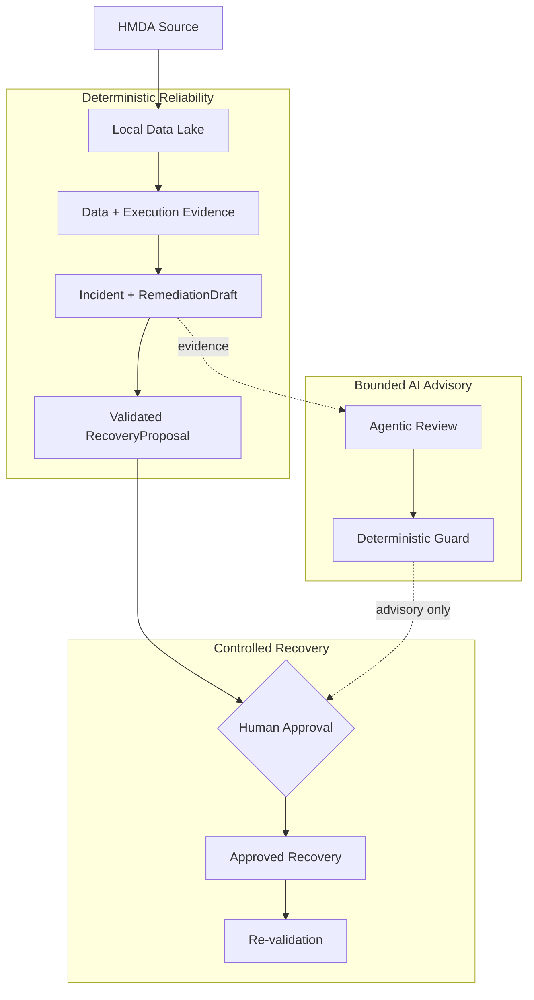

# Project Pivot

**Evidence-first data reliability with bounded AI delegation.**

Project Pivot은 "파이프라인이 끝났으니 데이터도 믿을 만하다"는 전제를 의심하는 데서 시작했다. 로컬 HMDA Data Lake를 대상으로 데이터 상태를 근거로 설명하고, 문제가 생기면 incident evidence와 복구 제안을 남긴다. AI는 그 근거를 읽고 검토를 돕지만 직접 복구를 실행하지 않는다.

> [!NOTE]
> **Status: Active MVP.** 지금은 기능을 넓히기보다 HMDA 기반 reliability flow 하나를 끝까지 닫는 데 집중하고 있다. 정확한 scope와 acceptance는 [`docs/mvp.md`](docs/mvp.md)에서 관리한다.

## Problem

파이프라인이 정상 종료돼도 결과 데이터가 믿을 만하다는 뜻은 아니다. 이상 징후를 찾았다고 해서 영향 범위와 복구 방법까지 설명되는 것도 아니다. AI가 그럴듯한 답을 내놓더라도 그 판단에 곧바로 실행 권한을 줄 수는 없다.

Project Pivot은 이 세 지점을 하나의 흐름으로 묶는다. 데이터 상태와 incident를 deterministic evidence로 남기고, AI review는 그 evidence 안에서만 움직이게 하며, 실제 recovery는 검증된 proposal과 human approval 뒤에 실행한다.

## Design Boundaries

핵심 reliability 판단은 다시 실행해도 같은 근거를 따라 설명할 수 있어야 한다. Incident detection과 safety 판단은 deterministic evidence에 고정하고, AI는 그 결과를 해석하거나 remediation을 검토하는 역할만 맡는다.

State mutation은 validated proposal과 human approval 뒤에만 허용한다. Recovery가 끝나면 같은 기준으로 다시 검증한다. AI가 틀려도 reliability 판단과 recovery path 자체가 무너지지 않는 구조를 우선한다.

## Current MVP

현재 MVP는 아래 흐름 하나를 실제로 닫는 데 집중한다.



점선은 AI가 evidence와 advisory를 제공하는 경로다. Approval이나 recovery의 authority를 갖는 경로는 아니다.

## Toolchain

| Area | Stack | Use |
| --- | --- | --- |
| Runtime | `Python 3.13`, `uv` | local 환경과 dependency 관리 |
| Data | `DuckDB`, `dbt Core`, `Polars`, `PyArrow` | ingestion, query, transform |
| Orchestration | `Dagster` | data-plane asset과 job 실행 |
| Contracts | `Pydantic` | reliability와 AI boundary의 structured model |
| Agentic review | `LangGraph` | remediation review flow |

세부 tool choice와 layer별 책임은 [`DEVELOPMENT.md`](DEVELOPMENT.md)에 정리되어 있다.

## Validate Locally

로컬에서 빠르게 확인하려면:

```bash
uv sync --locked
uv run pytest -m "unit and not memory and not stress"
```

더 좁거나 넓은 test 선택법은 [Testing Guide](docs/development/testing.md)를 참고한다.

## Documentation

| 찾고 싶은 내용 | 문서 |
| --- | --- |
| 장기 방향과 AI delegation boundary | [Vision](docs/VISION.md) |
| 현재 MVP scope와 acceptance | [MVP](docs/mvp.md) |
| 시스템 구조와 execution boundary | [Architecture](docs/ARCHITECTURE.md) |
| capability의 canonical contract | [OpenSpec Specs](openspec/specs) |
| domain별 책임과 공개 surface | [Domain Guides](docs/domains/OVERVIEW.md) |
| 개발 환경과 workflow | [Development Guides](docs/development/README.md) |
| 사람이 보는 진행 상태 snapshot — canonical evidence 아님 | [Development Dashboard](docs/development/dashboard.md) |
