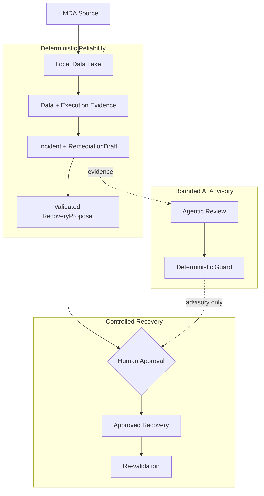

# Project Pivot

**Evidence-first data reliability with bounded AI delegation.**

Project Pivot은 로컬 HMDA Data Lake에서 데이터 신뢰성을 검증하고, 그 과정에서 AI에 맡길 수 있는 범위를 함께 다루는 프로젝트다. 데이터 상태부터 incident evidence, `RecoveryProposal`, re-validation까지 한 흐름에서 추적한다. AI는 evidence review에 쓰지만, 현재 MVP에서는 직접 복구하지 않는다.

> [!NOTE]
> **Status: Active MVP.** 지금은 기능을 넓히지 않고 HMDA reliability flow 하나를 end-to-end로 닫는 중이다. Scope와 acceptance는 [`docs/mvp.md`](docs/mvp.md)에서 관리한다.

## Problem

파이프라인이 끝났다는 사실만으로 결과 데이터를 신뢰할 수는 없다. 이상 징후를 잡아도 영향 범위와 복구 방법은 따로 확인해야 한다. 여기에 AI를 붙인다고 문제가 해결되지는 않는다. 그럴듯한 답과 실행 권한은 다른 문제다.

## Design Boundaries

Incident detection과 핵심 safety 판단은 deterministic code와 evidence로 처리한다. AI는 incident evidence와 `RemediationDraft`를 읽고 검토하지만 MVP에서는 state mutation을 일으킬 수 없다. Recovery는 검증된 `RecoveryProposal`과 human approval 뒤에만 실행하고, 끝나면 같은 기준으로 re-validation한다.

장기적으로는 검증과 복구 능력이 쌓이는 만큼 AI에 맡길 수 있는 범위도 넓힌다. 지금은 review까지가 그 경계다.

## Current MVP

현재 MVP는 아래 흐름 하나를 실제로 닫는 데 집중한다.



점선은 AI review의 보조 경로다. Approval이나 recovery 권한으로 이어지지 않는다.

## Toolchain

| Area | Stack | Use |
| --- | --- | --- |
| Runtime | `Python 3.13`, `uv` | local 환경과 dependency 관리 |
| Data | `DuckDB`, `dbt Core`, `Polars`, `PyArrow` | ingestion, query, transform |
| Orchestration | `Dagster` | data-plane asset과 job 실행 |
| Contracts | `Pydantic` | reliability contract와 AI review model |
| Agentic review | `LangGraph` | bounded remediation review |

세부 tool choice와 layer별 책임은 [`DEVELOPMENT.md`](DEVELOPMENT.md)에 정리되어 있다.

## Validate Locally

로컬에서 빠르게 확인하려면:

```bash
uv sync --locked
uv run pytest -m "unit and not memory and not stress"
```

더 좁거나 넓은 test 선택법은 [Testing Guide](docs/development/testing.md)를 참고한다.

## Documentation

| 찾고 싶은 내용 | 문서 |
| --- | --- |
| 장기 방향과 AI delegation boundary | [Vision](docs/VISION.md) |
| 현재 MVP scope와 acceptance | [MVP](docs/mvp.md) |
| 시스템 구조와 execution boundary | [Architecture](docs/ARCHITECTURE.md) |
| capability의 canonical contract | [OpenSpec Specs](openspec/specs) |
| domain별 책임과 공개 surface | [Domain Guides](docs/domains/OVERVIEW.md) |
| 개발 환경과 workflow | [Development Guides](docs/development/README.md) |
| 사람이 보는 진행 상태 snapshot (canonical evidence 아님) | [Development Dashboard](docs/development/dashboard.md) |
