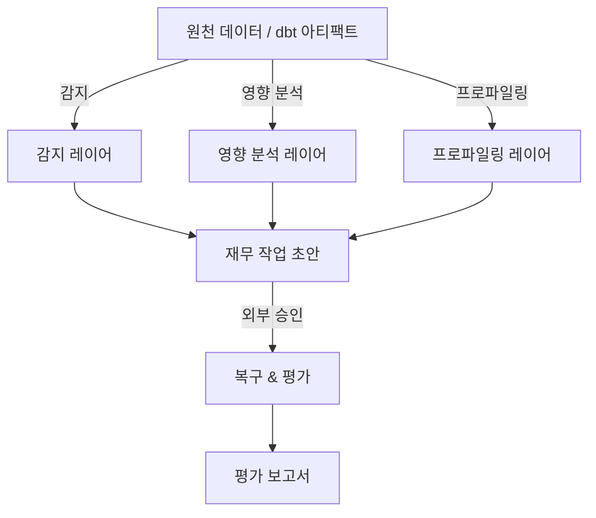

# 신뢰성 도메인 아키텍처

## 개요

**신뢰성(Reliability)** 도메인은 HMDA 데이터 품질과 일관성을 **읽기 전용** 방식으로 관리합니다. 주요 기능은 다음과 같습니다:

- Incident 감지
- 영향 분석
- 데이터 프로파일링
- 재무 작업 초안 생성

외부 승인 후에는 복구(recovery)와 평가(evaluation)가 별도 API로 트리거됩니다.

## 핵심 레이어

### 1. 감지 레이어 (Detection Layer)

- **BasicIncidentDetector** — 데이터 품질, lineage, 이상치 등 incident 감지 코어
- Contracts: `IncidentSeverity`, `IncidentStatus`

### 2. 영향 분석 레이어 (Impact Analysis Layer)

- **DbtImpactAnalyzer** — dbt manifest와 graph를 분석하여 변경 영향 계산

### 3. 프로파일링 & 메타데이터 레이어

- **DuckDBProfileSnapshotBuilder** — DuckDB 테이블에서 프로파일 스냅샷 생성
- **TableMetadataEvidenceBuilder** — lineage와 메타데이터 증거 생성

### 4. 재무 작업 레이어 (Remediation Layer)

- **RemediationDraft** — 재무 작업 계획 초안 생성
- 상태 관리: `RemediationState`

### 5. 복구 & 평가 레이어 (Recovery & Evaluation Layer)

- **ApprovalBackfillValidator** — 승인 후 백필 검증
- **EvaluationReport** — 최종 평가 보고서

## 시스템 흐름

## 주요 클래스 및 컨트랙트

| 레이어 | 주요 클래스 | 역할 |
| -------- | ------------- | ------ |
| 감지 | BasicIncidentDetector | incident 감지 |
| 영향 분석 | DbtImpactAnalyzer | 하류 영향 분석 |
| 프로파일링 | DuckDBProfileSnapshotBuilder | 프로파일 스냅샷 생성 |
| 메타데이터 | TableMetadataEvidenceBuilder | lineage/metdata 증거 생성 |
| 재무 작업 | RemediationDraft | 재무 작업 계획 초안 |
| 복구 | ApprovalBackfillValidator | 백필 검증 |
| 평가 | EvaluationReport | 최종 평가 보고서 |

## 컨트랙트 (Pydantic 기반)

- `ReliabilityContract` — 모든 주요 타입의 베이스 클래스
- Enum: `IncidentSeverity`, `IncidentStatus`, `ApprovalStatus`

이 아키텍처는 책임 분리와 읽기 전용 라이프사이클을 깨끗하게 지원합니다.

---

*생성: 2026-08-02*  
*파일: artifacts/reliability-architecture.md*
