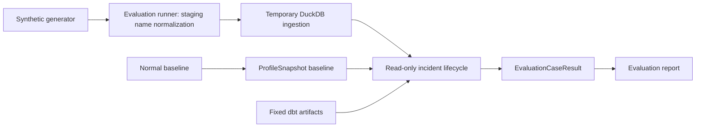

# Synthetic Lifecycle Evaluation 설명

## Summary

이 연구는 이미 존재하는 세 기능, 즉 synthetic HMDA data 생성, incident lifecycle 실행,
evaluation report 집계를 하나의 재현 가능한 평가 흐름으로 연결할 수 있는지 검증한다.

결론은 **가능하지만, 단순 연결은 불가능하다**이다. 평가 runner가 다음 두 입력
정규화를 소유해야 한다.

1. ingestion이 인식하는 연도 포함 staging filename을 만든다.
1. freshness case가 의도치 않게 `schema_drift`까지 탐지하지 않도록 baseline과 case의
   schema 정책을 결정한다.

## Overview

현재 프로젝트의 reliability lifecycle은 raw DuckDB table과 dbt artifact를 **읽기만**
하여 incident, 영향도, remediation draft를 계산한다. 반면 existing evaluation API는
이미 만들어진 `EvaluationCaseResult` 목록을 report로 집계할 뿐, synthetic case를
만들고 lifecycle을 실행하는 책임은 없다.

따라서 연구가 제안하는 것은 기존 reporter를 확장하는 것이 아니라, 아래 책임만 가진
별도 `synthetic-lifecycle-evaluation` capability를 두는 것이다.

## 평가 대상

정상 case 하나와 결함 case 네 개를 독립 실행한다.

| Case | 기대 incident |
| --- | --- |
| normal | 없음 |
| row count drop | `volume_drop` |
| null spike | `null_spike` |
| schema drift | `schema_drift` |
| freshness delay | `freshness_delay` |

각 case는 별도 임시 DuckDB file을 사용한다. 이는 schema drift처럼 table schema가
변하는 case가 다른 실행이나 baseline을 오염시키지 않게 하기 위함이다.

## 확인된 사실

| 항목 | 연구에서 확인한 내용 | 의미 |
| --- | --- | --- |
| Baseline | source EDA 결과가 아니라 동일 asset·partition의 `ProfileSnapshot`이어야 한다. | 비교 대상의 계약을 lifecycle과 일치시킨다. |
| Ingestion | partition ingestion은 filename에서 네 자리 연도를 읽는다. | 기존 synthetic output filename을 바로 넘기면 빈 partition으로 거부된다. |
| Schema drift | baseline table을 overwrite하지 않고 case별 새 table을 만들면 schema hash 차이가 보존된다. | schema drift detector를 실제로 검증할 수 있다. |
| Freshness | `freshness_column`을 request에 지정해야 table의 timestamp로 지연을 계산한다. | 지정하지 않으면 fallback 값 때문에 delay 탐지가 사라질 수 있다. |
| dbt artifact | 현재 impact analysis는 artifact graph와 run results file의 존재를 사용하며, case별 `dbt build` 결과를 해석하지 않는다. | 이번 평가는 data model correctness가 아니라 detection과 recommended action 평가로 한정된다. |
| 결정성 | detector와 lifecycle은 incident/action 순서를 유지하고 중복을 제거한다. | 같은 입력의 반복 실행 결과를 비교할 수 있다. |

## 핵심 충돌과 결정 필요 사항

### 1. Freshness와 schema drift의 충돌

현재 freshness synthetic generator는 `observed_at` column을 추가한다. 정상 baseline에
이 column이 없으면 freshness case는 의도한 `freshness_delay` 외에 `schema_drift`도
함께 탐지한다.

결정할 정책은 두 가지다.

| 선택지 | 장점 | 비용 및 위험 |
| --- | --- | --- |
| baseline normal case에도 고정 `observed_at` column을 둔다 | profile schema를 일치시켜 freshness만 검증한다. | synthetic data schema contract가 넓어진다. |
| freshness 값을 table schema 밖의 profile input으로 주입한다 | source table schema를 바꾸지 않는다. | profile/lifecycle API와 구현 범위가 커질 수 있다. |

**권장:** 이번 capability의 목적이 synthetic case runner라면 첫 번째 선택지가 더 작다.
다만 이 결정은 public synthetic data contract에 영향을 줄 수 있으므로 OpenSpec design에
명시해야 한다.

### 2. Synthetic filename과 ingestion 규약의 충돌

Synthetic writer는 `row_count_drop.parquet`처럼 연도가 없는 filename을 만들지만,
ingestion은 filename에서 `2025` 같은 네 자리 연도를 추출해 `source_year` filter에
사용한다. 따라서 runner가 `year_2025.parquet` 같은 staging name으로 복사한 뒤
ingestion에 전달해야 한다.

이 해결은 writer의 public API를 바꾸지 않고 evaluation 경계에서만 규약 차이를 흡수한다.
프로젝트 전체 synthetic naming을 바꾸는 일은 별도 필요가 확인될 때까지 범위 밖이다.

## 범위 경계

이번 연구가 지지하는 범위는 lifecycle 평가이며, 복구나 pipeline 운영 자동화가 아니다.

| 포함 | 제외 |
| --- | --- |
| case별 temporary DuckDB, baseline 생성, lifecycle 실행 | Dagster job, sensor, asset check 등록 |
| lifecycle 결과를 `EvaluationCaseResult`로 변환 | approval 생성과 backfill 실행 |
| fixed dbt artifact 기반 영향도 분석 | case별 dbt build, dbt model/test 수정 |
| 결정적 report 생성 | cloud 실행, 장기 monitoring, 기존 `pipeline_job` 변경 |

이 경계는 architecture의 read-only lifecycle 원칙과도 맞는다. lifecycle은 mutation이나
report write를 하지 않고, evaluation runner와 report writer가 별도 API로 책임을 나눈다.

## 검증 기준

구현 시 다음을 integration test로 검증하는 것이 연구의 결론을 실제 계약으로 바꾸는
가장 작은 방법이다.

1. normal과 네 defect case에서 expected incident와 required action이 일치한다.
1. detection 및 action 평가가 모두 통과한다.
1. 같은 입력을 두 번 실행해도 결과가 동일하다.
1. case 사이에서 schema가 격리된다.
1. source file과 configured project database는 실행 전후 변하지 않는다.
1. freshness case에는 의도하지 않은 `schema_drift`가 없다.

## 한계와 후속 작업

고정 dbt artifact를 재사용하므로 이 평가는 dbt model이 실제로 빌드되거나 data quality
test가 통과하는지는 증명하지 않는다. 그것은 실제 dbt build와 결과 해석을 포함하는 별도
change로 다루는 편이 책임과 실패 원인을 명확히 한다.

연구의 다음 단계는 `synthetic-lifecycle-evaluation` capability를 새 OpenSpec proposal로
정의하고, 먼저 freshness schema 정책을 선택하는 것이다.
