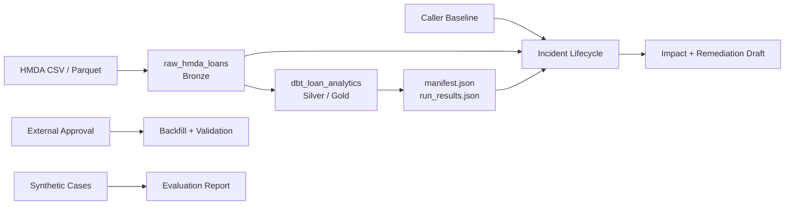

# ARCHITECTURE

HMDA 파일을 DuckDB Bronze에 멱등 적재하고, dbt로 Silver·Gold를 만든다.

## Overview

| Layer | Responsibility |
|---|---|
| Bronze | 원천 파일 적재·추적 |
| Silver | dbt staging 정제 |
| Gold | dbt mart 집계 |
| Reliability | incident 탐지·영향 분석·remediation 초안 |

> [!NOTE]
> Reliability control plane은 read-only다. Recovery와 Evaluation은 독립 API로 실행한다.

## Data Flow

Dagster `pipeline_job` 실행 순서:

1. `raw_hmda_loans` 적재
2. `dbt_loan_analytics` 실행

Schedule, sensor, asset check는 없다. Reliability lifecycle은 Dagster graph에 포함하지 않는다.

## Data Contract

| Layer / Field | Contract |
|---|---|
| Source | `data/raw/hmda`, CSV/Parquet |
| Required columns | `activity_year`, `state_code`, `county_code`, `loan_purpose`, `action_taken`, `loan_amount`, `income` |
| Bronze table | `raw.hmda_loans`; `source_file`, `source_file_name`, `source_year`, `ingested_at` 추적 |
| Partition | `source_year`; `source_file_name` 선택 가능 |
| Silver model | `staging.stg_hmda_loans` dbt view |
| Gold model | `marts.mart_hmda_loan_outcomes` dbt table; grain: `activity_year + state_code + loan_purpose` |

| Contract rules |
| --- |
| Required columns는 존재해야 한다. |
| `state_code`, `county_code`는 Null 허용한다.|
| Staging은 Null을 보존한다.|
| Mart는 완전한 grain만 집계한다.|
| Full load는 raw table을 교체한다.|
| Partition load는 임시 table 검증 후 transaction overwrite한다.|
| 지원하지 않는 파일은 발견 단계에서 제외한다.|

## Execution Layers

| Layer | Responsibility |
| --- | --- |
| Dagster asset | 적재·dbt 실행 함수 호출, metadata 기록 |
| Dagster resource | `dbt build` 실행 |
| `pipeline_job` | Bronze 적재 후 Silver·Gold 변환 |
| Reliability lifecycle | incident 탐지, 영향 분석, remediation 초안 |

## Incident Lifecycle

`run_incident_lifecycle(request, baseline)` execution order:

1. Raw metadata와 current partition profile 측정
2. Baseline과 current asset·partition 검증
3. 모든 incident 탐지
4. dbt downstream 영향과 remediation draft 생성
5. 중복 제거 후 탐지 순서대로 반환

Lifecycle boundary:

- Lifecycle은 read-only다.
- Approval 생성, backfill, validation, evaluation, report 파일 생성은 하지 않는다.

| Capability | API |
| --- | --- |
| Recovery | 외부 approval 후 `execute_approved_backfill()` |
| Evaluation | `build_evaluation_report()`, `write_evaluation_report()` |

## Scope

| In scope | Out of scope |
|---|---|
| 로컬 DuckDB와 HMDA 적재 | 원천 다운로드, lakehouse, 분산처리 |
| dbt staging/mart/test/lineage | 대출 정책, 신용 위험 ML |
| 실제 baseline/current 규칙 탐지 | 범용 자동 RCA Agent |
| Approval gate와 backfill 검증 API | human approval UI, 감사 시스템 |
| 결정론적 remediation draft | 자동 코드 수정, dbt compile 검증 |
| 로컬 Dagster graph와 evaluation report | cloud 배포, production SLO, 장기 모니터링 |
