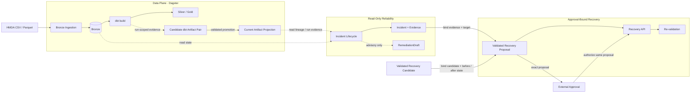

# Architecture: Local HMDA Reliability Pipeline

**핵심 경계는 분석과 위험한 상태 변경의 분리다.** 로컬 HMDA 데이터를 DuckDB Bronze에 적재하고 dbt로 Silver·Gold를 만든다. Reliability lifecycle은 raw table과 dbt artifact를 읽어 incident evidence와 `RemediationDraft`를 계산하지만, 상태 변경은 검증된 recovery proposal에 대한 외부 승인 뒤 별도 recovery API에서만 수행한다.

## System Flow

`RemediationDraft`는 설명·검토용 산출물이며 실행 권한이 아니다. Approval은 exact validated recovery proposal에 결합되고, approved recovery는 같은 대상과 상태를 다시 확인한 뒤에만 mutation을 수행한다. Partition/freshness recovery는 `RecoveryProposal`, schema/table recovery는 별도 `SchemaRecoveryProposal` contract를 사용한다.

## Execution Boundaries

| Area | Rule |
| --- | --- |
| Pipeline | Dagster `pipeline_job`은 Bronze 적재 후 dbt 분석만 실행한다. |
| Reliability lifecycle | Read-only다. approval, recovery, evaluation 또는 report write를 수행하지 않는다. |
| Recovery proposal | Incident evidence, 검증된 candidate와 target state를 mutation 전에 immutable contract로 묶는다. Concrete contract는 recovery scope에 따라 달라진다. |
| Approval | Lifecycle 밖에서 결정하며 exact validated proposal에 결합된다. |
| Recovery | Approved proposal의 target/action/state를 다시 확인한 뒤 별도 API로 실행하고 재검증한다. |
| Evaluation | Synthetic case 결과와 recovery/replay evidence를 별도 API로 집계한다. |

## Design Constraints

- lifecycle은 caller가 제공한 baseline을 받아 profile, detection, impact와 remediation draft만 계산한다.
- Dagster는 data plane 실행만 담당하며 reliability lifecycle, approval, recovery 또는 evaluation을 자동으로 묶지 않는다.
- `RemediationDraft`와 validated recovery proposal은 다른 역할이다. Draft는 권고이고 proposal은 승인 가능한 exact mutation contract다.
- Partition/freshness recovery의 `RecoveryProposal`과 schema/table recovery의 `SchemaRecoveryProposal`은 각 scope의 state identity와 action을 독립적으로 고정한다.
- approval은 lifecycle 외부에서 결정하며 proposal과 다른 candidate, target state 또는 action에 재사용할 수 없다.
- ingestion과 dbt는 재실행 가능해야 하며 같은 partition의 중복 row를 만들지 않는다.
- candidate dbt evidence와 current last-known-good artifact projection은 분리하며 current projection 변경은 검증된 target에 한정한다.

## Domain Ownership Guides

Current capability의 normative contract는 [`../openspec/specs/`](../openspec/specs/)가 소유한다. 아래 domain 문서는 시스템 책임, 공개 surface와 비책임을 설명하는 durable guide이며 OpenSpec Spec을 대체하지 않는다.

| Need | Document |
| --- | --- |
| 원천 파일, Bronze 적재, descriptive EDA, 합성 결함 | [`HMDA Data`](domains/hmda-data.md) |
| 실행 request, 결과, dbt build와 promotion | [`Data Operations`](domains/data-operations.md) |
| DuckDB, dbt model·lineage, artifact projection primitive | [`Data Platform`](domains/data-platform.md) |
| Incident, impact, remediation, recovery, evaluation | [`Reliability`](domains/reliability.md) |
| Dagster asset graph와 config | [`Orchestration`](domains/orchestration.md) |

## Project Scope

| In scope | Out of scope |
| --- | --- |
| 로컬 DuckDB, HMDA 적재, dbt model, reliability control plane | 원천 다운로드, lakehouse, 분산 처리 |
| 승인된 recovery와 deterministic re-validation/evaluation | human approval UI, 범용 자율 복구, 감사 시스템 |
| 로컬 Dagster data plane | cloud 배포, production SLO, 장기 모니터링 |
