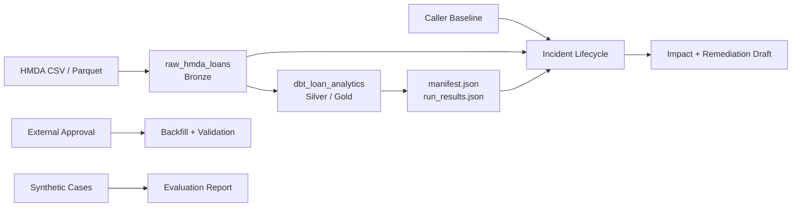

# ARCHITECTURE

HMDA 파일을 DuckDB Bronze에 멱등 적재하고 dbt로 Silver/Gold를 만든다.

> [!NOTE]
> Reliability control plane은 탐지·영향 분석·remediation 초안만 담당한다. 복구와 평가는 독립 API다.

## Data Flow

Dagster `pipeline_job`은 `raw_hmda_loans`와 `dbt_loan_analytics`만 순서대로 조율한다.

## Data Contract

| 구분 | 계약 |
|---|---|
| 원천 | `data/raw/hmda`, CSV/Parquet |
| 필수 컬럼 | `activity_year`, `state_code`, `county_code`, `loan_purpose`, `action_taken`, `loan_amount`, `income` |
| Bronze | `raw.hmda_loans`; `source_file`, `source_file_name`, `source_year`, `ingested_at` 추적 |
| 파티션 | `source_year`; 선택적 `source_file_name` |
| Silver | `staging.stg_hmda_loans` dbt view |
| Gold | `marts.mart_hmda_loan_outcomes` dbt table; grain은 `activity_year + state_code + loan_purpose` |

필수 컬럼은 존재 계약이다. `state_code`, `county_code`는 Null을 허용한다. Staging은 Null을 보존하고, mart는 완전한 grain만 집계한다.

전체 적재는 raw table을 교체한다. 파티션 적재는 임시 table 검증 후 transaction overwrite한다. 지원하지 않는 파일은 발견 단계에서 제외한다.

## Execution Layers

| 계층 | 책임 |
| --- | --- |
| Dagster asset | 데이터 적재·dbt 실행 함수 호출과 metadata 기록 |
| Dagster resource | dbt build 실행 |
| `pipeline_job` | Bronze 적재 후 Silver/Gold 변환 |
| Reliability lifecycle | incident 탐지, 영향 분석, remediation 초안 |

> [!IMPORTANT]
> Schedule, sensor, asset check는 없다. Lifecycle은 Dagster graph에 포함하지 않는다.

## Incident Lifecycle

`run_incident_lifecycle(request, baseline)` 실행 순서:

1. Raw metadata와 current partition profile 측정
2. Baseline과 current asset·partition 검증
3. 모든 incident 탐지
4. dbt downstream 영향과 remediation draft 생성
5. 중복 제거 후 탐지 순서대로 반환

Lifecycle은 read-only다. Approval 생성, backfill, validation, evaluation, report 파일 생성은 하지 않는다.

| 기능 | API |
| --- | --- |
| Recovery | 외부 approval 후 `execute_approved_backfill()` 실행 |
| Evaluation | `build_evaluation_report()`, `write_evaluation_report()` 실행 |

## Scope

| 포함 | 제외 |
|---|---|
| 로컬 DuckDB와 HMDA 적재 | 원천 다운로드, lakehouse, 분산처리 |
| dbt staging/mart/test/lineage | 대출 정책, 신용 위험 ML |
| 실제 baseline/current 규칙 탐지 | 범용 자동 RCA Agent |
| 승인 gate와 backfill 검증 API | human approval UI, 감사 시스템 |
| 결정론적 remediation draft | 자동 코드 수정, dbt compile 검증 |
| 로컬 Dagster graph와 evaluation report | cloud 배포, production SLO, 장기 모니터링 |
