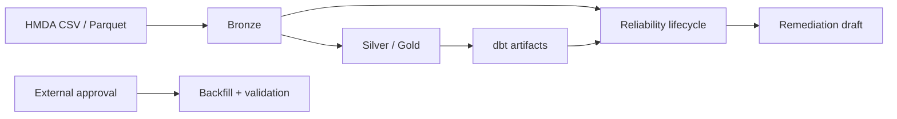

# Architecture: Local HMDA Reliability Pipeline

**핵심 경계는 분석과 위험 작업의 분리다.** 로컬 HMDA 데이터를 DuckDB Bronze에 적재하고 dbt로 Silver·Gold를 만든다. Reliability lifecycle은 raw table과 dbt artifact를 읽어 incident와 remediation draft를 계산하지만, approval 이후 recovery와 evaluation은 별도 API가 담당한다.

## System Flow

## Execution Boundaries

| Area | Rule |
| --- | --- |
| Pipeline | Dagster `pipeline_job`은 Bronze 적재 후 dbt 분석만 실행한다. |
| Reliability lifecycle | Read-only다. approval, backfill, validation, evaluation, report file write를 수행하지 않는다. |
| Recovery | 외부 approval 뒤 별도 API로 실행한다. |
| Evaluation | Synthetic case 결과를 별도 API로 집계하고 report를 별도로 작성한다. |

## Canonical Domain Contracts

세부 계약의 canonical source는 [`docs/domains/OVERVIEW`](domains/OVERVIEW.md)와 연결된 도메인 문서다.

| Need | Document |
| --- | --- |
| 원천 파일, Bronze 적재, 합성 결함 | [`HMDA Data`](domains/hmda-data.md) |
| 실행 request, 결과, dbt build | [`Data Operations`](domains/data-operations.md) |
| DuckDB, dbt model, lineage | [`Data Platform`](domains/data-platform.md) |
| Incident, impact, remediation, recovery, evaluation | [`Reliability`](domains/reliability.md) |
| Dagster asset graph와 config | [`Orchestration`](domains/orchestration.md) |

## Project Scope

| In scope | Out of scope |
| --- | --- |
| 로컬 DuckDB, HMDA 적재, dbt model, reliability control plane | 원천 다운로드, lakehouse, 분산 처리 |
| 승인된 backfill 검증과 evaluation report | human approval UI, 감사 시스템 |
| 로컬 Dagster graph | cloud 배포, production SLO, 장기 모니터링 |
