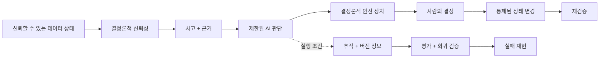

# 비전

> **비전:** 데이터 상태, 신뢰성 판단, AI 판단과 상태 변경 권한을 하나의 근거 사슬로 연결해, 중요한 결정을 설명·검증·재현할 수 있는 **근거 우선(Evidence-First) 데이터 신뢰성 시스템**을 만든다.

## 왜 이 프로젝트가 존재하는가

데이터 시스템의 신뢰는 파이프라인이 성공했다는 사실만으로 증명되지 않는다.

- **파이프라인 성공 ≠ 신뢰할 수 있는 데이터.** 실행 성공은 이후 계층의 데이터가 올바르다는 보장이 아니다.
- **이상 탐지 ≠ 설명 가능한 사고.** 이상 신호만으로는 무엇이 잘못됐고 어떤 근거로 판단했는지 설명할 수 없다.
- **그럴듯한 AI 출력 ≠ 신뢰할 수 있는 판단.** 자연스러운 LLM 응답은 근거, 재현성 또는 안전성을 보장하지 않는다.
- **상태 변경 성공 ≠ 정당한 복구.** 데이터가 변경됐다는 사실만으로 그 변경이 정당하고 안전했다는 뜻은 아니다.

신뢰를 하나의 상태 값이 아니라 **데이터 상태 → 결정론적 근거 → AI 판단 → 사람의 승인 → 통제된 상태 변경 → 재검증**으로 이어지는 근거 사슬로 다룬다.

## 장기 방향

**데이터 신뢰성과 운영 가능한 AI 판단을 하나의 신뢰 모델 안에서 결합**한다.

결정론적 시스템이 데이터 상태와 핵심 안전 경계를 확립하고, AI는 그 근거를 바탕으로 설명·검토·보강하는 제한된 계층으로 동작한다. AI 판단은 실행 조건과 함께 추적되고 반복 가능한 평가로 비교되며, 회귀 검증과 실패를 다시 조사할 수 있어야 한다. 위험한 상태 변경의 최종 권한은 사람과 결정론적 통제에 남는다.

로컬 HMDA 파이프라인은 이 비전을 검증하는 **첫 증명 환경**이다. HMDA나 로컬 실행 자체가 최종 정체성은 아니다. 신뢰성 의미론과 근거 모델을 작은 환경에서 먼저 증명하고, 규모와 인프라는 실제 요구가 생길 때 확장한다.

## 핵심 명제

1. **신뢰할 수 있는 데이터 상태** — 어떤 데이터 상태가 채택됐는지 식별하고 그 상태가 만들어진 과정을 다시 설명할 수 있어야 한다.
2. **결정론적 신뢰성** — 사고 탐지, 안전 제약과 핵심 검증은 재현 가능한 코드와 근거를 우선한다.
3. **근거에 묶인 AI** — AI는 확인 가능한 근거와 결정론적 결과에 기반하며, 근거 밖의 추론을 신뢰성 판단의 기준으로 승격하지 않는다.
4. **관찰 가능한 AI 운영** — AI 판단을 근거, 프롬프트, 모델, 설정과 실행 조건에 연결해 추적하고 비교할 수 있어야 한다.
5. **사람이 통제하는 상태 변경** — 위험한 상태 변경은 검증 가능한 근거와 명시적인 사람의 승인 뒤에만 수행한다.
6. **재현 가능한 평가** — 재현 가능한 사례와 버전이 관리되는 평가 기준으로 변경 전후 품질을 비교하고 회귀 검증과 실패를 다시 조사할 수 있어야 한다.

## 신뢰 루프

AI가 추가되더라도 신뢰성 판단의 기준과 상태 변경 권한은 AI가 소유하지 않는다. AI의 역할이 커질수록 근거 연결, 평가와 재현 가능성도 함께 강해져야 한다.

## LLMOps: AI 판단의 운영 규율

LLMOps는 특정 관찰 도구를 도입하는 일이 아니라 **AI 판단을 운영 가능한 엔지니어링 산출물로 만드는 규율**이다.

- **추적과 버전 식별** — 중요한 판단을 입력 근거와 프롬프트, 모델, 설정, 애플리케이션 버전에 연결한다.
- **평가와 회귀 검증** — 재현 가능한 도메인 사례와 기대 결과를 기준으로 품질을 평가하고 변경 전후를 비교한다.
- **실패 재현** — 실패한 판단과 중요한 경계 사례를 다시 실행 가능한 회귀 검증 사례로 전환한다.
- **운영 지표 관찰** — 지연시간, 사용량과 비용 같은 운영 특성도 품질과 함께 관찰한다.
- **권한 분리** — 추적, 평가 또는 모델 제공 시스템이 신뢰성 판단의 기준이나 상태 변경 권한을 대신하지 않는다.

과거 모델 출력 자체를 자동으로 정답으로 취급하지 않으며, 객관적으로 검증 가능한 안전성과 계약은 결정론적 근거를 우선한다.

## 원칙

- **자동화보다 근거 먼저** — 자동화 범위를 넓히기 전에 판단 근거와 검증 방법을 먼저 만든다.
- **가능하면 결정론적으로** — 안정적으로 코드로 판단할 수 있는 문제를 확률적 판단으로 대체하지 않는다.
- **권한은 별도로 정당화한다** — AI의 권한은 기능의 존재가 아니라 별도의 안전 근거와 통제 경계로 정당화한다.
- **확장보다 증명 먼저** — 인프라와 오케스트레이션 규모보다 작은 환경에서 끝까지 재현 가능한 신뢰 루프를 먼저 증명한다.

## 전략적 경계

다음은 장기 비전의 필수 조건이 아니다.

- LLM 기반 이상 탐지를 신뢰성 판단의 기준으로 사용하는 것
- 사람의 승인 없는 자율 복구
- 범용 자율 RCA 또는 멀티 에이전트 자율성
- 특정 LLM 제공자나 LLMOps 제품에 종속되는 것
- 클라우드·분산 아키텍처 자체를 품질의 증거로 사용하는 것
- 운영 수준의 권한 관리나 대규모 인프라를 신뢰 모델의 증명보다 먼저 구축하는 것

이 기능들은 실제 필요가 생기고 기존 안전 경계를 훼손하지 않을 때 확장할 수 있다. **복잡성 자체는 목표가 아니다.**

## 우리가 지향하는 상태

중요한 실행과 변경에 대해 다음 질문에 답할 수 있어야 한다.

1. **어떤 데이터 상태를 신뢰했고, 왜 신뢰했는가?**
2. **어떤 사고를 어떤 결정론적 근거로 판단했는가?**
3. **AI는 어떤 근거와 실행 조건을 보고 무엇을 판단했으며, 그 판단을 어떻게 평가했는가?**
4. **누가 어떤 근거로 상태 변경을 허용했고, 재검증 결과는 무엇인가?**
5. **같은 실패나 회귀 검증 결과를 다시 재현하고 비교할 수 있는가?**

이 질문에 답할 수 없다면 파이프라인이나 AI 데모가 동작하더라도 우리가 추구하는 신뢰는 완성되지 않은 것이다.
