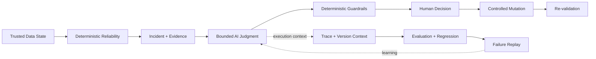

# Project Pivot Vision

> **Vision:** 데이터 상태, Reliability 판단, AI judgment와 mutation authorization을 하나의 evidence chain으로 연결해, 중요한 결정을 설명·검증·재현할 수 있는 **Evidence-First Data Reliability system**을 만든다.

## Why Project Pivot Exists

데이터 시스템의 신뢰는 pipeline이 성공했다는 사실만으로 증명되지 않는다.

- **Pipeline success ≠ trusted data.** 실행 성공은 downstream 데이터가 올바르다는 보장이 아니다.
- **Anomaly detected ≠ explainable incident.** 이상 신호만으로는 무엇이 잘못됐고 어떤 근거로 판단했는지 설명할 수 없다.
- **Plausible AI output ≠ reliable judgment.** 자연스러운 LLM 응답은 근거, 재현성 또는 안전성을 보장하지 않는다.
- **Successful mutation ≠ justified recovery.** 데이터가 바뀌었다는 사실만으로 그 변경이 승인됐고 올바르게 복구됐다는 뜻은 아니다.

Project Pivot은 신뢰를 하나의 status가 아니라 **data state → deterministic evidence → AI judgment → human authorization → controlled mutation → re-validation**으로 이어지는 evidence chain으로 다룬다.

## Long-Term Direction

Project Pivot은 **Data Reliability와 운영 가능한 AI judgment를 하나의 신뢰 모델 안에서 결합**한다.

Deterministic system이 데이터 상태와 핵심 safety boundary를 확립하고, AI는 그 evidence를 바탕으로 설명·검토·보강하는 bounded layer로 동작한다. AI judgment는 실행 조건과 함께 추적되고, 반복 가능한 evaluation으로 비교되며, regression과 failure를 다시 조사할 수 있어야 한다. 위험한 mutation의 최종 authority는 사람과 deterministic control에 남는다.

현재의 local HMDA pipeline은 이 비전을 검증하기 위한 **initial proving ground**다. HMDA나 local execution 자체가 Project Pivot의 최종 정체성은 아니다. 규모와 infrastructure는 reliability semantics와 evidence model이 먼저 증명된 뒤 실제 요구에 따라 확장한다.

## Product Thesis

1. **Trusted Data State** — source에서 analytical layer까지 어떤 데이터 상태가 채택됐는지 식별하고 다시 설명할 수 있어야 한다.
2. **Deterministic Reliability** — incident detection, safety constraint와 핵심 validation은 재현 가능한 code와 evidence를 우선한다.
3. **Evidence-Bound AI** — AI는 확인 가능한 evidence와 deterministic result를 근거로 판단하며, 근거 밖의 추론을 system truth로 승격하지 않는다.
4. **Observable AI Operations** — AI judgment를 evidence, prompt/model/configuration과 실행 context에 연결해 추적·비교할 수 있어야 한다.
5. **Human-Controlled Mutation** — 위험한 state change는 검증 가능한 proposal과 명시적 human authorization 뒤에만 수행한다.
6. **Replayable Evaluation** — 재현 가능한 case와 versioned evaluation으로 deterministic system과 AI judgment의 변경 전후 품질을 비교하고 regression과 failure를 다시 조사할 수 있어야 한다.

## Trust Loop

이 loop에서 AI는 reliability truth나 mutation authority를 소유하지 않는다. AI가 추가되더라도 deterministic evidence와 human-controlled mutation boundary는 유지된다.

## LLMOps As A Reliability Discipline

Project Pivot에서 LLMOps는 특정 observability 제품을 도입하는 일이 아니라 **AI judgment를 운영 가능한 engineering artifact로 만드는 discipline**이다.

- **Traceability** — 중요한 AI judgment는 어떤 evidence와 실행 조건에서 만들어졌는지 추적할 수 있어야 한다.
- **Versionability** — prompt, model, configuration과 application change를 결과 변화와 연결할 수 있어야 한다.
- **Evaluability** — 구조, evidence binding, forbidden action처럼 code로 판정 가능한 항목은 deterministic evaluation을 우선한다.
- **Regression** — 동일하거나 동등한 evaluation case에서 변경 전후 품질을 비교할 수 있어야 한다.
- **Failure Replay** — 실패한 judgment와 중요한 edge case를 재현 가능한 regression evidence로 전환할 수 있어야 한다.
- **Operational Observability** — latency, usage와 cost처럼 운영 판단에 필요한 특성도 AI 품질과 함께 관찰 가능해야 한다.
- **Grounded Evaluation Data** — 최초 evaluation 기준은 재현 가능한 domain case와 expectation에서 만들며, 과거 model output을 자동으로 정답으로 취급하지 않는다.
- **Authority Separation** — tracing, evaluation 또는 model-serving system은 Project Pivot의 canonical domain truth나 mutation authority를 소유하지 않는다.

LLM-as-a-Judge 같은 probabilistic evaluator는 설명 품질처럼 deterministic code로 충분히 판정하기 어려운 영역에 선택적으로 사용할 수 있다. 객관적으로 검증 가능한 safety와 contract는 가능한 한 deterministic evaluator에 남긴다.

## Operating Principles

- **Evidence over inference** — 중요한 주장은 식별 가능한 source와 evidence에 연결한다.
- **Deterministic before probabilistic** — 안정적으로 code로 판정할 수 있는 문제를 LLM judgment로 대체하지 않는다.
- **Advisory before authority** — AI capability의 가치는 먼저 설명·검토·평가에서 증명하고, 권한은 필요성과 safety contract가 별도로 정당화될 때만 확대한다.
- **Inspectable judgment** — AI 판단은 결과만 저장하지 않고 판단에 영향을 준 evidence와 실행 조건을 함께 설명할 수 있어야 한다.
- **Reproducibility over demos** — 한 번 성공하는 demo보다 같은 조건에서 다시 검증하고 실패를 설명할 수 있는 system을 우선한다.
- **Proof before scale** — cloud, distributed processing와 복잡한 orchestration은 reliability contract와 운영 evidence를 대체하지 않는다.
- **Tool neutrality** — 특정 LLM provider, tracing platform 또는 evaluation product를 project truth의 전제로 만들지 않는다.
- **One owner per truth** — contract, implementation state, validation evidence와 human projection의 ownership을 섞지 않는다.

## Strategic Boundaries

다음은 Project Pivot의 장기 비전을 증명하기 위한 필수 전제가 아니다.

- LLM 기반 anomaly detection을 system truth로 사용하는 것
- human authorization 없는 autonomous recovery
- 범용 autonomous RCA 또는 multi-agent autonomy
- 특정 LLM/LLMOps vendor에 대한 lock-in
- observability 또는 evaluation UI를 canonical source로 사용하는 것
- cloud/distributed architecture 자체를 품질의 증거로 사용하는 것
- production-grade authorization, audit platform 또는 대규모 운영 infrastructure를 초기 proof보다 먼저 구축하는 것

이 capability들은 실제 requirement가 생기고 기존 trust boundary를 훼손하지 않을 때 확장할 수 있다. **복잡성 자체는 Project Pivot의 목표가 아니다.**

## What Success Looks Like

Project Pivot은 중요한 실행과 변경에 대해 다음 질문에 답할 수 있는 system을 지향한다.

1. **어떤 데이터 상태를 신뢰했고, 왜 신뢰했는가?**
2. **어떤 incident를 어떤 deterministic evidence로 판단했는가?**
3. **AI는 어떤 evidence와 versioned execution context를 보고 무엇을 판단했는가?**
4. **그 AI judgment의 품질과 safety를 어떤 evaluation으로 검증했는가?**
5. **누가 어떤 근거로 mutation을 허용했고, 무엇이 실제로 변경됐는가?**
6. **re-validation 결과는 무엇이며, 동일한 failure나 regression을 다시 재현할 수 있는가?**

이 질문에 답할 수 없다면 pipeline이나 AI demo가 동작하더라도 Project Pivot이 추구하는 신뢰는 완성되지 않은 것이다.

## Initial Proving Ground

Project Pivot은 이 비전을 먼저 **bounded local HMDA reliability system**에서 증명한다.

작은 domain과 재현 가능한 synthetic/realistic case를 사용해 data state, deterministic reliability, bounded AI judgment, human-controlled recovery와 evaluation loop를 끝까지 닫는 것이 초기 목표다. 이 proving ground에서 얻은 contract와 evidence가 충분히 안정된 뒤에만 더 많은 dataset, incident type, infrastructure 또는 automation을 확장한다.

## Document Ownership

이 문서는 Project Pivot의 **장기 방향, 제품 철학과 non-negotiable principles**를 소유한다. 자주 변하는 현재 상태나 구현 세부사항을 소유하지 않는다.

| Question | Owning source |
| --- | --- |
| 지금 무엇을 완료해야 하는가? | [`mvp.md`](mvp.md) |
| 시스템과 domain은 어떻게 나뉘는가? | [`ARCHITECTURE.md`](ARCHITECTURE.md), [`domains/`](domains/OVERVIEW.md) |
| 현재 capability가 무엇을 보장해야 하는가? | [`../openspec/specs/`](../openspec/specs/) |
| 실제로 무엇이 구현됐는가? | source와 configuration |
| 현재 revision에서 무엇이 검증됐는가? | matching-revision execution evidence |
| 사람이 현재 개발 상태를 빠르게 보고 싶은가? | [`development/dashboard.md`](development/dashboard.md) |

특정 vendor 선택, current phase status, progress number, implementation detail과 validation result는 이 문서에 기록하지 않는다.

**VISION.md는 Project Pivot의 장기 방향이 바뀔 때만 수정한다.**
