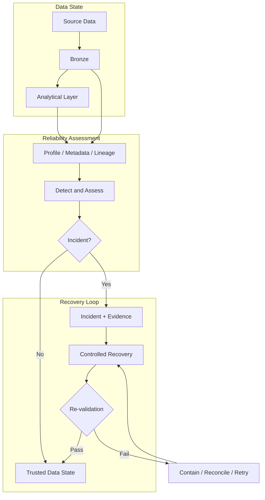
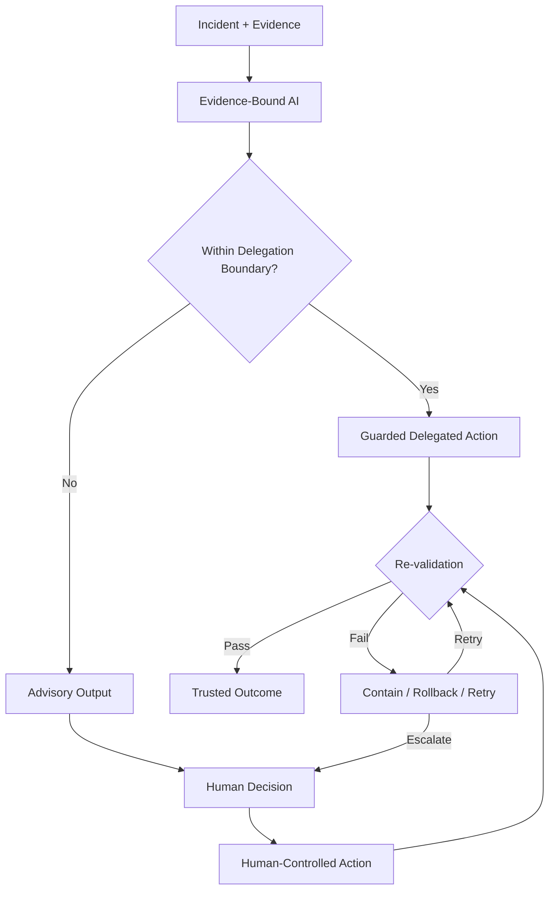
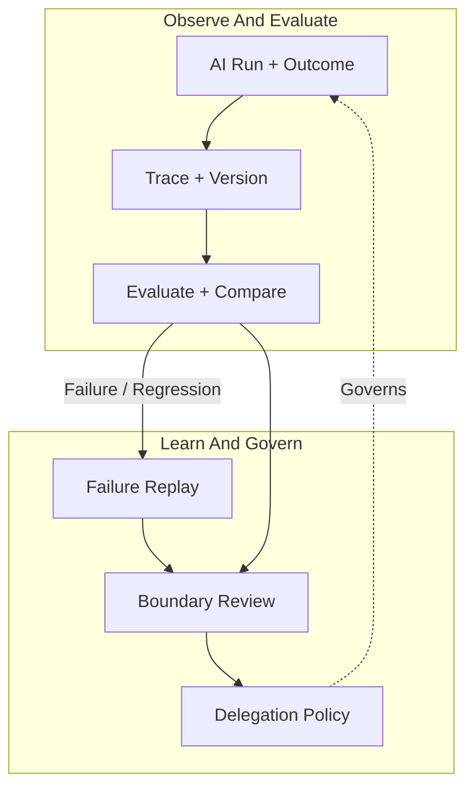

# Vision

> **Vision:** 데이터 상태와 신뢰성 판단을 결정론적 근거에 고정하고, 충분한 품질을 보이면서 실패가 탐지·격리·복구 가능한 범위에서는 유용한 작업을 AI에 가능한 한 많이 위임하며, 그 경계 밖에서는 AI를 사람의 판단을 돕는 보조 계층으로 제한하는 **근거 우선(Evidence-First) 데이터 신뢰성 시스템**을 만든다.

## Why This Project Exists

데이터 시스템의 신뢰는 파이프라인이 성공했다는 사실만으로 증명되지 않는다.

- **Pipeline Success ≠ Trusted Data.** 실행 성공은 이후 계층의 데이터가 올바르다는 보장이 아니다.
- **Anomaly Detected ≠ Explainable Incident.** 이상 신호만으로는 무엇이 잘못됐고 어떤 근거로 판단했는지 설명할 수 없다.
- **Plausible AI Output ≠ Reliable Judgment.** 자연스러운 LLM 응답은 근거, 재현성 또는 안전성을 보장하지 않는다.
- **Successful AI Action ≠ Safe Delegation.** 한 번의 성공은 AI가 틀렸을 때도 영향이 제한되고 복구 가능하다는 증거가 아니다.
- **Successful Mutation ≠ Justified Recovery.** 데이터가 변경됐다는 사실만으로 그 변경이 정당하고 안전했다는 뜻은 아니다.

LLM이 틀리지 않는 시스템을 가정하지 않는다. 중요한 것은 **LLM 오류가 신뢰성 사고로 확산되지 않도록 실패를 발견하고, 영향을 제한하고, 다시 검증하거나 복구할 수 있는 시스템**을 만드는 것이다.

## Long-Term Direction

**데이터 신뢰성과 안전한 AI 위임을 하나의 신뢰 모델 안에서 결합**한다.

목표는 AI의 역할을 최소화하는 것이 아니다. 신뢰성 판단의 기준과 핵심 안전 조건은 결정론적으로 유지하되, 검증된 품질과 효용을 갖고 실패를 감당할 수 있는 영역에서는 조사·해석·검토·계획·실행을 포함한 유용한 작업을 가능한 한 AI에 위임한다. 반대로 품질을 신뢰하기 어렵거나 오류를 알아차리기 어렵고 영향이 크며 복구하기 어려운 영역에서는 AI를 보조 계층으로 제한하고 사람의 판단과 결정론적 통제를 유지한다.

위임의 한계는 모델의 자신감이나 벤치마크 점수만으로 결정하지 않는다. **실제 평가에서 충분히 유용한가, 실패했을 때 시스템이 어떻게 반응할 수 있는가**를 함께 본다. 위임 경계는 고정된 선이 아니다. 검증, 격리, rollback, retry, replay와 복구가 개선되고 그 효과가 근거로 축적되면 더 넓힐 수 있고, 새로운 실패가 드러나면 다시 좁혀야 한다.

로컬 HMDA 파이프라인은 이 비전을 검증하는 **첫 증명 환경**이다. HMDA나 로컬 실행 자체가 최종 정체성은 아니다. 신뢰성 의미론, 근거 모델과 안전한 위임 경계를 작은 환경에서 먼저 증명하고, 규모와 인프라는 실제 요구가 생길 때 확장한다.

## Product Thesis

1. **Trusted Data State** — 어떤 데이터 상태가 채택됐는지 식별하고 그 상태가 만들어진 과정을 다시 설명할 수 있어야 한다.
2. **Deterministic Reliability** — 사고 탐지, 핵심 안전 조건과 재검증은 재현 가능한 코드와 근거를 우선한다.
3. **Evidence-Bound AI** — AI는 확인 가능한 근거와 결정론적 결과에 기반하며, 근거 밖의 추론을 신뢰성 판단의 기준으로 승격하지 않는다.
4. **Recoverability-Bounded Delegation** — 충분한 품질을 보인 작업에서 AI 오류를 탐지하고 영향을 제한하며 되돌리거나 복구할 수 있다면 적극적으로 위임하고, 그렇지 않다면 사람의 판단을 보조하는 수준으로 제한한다.
5. **Observable AI Operations** — AI 판단과 행동을 근거, 프롬프트, 모델, 설정과 실행 조건에 연결해 추적하고 비교할 수 있어야 한다.
6. **Replayable Evaluation** — 재현 가능한 사례와 버전이 관리되는 평가 기준으로 변경 전후 품질과 위임 경계의 안전성을 비교하고 실패를 다시 조사할 수 있어야 한다.

## Delegation Boundary

AI 위임은 기능 자체가 아니라 **검증된 효용과 실패 특성**으로 판단한다. Recoverability는 위임의 안전 조건이지 품질을 대신하는 충분 조건이 아니다.

| Dimension | Delegate When | Escalate When |
| --- | --- | --- |
| **Quality** | 재현 가능한 평가에서 작업 목적에 필요한 품질과 효용을 일관되게 충족한다. | 품질을 측정하기 어렵거나 오류가 너무 잦아 자동화의 이점이 없다. |
| **Detectability** | 잘못된 결과나 행동을 신뢰 가능한 검증으로 발견할 수 있다. | 오류가 장기간 숨어 있거나 검증 기준이 불명확하다. |
| **Blast Radius** | 실패의 영향 범위가 작고 격리할 수 있다. | 하나의 오류가 넓은 데이터나 외부 상태로 확산될 수 있다. |
| **Reversibility** | rollback, retry 또는 안전한 대체 실행이 가능하다. | 결과가 비가역적이거나 원상 복구가 어렵다. |
| **Recoverability** | 실패 후 제한된 비용과 절차로 정상 상태를 다시 증명할 수 있다. | 사후 복구 비용이 크거나 신뢰 상태를 다시 증명하기 어렵다. |

경계가 불명확하면 자율 위임을 낙관적으로 확대하지 않는다. 이 경우 AI는 분석, 제안과 의사결정 지원을 담당하고 최종 권한은 사람 또는 결정론적 통제에 남긴다.

위임 경계의 변경 자체도 통제 대상이다. 새로운 평가와 실패 근거는 경계를 재검토할 근거가 되지만 **AI가 자기 권한을 스스로 확대하지 않는다.** 경계 변경은 근거가 남는 명시적 정책 결정으로 다룬다.

## Data Reliability Flow

데이터 신뢰성은 AI가 판단하기 전에 먼저 닫혀 있어야 한다. 데이터 상태, 사고 판단, 복구와 재검증은 AI 사용 여부와 독립적으로 설명하고 반복 검증할 수 있어야 한다.

## Safe Delegation Flow

AI의 역할이 커질수록 위임 경계를 보호하는 검증과 복구도 함께 강해져야 한다. 자율성은 신뢰 경계를 제거해서 얻는 것이 아니라 **유용한 AI 작업의 실패를 안전하게 다룰 수 있는 시스템을 만들어 얻는 것**이다.

## LLMOps Feedback Loop

## LLMOps: Control Loop for Safe Delegation

LLMOps는 특정 관찰 도구를 도입하는 일이 아니라 **AI 판단과 행동을 추적·평가하고, 그 근거로 안전한 위임 경계를 검토할 수 있게 만드는 운영 규율**이다.

- **Trace and Version** — 중요한 판단과 행동을 입력 근거, 프롬프트, 모델, 설정, 애플리케이션 버전에 연결한다.
- **Evaluate and Regress** — 재현 가능한 도메인 사례와 기대 결과를 기준으로 품질을 평가하고 변경 전후를 비교한다.
- **Replay Failures** — 실패한 판단과 중요한 경계 사례를 다시 실행 가능한 회귀 검증 사례로 전환한다.
- **Observe Operations** — 지연시간, 사용량과 비용 같은 운영 특성도 품질과 함께 관찰한다.
- **Inform Delegation Policy** — 평가 품질, 실제 실패와 복구 근거를 위임 경계 검토의 근거로 제공한다.

과거 모델 출력 자체를 자동으로 정답으로 취급하지 않는다. 객관적으로 검증 가능한 안전성과 계약은 결정론적 근거를 우선하며, LLMOps의 성공은 로그의 양이 아니라 **위임 경계를 근거 있게 검토하고 조정할 수 있는가**로 판단한다.

## Principles

- **Design for AI Failure** — LLM 오류를 예외적인 사건으로 취급하지 않고, 오류가 큰 사고로 확산되지 않도록 시스템을 설계한다.
- **Authority Must Be Earned** — 비가역적이거나 영향이 큰 권한은 기능의 존재만으로 부여하지 않고 충분한 안전성과 복구 근거가 있을 때만 확대한다. AI는 자신의 권한 확대를 스스로 승인하지 않는다.
- **Proof Before Scale** — 모델 성능이나 자동화 범위를 자랑하기보다 작은 환경에서 위임, 실패, 복구와 재검증을 끝까지 증명한다.

## Strategic Boundaries

다음은 장기 비전의 필수 조건이 아니다.

- LLM 기반 이상 탐지를 신뢰성 판단의 기준으로 사용하는 것
- 복구 가능성이 입증되지 않은 고위험 상태 변경을 사람의 승인 없이 자동 실행하는 것
- 범용 자율 RCA 또는 멀티 에이전트 자율성 자체를 목표로 삼는 것
- 특정 LLM 제공자나 LLMOps 제품에 종속되는 것
- 클라우드·분산 아키텍처 자체를 품질의 증거로 사용하는 것
- 운영 수준의 권한 관리나 대규모 인프라를 신뢰 모델과 복구 증명보다 먼저 구축하는 것

이 기능들은 실제 필요가 생기고 기존 안전 경계를 훼손하지 않을 때 확장할 수 있다. **복잡성과 자율성 자체는 목표가 아니다.**

## What Success Looks Like

중요한 실행과 변경에 대해 다음 질문에 답할 수 있어야 한다.

1. **어떤 데이터 상태를 신뢰했고, 왜 신뢰했는가?**
2. **어떤 사고를 어떤 결정론적 근거로 판단했는가?**
3. **어떤 작업을 AI에 위임했고, 그 품질과 효용을 어떤 평가로 증명했는가?**
4. **LLM이 틀렸을 때 오류를 발견하고 영향을 제한하며 큰 문제 없이 복구할 수 있는가?**
5. **위임 경계 밖의 작업은 어떻게 사람에게 이관되고, 그 판단과 행동을 어떻게 재검증하는가?**
6. **같은 실패를 다시 재현하고 평가해 위임 경계를 근거 있게 넓히거나 좁힐 수 있는가?**

이 질문에 답할 수 없다면 파이프라인이나 AI 데모가 동작하더라도 우리가 추구하는 신뢰와 위임은 완성되지 않은 것이다.