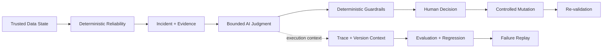

# Project Pivot Vision

> **Vision:** 데이터 상태, Reliability 판단, AI judgment와 mutation authorization을 하나의 evidence chain으로 연결해, 중요한 결정을 설명·검증·재현할 수 있는 **Evidence-First Data Reliability system**을 만든다.

## Why Project Pivot Exists

데이터 시스템의 신뢰는 pipeline이 성공했다는 사실만으로 증명되지 않는다.

- **Pipeline success ≠ trusted data.** 실행 성공은 downstream 데이터가 올바르다는 보장이 아니다.
- **Anomaly detected ≠ explainable incident.** 이상 신호만으로는 무엇이 잘못됐고 어떤 근거로 판단했는지 설명할 수 없다.
- **Plausible AI output ≠ reliable judgment.** 자연스러운 LLM 응답은 근거, 재현성 또는 안전성을 보장하지 않는다.
- **Successful mutation ≠ justified recovery.** 데이터가 변경됐다는 사실만으로 그 변경이 정당하고 안전했다는 뜻은 아니다.

Project Pivot은 신뢰를 하나의 status가 아니라 **data state → deterministic evidence → AI judgment → human authorization → controlled mutation → re-validation**으로 이어지는 evidence chain으로 다룬다.

## Long-Term Direction

Project Pivot은 **Data Reliability와 운영 가능한 AI judgment를 하나의 신뢰 모델 안에서 결합**한다.

Deterministic system이 데이터 상태와 핵심 safety boundary를 확립하고, AI는 그 evidence를 바탕으로 설명·검토·보강하는 bounded layer로 동작한다. AI judgment는 실행 조건과 함께 추적되고 반복 가능한 evaluation으로 비교되며, regression과 failure를 다시 조사할 수 있어야 한다. 위험한 mutation의 최종 authority는 사람과 deterministic control에 남는다.

현재의 local HMDA pipeline은 이 비전을 검증하는 **initial proving ground**다. HMDA나 local execution 자체가 Project Pivot의 최종 정체성은 아니다. Reliability semantics와 evidence model을 작은 환경에서 먼저 증명하고, 규모와 infrastructure는 실제 요구가 생길 때 확장한다.

## Product Thesis

1. **Trusted Data State** — 어떤 데이터 상태가 채택됐는지 식별하고 그 상태가 만들어진 과정을 다시 설명할 수 있어야 한다.
2. **Deterministic Reliability** — incident detection, safety constraint와 핵심 validation은 재현 가능한 code와 evidence를 우선한다.
3. **Evidence-Bound AI** — AI는 확인 가능한 evidence와 deterministic result에 근거하며, 근거 밖의 추론을 system truth로 승격하지 않는다.
4. **Observable AI Operations** — AI judgment를 evidence, prompt, model, configuration과 execution context에 연결해 추적·비교할 수 있어야 한다.
5. **Human-Controlled Mutation** — 위험한 state change는 검증 가능한 근거와 명시적인 human authorization 뒤에만 수행한다.
6. **Replayable Evaluation** — 재현 가능한 case와 versioned evaluation으로 변경 전후 품질을 비교하고 regression과 failure를 다시 조사할 수 있어야 한다.

## Trust Loop

AI가 추가되더라도 reliability truth와 mutation authority는 AI가 소유하지 않는다. AI의 역할이 커질수록 evidence binding, evaluation과 replayability도 함께 강해져야 한다.

## LLMOps As A Reliability Discipline

Project Pivot에서 LLMOps는 특정 observability 제품을 도입하는 일이 아니라 **AI judgment를 운영 가능한 engineering artifact로 만드는 discipline**이다.

- **Trace and version** — 중요한 judgment를 입력 evidence와 prompt/model/configuration/application version에 연결한다.
- **Evaluate before trust** — 구조, evidence binding, forbidden action처럼 code로 판정 가능한 항목은 deterministic evaluation을 우선한다.
- **Regression and replay** — 재현 가능한 domain case를 기준으로 변경 전후를 비교하고 실패한 judgment와 edge case를 regression case로 되돌릴 수 있어야 한다.
- **Observe operations** — latency, usage와 cost 같은 운영 특성도 품질과 함께 관찰한다.
- **Separate authority** — tracing, evaluation 또는 model-serving system이 reliability truth나 mutation authority를 대신하지 않는다.

LLM-as-a-Judge 같은 probabilistic evaluator는 설명 품질처럼 deterministic code만으로 충분히 판정하기 어려운 영역에 선택적으로 사용한다. 재현 가능한 domain case와 expectation을 평가 기준의 출발점으로 삼으며 과거 model output을 자동으로 정답으로 취급하지 않는다.

## Principles

- **Evidence over inference** — 중요한 판단은 식별 가능한 evidence에 연결한다.
- **Deterministic before probabilistic** — 안정적으로 code로 판정할 수 있는 문제를 LLM judgment로 대체하지 않는다.
- **Advisory before authority** — AI의 가치는 먼저 설명·검토·평가에서 증명하고, 권한 확대는 별도의 safety 근거를 요구한다.
- **Reproducibility over demos** — 한 번 성공하는 demo보다 같은 조건에서 다시 검증하고 실패를 설명할 수 있는 system을 우선한다.
- **Proof before scale** — cloud, distributed processing와 복잡한 orchestration은 reliability contract와 evidence를 대체하지 않는다.
- **Tool neutrality** — 특정 LLM provider나 LLMOps platform을 프로젝트의 신뢰 전제로 만들지 않는다.

## Strategic Boundaries

Project Pivot은 다음을 장기 비전의 필수 조건으로 두지 않는다.

- LLM 기반 anomaly detection을 reliability truth로 사용하는 것
- human authorization 없는 autonomous recovery
- 범용 autonomous RCA 또는 multi-agent autonomy
- 특정 LLM/LLMOps vendor에 대한 lock-in
- cloud/distributed architecture 자체를 품질의 증거로 사용하는 것
- production-grade authorization이나 대규모 운영 infrastructure를 신뢰 모델의 proof보다 먼저 구축하는 것

이 capability들은 실제 필요가 생기고 기존 safety boundary를 훼손하지 않을 때 확장할 수 있다. **복잡성 자체는 Project Pivot의 목표가 아니다.**

## What Success Looks Like

Project Pivot은 중요한 실행과 변경에 대해 다음 질문에 답할 수 있는 system을 지향한다.

1. **어떤 데이터 상태를 신뢰했고, 왜 신뢰했는가?**
2. **어떤 incident를 어떤 deterministic evidence로 판단했는가?**
3. **AI는 어떤 evidence와 execution context를 보고 무엇을 판단했으며, 그 판단을 어떻게 평가했는가?**
4. **누가 어떤 근거로 mutation을 허용했고, re-validation 결과는 무엇인가?**
5. **같은 failure나 regression을 다시 재현하고 비교할 수 있는가?**

이 질문에 답할 수 없다면 pipeline이나 AI demo가 동작하더라도 Project Pivot이 추구하는 신뢰는 완성되지 않은 것이다.
