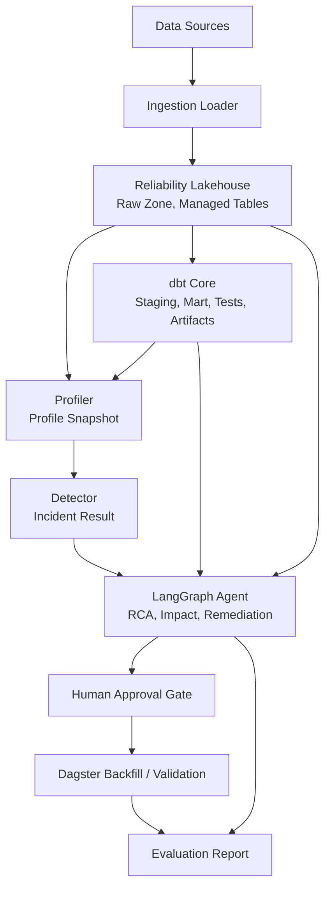
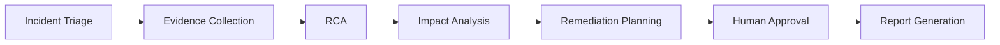
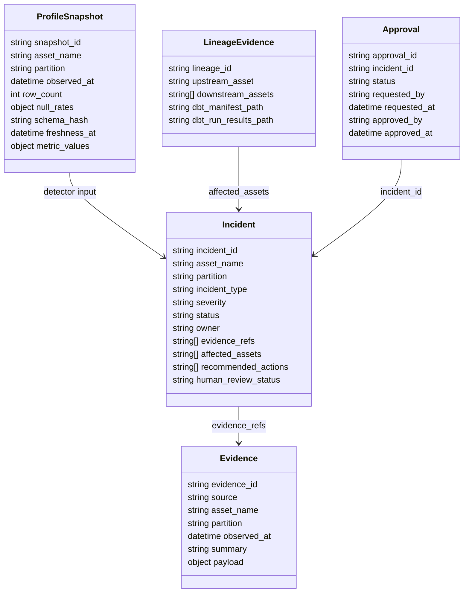

# Architecture

## 목표

데이터 품질 이상을 단순 alert가 아니라 **Data Reliability Incident**로 처리한다. 아키텍처는 특정 데이터셋이나 필드에 의존하지 않고, 탐지, 근거 수집, RCA, 영향 분석, remediation, 재처리, 평가를 하나의 운영 흐름으로 연결한다.

## 전체 흐름

## 컴포넌트 책임

| 컴포넌트 | 책임 | 주요 출력 |
|---|---|---|
| Ingestion Loader | 원천 데이터를 partition 또는 batch 기준으로 적재 | Raw data |
| Table Metadata Layer | managed table의 snapshot, schema, partition metadata 제공 | Metadata evidence |
| dbt Core | staging, mart, test, lineage 생성 | `manifest.json`, `run_results.json` |
| Profiler | volume, completeness, schema, freshness 지표 계산 | Profile snapshot |
| Detector | baseline/current profile 비교로 incident 생성 | Incident result |
| Dagster | asset graph, daily partition, backfill 실행 | Run metadata |
| LangGraph Agent | RCA, 영향 분석, remediation plan 생성 | Structured output |
| Evaluation | 탐지, RCA, impact, compile, backfill 결과 평가 | Evaluation report |

## Agent Workflow

## Evidence Sources

| Source | 포함 정보 | 사용 목적 |
|---|---|---|
| Table metadata | snapshot id, schema history, partition metadata | schema drift, volume change RCA |
| Profile snapshot | volume, completeness, freshness, distribution | anomaly detection, RCA evidence |
| dbt artifacts | lineage, model status, test result | impact analysis, compile 검증 |
| YAML catalog | owner, SLA, grain, business context | severity, routing, report |
| Dagster metadata | partition status, materialization result | freshness, backfill planning |

## Reliability Contract

핵심 contract는 `project_pivot.reliability.contracts`에 둔다. Detector, Agent,
Evaluation은 같은 Pydantic 모델을 공유한다.

`Approval.status`가 `approved`이고 승인자와 승인 시각이 있을 때만 partition overwrite, backfill, validation workflow를 실행한다.

## MVP 경계

| 포함 | 제외 |
|---|---|
| 대표 managed table 1개 metadata 관리 | 전체 lakehouse 특정 table format 전환 |
| 로컬 DuckDB 실행 | 대규모 Spark cluster |
| Dagster daily partition과 backfill demo | production cloud deployment |
| dbt test suggestion과 compile 검증 | 자동 PR merge |
| Human approval 기반 재처리 | 승인 없는 자동 복구 |
