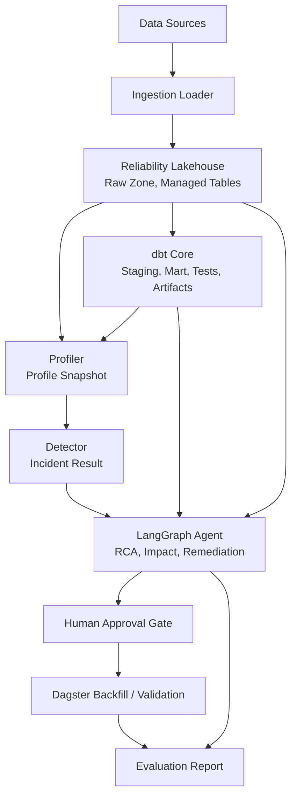
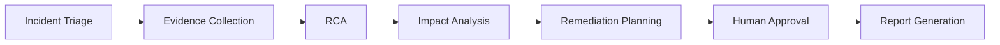
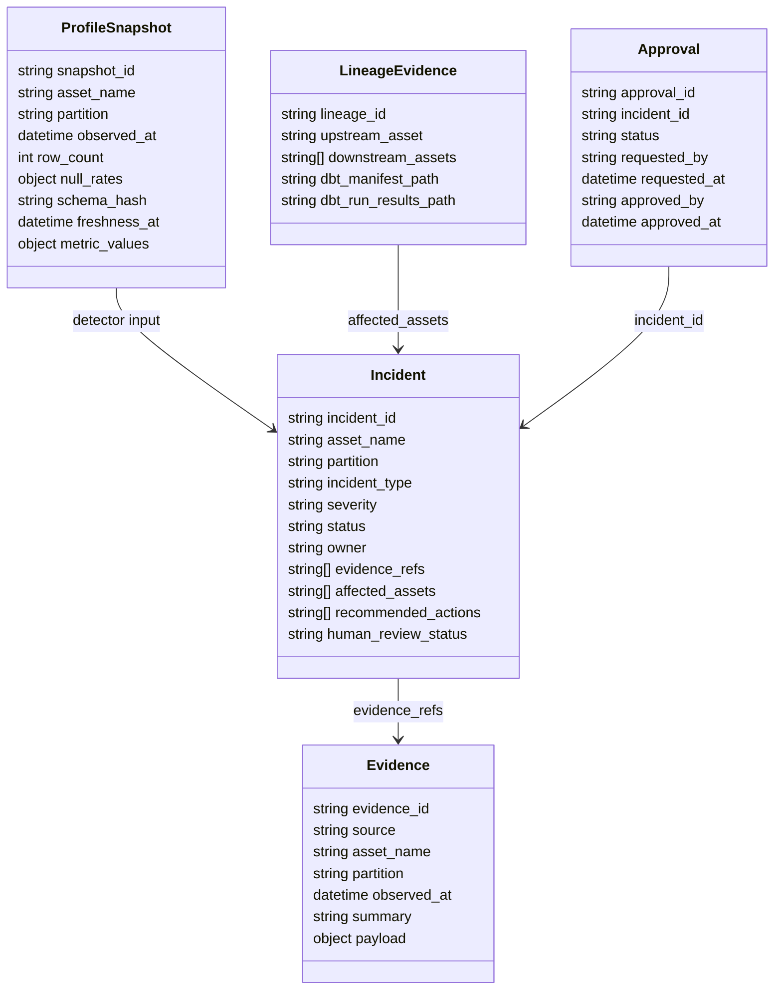

# Architecture

## 목표
데이터 품질 이상 -> **Data Reliability Incident** 처리. 탐지-근거-RCA-영향-remediation-재처리-평가 흐름 연결. 특정 데이터셋 의존 없음.

현재 기본 원천은 `data/raw/hmda`의 HMDA 대출 신청 데이터다. raw 레이어는 `raw.hmda_loans`, dbt 분석 모델은 `stg_hmda_loans`와 `mart_hmda_loan_outcomes`를 기준으로 한다.

## 전체 흐름

## 컴포넌트 책임
| 컴포넌트 | 책임 | 주요 출력 |
|---|---|---|
| Ingestion Loader | source_year/source_file 기준 원천 적재 | Raw HMDA loans |
| Table Metadata Layer | managed table snapshot/schema/partition | Metadata evidence |
| dbt Core | staging/mart/test/lineage 생성 | `manifest.json`, `run_results.json` |
| Profiler | volume/completeness/schema/freshness 계산 | Profile snapshot |
| Detector | baseline/current 비교 -> incident | Incident result |
| Dagster | HMDA asset graph/materialization | Run metadata |
| LangGraph Agent | RCA/영향 분석/remediation | Structured output |
| Evaluation | 탐지/RCA/impact/compile/backfill 평가 | Evaluation report |

## Agent Workflow

## Evidence Sources
| Source | 포함 정보 | 사용 목적 |
|---|---|---|
| Table metadata | snapshot id/schema/partition | schema drift/volume RCA |
| Profile snapshot | volume/completeness/freshness/distribution | anomaly/RCA evidence |
| dbt artifacts | lineage/model status/test result | impact analysis/compile 검증 |
| YAML catalog | owner/SLA/grain/business context | severity/routing/report |
| Dagster metadata | source year/materialization | freshness/backfill planning |

## Reliability Contract
핵심 contract: `project_pivot.reliability.contracts`. Detector/Agent/Evaluation Pydantic 모델 공유.

`Approval.status` `approved` + 승인자/시각 존재 시 partition overwrite/backfill/validation 실행.

## MVP 경계
| 포함 | 제외 |
|---|---|
| 대표 managed table 1개 metadata | 전체 lakehouse 특정 table format 전환 |
| 로컬 DuckDB 실행 | 대규모 Spark cluster |
| Dagster HMDA materialization demo | production cloud deployment |
| dbt test suggestion/compile 검증 | 자동 PR merge |
| Human approval 기반 재처리 | 승인 없는 자동 복구 |
