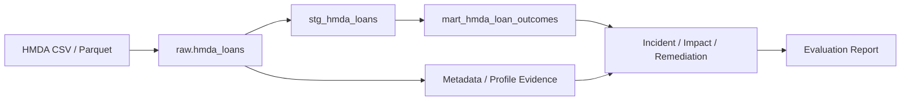
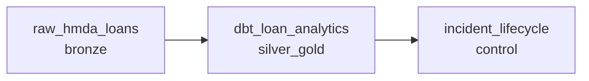

# Architecture

## 현재 범위

HMDA 공개 대출 신청 파일을 로컬 DuckDB에 멱등 적재하고, dbt 분석 모델과 reliability incident lifecycle을 Dagster asset graph로 실행한다.

## 데이터 흐름

## HMDA 데이터 계약

| 구분 | 계약 |
|---|---|
| 원천 경로 | `data/raw/hmda` |
| 지원 형식 | CSV, Parquet |
| 필수 컬럼 | `activity_year`, `state_code`, `county_code`, `loan_purpose`, `action_taken`, `loan_amount`, `income` |
| raw 테이블 | `raw.hmda_loans` |
| 추적 컬럼 | `source_file`, `source_file_name`, `source_year`, `ingested_at` |
| 파티션 선택 | `source_year`, 선택적 `source_file_name` |
| staging | `stg_hmda_loans` |
| mart | `mart_hmda_loan_outcomes` |
| mart grain | `activity_year + state_code + loan_purpose` |

전체 적재는 raw 테이블을 교체한다. 파티션 적재는 대상 행을 임시 테이블에서 검증한 뒤 트랜잭션으로 덮어써 중복을 막는다. 지원하지 않는 파일은 발견 단계에서 제외한다.

## 실행 구조

`pipeline_job`은 위 세 asset을 순서대로 실행한다. asset은 도메인 로직을 구현하지 않고 `project_pivot.pipeline` 실행 함수를 호출하며 Dagster metadata만 기록한다.

## 컴포넌트 책임

| 컴포넌트 | 책임 | 주요 출력 |
|---|---|---|
| `hmda_data.ingestion` | 파일 발견, 필수 컬럼 검증, 연도/파일 파티션 적재 | `raw.hmda_loans` |
| dbt | staging, mart, test, lineage 생성 | 모델, `manifest.json`, `run_results.json` |
| profiling/metadata | 행 수, Null 비율, schema와 table metadata 수집 | evidence |
| detection | baseline/current 비교와 volume drop 탐지 | incident |
| impact/remediation | dbt lineage 영향 분석과 복구 초안 | affected assets, actions |
| recovery | 승인된 파티션 재적재와 profile 검증 | backfill result |
| evaluation | 탐지·조치 성공률 계산 | Markdown report |
| Dagster | 의존성, config, materialization metadata | asset events |

## 현재 경계

| 포함 | 제외 |
|---|---|
| 로컬 DuckDB와 파일 기반 HMDA 적재 | 원천 다운로드 클라이언트 |
| dbt staging/mart와 기본 테스트 | 대출 승인 정책·신용 위험 ML |
| volume drop 시뮬레이션과 incident lifecycle | 범용 자동 RCA Agent |
| 승인 옵션을 통한 로컬 backfill 검증 | 승인 없는 production 자동 복구 |
| Dagster asset graph | schedule, sensor, cloud deployment |
