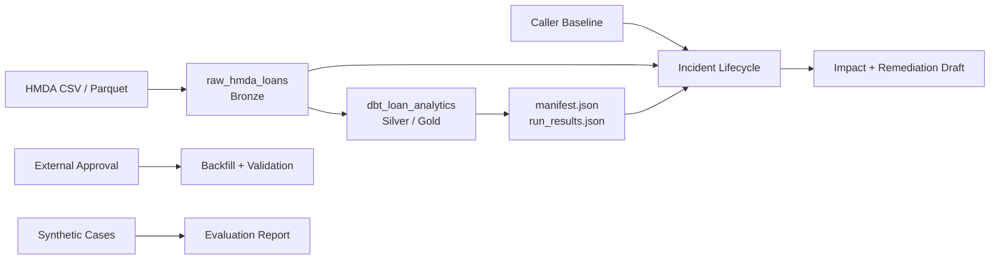

# 아키텍처

HMDA 파일을 DuckDB Bronze에 멱등 적재하고 dbt로 Silver/Gold를 만든다. Reliability control plane은 탐지·영향·remediation만 수행한다. 복구와 평가는 독립 API다. 제품 방향은 [비전](vision.md)을 따른다.

## 구조

Dagster `pipeline_job`은 `raw_hmda_loans`, `dbt_loan_analytics` 순서만 조율한다. Lifecycle은 baseline 공급 정책 전까지 graph에서 제외한다.

## 데이터 계약

| 구분 | 계약 |
|---|---|
| 원천 | `data/raw/hmda`, CSV/Parquet |
| 필수 컬럼 | `activity_year`, `state_code`, `county_code`, `loan_purpose`, `action_taken`, `loan_amount`, `income` |
| Bronze | `raw.hmda_loans`; `source_file`, `source_file_name`, `source_year`, `ingested_at` 추적 |
| 파티션 | `source_year`; 선택적 `source_file_name` |
| Silver | `staging.stg_hmda_loans` dbt view |
| Gold | `marts.mart_hmda_loan_outcomes` dbt table; grain은 `activity_year + state_code + loan_purpose` |

필수 컬럼은 존재 계약이다. `state_code`, `county_code`는 Null 허용. Staging은 Null 보존, mart는 완전한 grain만 집계한다.

전체 적재는 raw table 교체. 파티션 적재는 임시 table 검증 후 transaction overwrite. 지원하지 않는 파일은 발견 단계에서 제외한다.

## Dagster

- Group: `raw_hmda_loans`는 `bronze`, `dbt_loan_analytics`는 `silver_gold`.
- Asset은 `project_pivot.data_operations` 함수 호출과 metadata 기록만 담당.
- Resource는 기본적으로 dbt build 실행.
- Definitions: asset 2개, job 1개, resource 1개.
- Schedule, sensor, asset check 없음.

## Incident lifecycle

`run_incident_lifecycle(request, baseline)`:

1. Raw metadata와 실제 current partition profile 측정.
2. Baseline/current asset·partition 검증.
3. 모든 incident 탐지.
4. 각 incident의 dbt downstream 영향과 remediation draft 생성.
5. 탐지 순서 유지, evidence·affected asset·action 중복 제거 후 반환.

Lifecycle은 read-only다. Approval 생성, backfill, post-backfill validation, synthetic evaluation, report 파일 생성을 하지 않는다.

- Recovery: 외부 approval을 받은 `execute_approved_backfill()`이 실행.
- Evaluation: `build_evaluation_report()`, `write_evaluation_report()`가 synthetic case 평가.

## 경계

| 포함 | 제외 |
|---|---|
| 로컬 DuckDB와 HMDA 적재 | 원천 다운로드, lakehouse, 분산처리 |
| dbt staging/mart/test/lineage | 대출 정책, 신용 위험 ML |
| 실제 baseline/current 규칙 탐지 | 범용 자동 RCA Agent |
| 승인 gate와 backfill 검증 API | human approval UI, 감사 시스템 |
| 결정론적 remediation draft | 자동 코드 수정, dbt compile 검증 |
| 로컬 Dagster graph와 evaluation report | cloud 배포, production SLO, 장기 모니터링 |
