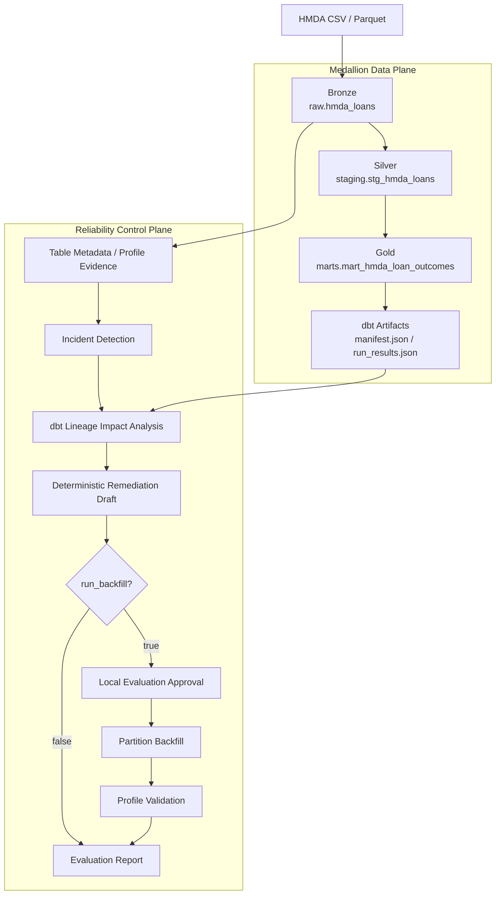
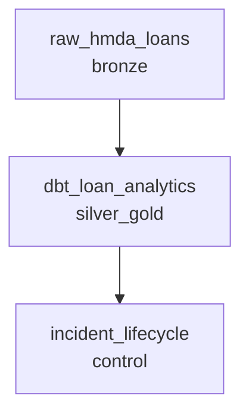

# 아키텍처

## 현재 범위

이 프로젝트는 로컬 Medallion Architecture를 사용한다. HMDA 공개 대출 신청 파일을 Bronze에 멱등 적재하고, dbt로 Silver와 Gold를 만든다. Reliability control plane은 이 데이터 계층의 품질 이상을 탐지하고 영향 분석, remediation, 재처리 검증을 수행한다.

제품 방향과 단계별 목표는 [비전](vision.md)을 따른다.

## Medallion 계층

| 계층 | 데이터 객체 | 역할 | 저장 방식 |
|---|---|---|---|
| Bronze | `raw.hmda_loans` | 원천 데이터와 적재 추적 정보 보존 | DuckDB table |
| Silver | `staging.stg_hmda_loans` | 분석 타입 정규화와 컬럼 계약 적용 | dbt view |
| Gold | `marts.mart_hmda_loan_outcomes` | 연도·주·대출 목적별 결과 집계 | dbt table |

Dagster는 Bronze를 `bronze` group으로 관리한다. Silver와 Gold는 하나의 dbt build에서 함께 생성되므로 `silver_gold` group의 단일 asset으로 묶는다. Incident lifecycle은 데이터 계층과 분리된 `control` group에 둔다.

## 데이터 흐름

주 데이터 흐름은 `Bronze -> Silver -> Gold`다. Control plane은 Bronze의 metadata와 profile을 관측하고, dbt artifact로 Gold까지의 downstream 영향을 계산한다. Mart 데이터를 incident 분석에서 직접 조회하지는 않는다.

`run_backfill=false`이면 remediation 초안에서 evaluation으로 진행한다. `run_backfill=true`이면 로컬 평가용 승인 객체를 자동 생성하고, 대상 partition을 재적재한 뒤 profile을 검증한다.

## HMDA 데이터 계약

| 구분 | 계약 |
|---|---|
| 원천 경로 | `data/raw/hmda` |
| 지원 형식 | CSV, Parquet |
| 필수 컬럼 | `activity_year`, `state_code`, `county_code`, `loan_purpose`, `action_taken`, `loan_amount`, `income` |
| raw 테이블 | `raw.hmda_loans` |
| 추적 컬럼 | `source_file`, `source_file_name`, `source_year`, `ingested_at` |
| 파티션 선택 | `source_year`, 선택적 `source_file_name` |
| mart grain | `activity_year + state_code + loan_purpose` |

필수 컬럼은 컬럼 존재 계약이다. `state_code`와 `county_code` 값은 Null일 수 있다. staging은 `state_code` Null을 보존하고, mart는 grain이 완전한 행만 집계한다.

전체 적재는 raw 테이블을 교체한다. 파티션 적재는 대상 행을 임시 테이블에서 검증한 뒤 트랜잭션으로 덮어써 중복을 막는다. 지원하지 않는 파일은 발견 단계에서 제외한다.

## 실행 구조

HMDA ingest를 작은 샘플부터 직접 확인하려면
[HMDA ingest 눈으로 확인하기](hmda_ingestion_review_guide.md)를 따른다.

`pipeline_job`은 위 세 asset을 의존성 순서로 실행한다. asset은 도메인 로직을 구현하지 않고 `project_pivot.pipeline` 실행 함수를 호출하며 Dagster metadata만 기록한다.

Dagster resource는 기본적으로 dbt build를 실행한다. CLI에서는 `--run-dbt-build`를 지정해야 새 dbt artifact를 만들며, incident impact analysis에는 유효한 artifact가 필요하다. `run_backfill`의 기본값은 `false`다.

등록된 정의는 asset 3개, `pipeline_job` 1개, pipeline resource 1개다. 현재 schedule, sensor, asset check는 없다.

## Incident lifecycle

1. raw table metadata와 partition profile을 생성한다.
2. 기본 end-to-end case는 row count를 줄여 `volume_drop`을 시뮬레이션한다.
3. 탐지 결과에 severity, owner, evidence reference를 포함한다.
4. dbt artifact로 downstream 영향을 계산한다.
5. 결정론적 LangGraph workflow가 RCA 요약과 remediation action을 만든다.
6. `run_backfill=true`이면 로컬 평가용 승인 객체를 생성하고 partition을 재적재한 뒤 profile row count를 검증한다.
7. synthetic case의 detection/action 성공률을 Markdown report로 기록한다.

승인 validator는 승인되지 않은 요청을 차단한다. 다만 현재 pipeline runner는 로컬 backfill 검증을 위해 승인 객체를 자동 생성하므로 외부 human approval workflow는 아직 없다.

## 컴포넌트 책임

| 컴포넌트 | 책임 | 주요 출력 |
|---|---|---|
| `hmda_data.ingestion` | 파일 발견, 필수 컬럼 검증, 연도/파일 파티션 적재 | `raw.hmda_loans` |
| dbt | staging, mart, test, lineage 생성 | 모델, `manifest.json`, `run_results.json` |
| profiling/metadata | raw table의 행 수, Null 비율, schema와 metadata 수집 | evidence |
| detection | baseline/current profile 비교와 기본 이상 탐지 | incident |
| impact | dbt artifact 기반 downstream 영향 분석 | lineage evidence, affected assets |
| remediation | 결정론적 workflow로 RCA 요약과 조치 초안 생성 | suggested actions |
| recovery | 승인 gate 이후 파티션 재적재와 profile 검증 | backfill result |
| evaluation | 탐지·조치 성공률 계산 | Markdown report |
| Dagster | 의존성, config, materialization metadata | asset events |

## 현재 경계

| 포함 | 제외 |
|---|---|
| 로컬 DuckDB와 파일 기반 HMDA 적재 | 원천 다운로드 클라이언트 |
| dbt staging/mart와 기본 테스트 | 대출 승인 정책·신용 위험 ML |
| 규칙 기반 탐지와 volume drop end-to-end 시뮬레이션 | 범용 자동 RCA Agent |
| 승인 contract와 로컬 backfill 검증 | 외부 human approval UI와 감사 시스템 |
| 결정론적 remediation 초안 | 자동 코드 수정과 dbt compile 검증 |
| Dagster asset graph | schedule, sensor, asset check, cloud deployment |
| Markdown evaluation report | production SLO와 장기 모니터링 |
