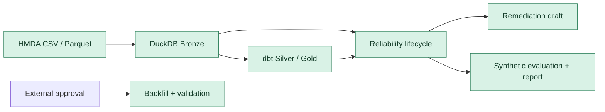
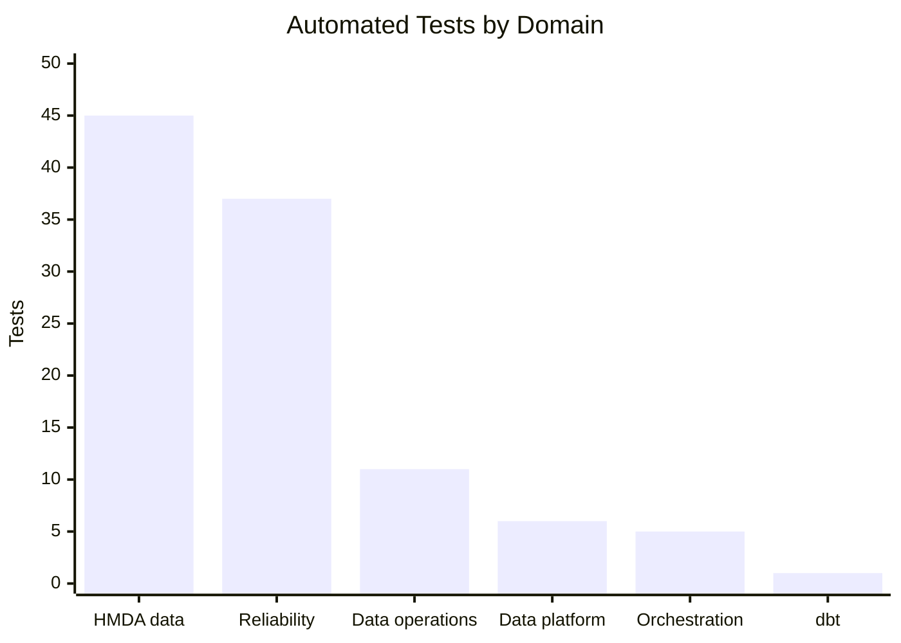

# Development Status: Core Path Validated

> **기준일:** 2026-08-02 | **상태:** 🟢 안정적 진행 | **품질 게이트:** 🟢 통과

**기록 시점에 핵심 data와 reliability 경로는 구현·검증됐지만 delivery traceability는 보완이 필요했다.** 전체 automated test는 통과했으며, 활성 OpenSpec change의 task artifact 부재와 원격 미공개 상태를 후속 과제로 기록했다.

> [!NOTE]
> 이 문서는 2026-08-02 repository snapshot이다. Test 수, Git 상태와 commit 차이는 이후 변경을 자동 반영하지 않는다.

## Executive Summary

Project Pivot은 원천 적재, dbt 변환, Dagster orchestration, reliability lifecycle와 승인 후 recovery/evaluation을 분리된 경계로 제공한다.

| Signal | Current state | Evidence |
| --- | --- | --- |
| 자동화 테스트 | 🟢 통과 | 108 passed, 14.58s |
| 작업 트리 | 🟢 정리됨 | Git tracked 변경 없음 |
| 구현 범위 | 🟢 핵심 경로 확보 | 6개 도메인, dbt Silver/Gold 모델 |
| 최근 delivery | 🟡 로컬 선행 | `origin/main` 대비 5 commits |
| 변경 추적 | 🟡 보완 필요 | 활성 OpenSpec change에 task artifact 없음 |

## System Coverage



| Capability | Status | Implementation signal |
| --- | --- | --- |
| HMDA data | 🟢 구현·검증 | discovery, full/partition load, synthetic case, EDA |
| Data platform | 🟢 구현·검증 | DuckDB helpers, SQL, dbt staging/mart |
| Data operations | 🟢 구현·검증 | request, runner, dbt/raw/lifecycle result |
| Orchestration | 🟢 구현·검증 | Dagster assets, resources, `pipeline_job` |
| Reliability | 🟢 구현·검증 | detection, impact, profile, remediation, recovery, evaluation |
| Documentation | 🟢 기준 정리 | architecture, development, 6개 domain contracts |

## Quality Dashboard

전체 pytest는 기본 설정으로 실행했다. 기본 실행은 병렬 worker, test당 60초 timeout,
strict marker, HTML report 생성을 포함하며 memory/stress test는 제외한다.



Chart는 표에 나열한 6개 implementation domain의 test function 수를 비교한다. 전체 실행 수와의 차이는 이 domain 분류 밖의 test에서 발생한다.

| Metric | Result |
| --- | ---: |
| Executed tests | **108 passed** |
| Elapsed time | **14.58s** |
| Test modules | 28 |
| Highest-tested domain | HMDA data: 45 test functions |
| Second-highest domain | Reliability: 37 test functions |
| Generated artifact | [pytest_report.html](../pytest_report.html) |

### Validation Scope

| Layer | Confirmed by current suite |
| --- | --- |
| Unit/component | data transformation, contracts, detection, impact, remediation |
| Integration | dbt analytics foundation, pipeline materialization, approval backfill validation |
| Workflow boundary | Reliability lifecycle의 read-only 경계와 recovery/evaluation 분리 |
| Excluded by default | memory budget, stress workload |

## Delivery Activity

`main`은 `origin/main`보다 5 commits 앞서 있다. 최근 변경은 제품 기능 자체보다
RPI workflow를 지원하는 agent, research, observability 정비에 집중됐다.

| Recent area | Delivery signal |
| --- | --- |
| Agent capability | `Project Pivot` 단일 실행 agent와 `review-lead` → quality·adversarial review chain 구성 |
| Observability | dogfooding event logging hook 추가 |
| Process | OpenSpec workflow와 RPI 문서 보강 |
| Repository state | 미커밋 tracked 변경 없음 |

## Priority Risks And Actions

| Priority | Item | Why it matters | Recommended action |
| --- | --- | --- | --- |
| P1 | 활성 change의 task artifact 부재 | 구현 완료도·남은 범위를 OpenSpec으로 추적할 수 없음 | `add-synthetic-lifecycle-evaluation`에 proposal, design, tasks 또는 archive 근거를 복원 |
| P1 | 5개 local commits 미push | 원격 기준과 delivery 이력이 분리됨 | review 후 `origin/main`에 publish 또는 PR 생성 |
| P2 | memory/stress 기본 제외 | resource limit의 현시점 회귀를 일반 CI가 포착하지 못함 | 적합한 WSL/Linux 환경에서 별도 resource 검증을 주기 실행 |
| P2 | dbt 테스트 비중이 작음 | Gold/Silver model 증가 시 데이터 계약 회귀 위험이 커짐 | model 추가와 함께 dbt schema/data test 확대 |

## Evidence

- 아키텍처와 lifecycle 경계: [docs/ARCHITECTURE.md](ARCHITECTURE.md)
- 개발 환경과 테스트 실행 규칙: [docs/DEVELOPMENT.md](DEVELOPMENT.md)
- 도메인 계약: [docs/domains/OVERVIEW.md](domains/OVERVIEW.md)
- 현재 활성 OpenSpec change: [openspec/changes/add-synthetic-lifecycle-evaluation/.openspec.yaml](../openspec/changes/add-synthetic-lifecycle-evaluation/.openspec.yaml)
- 최신 테스트 결과: [pytest_report.html](../pytest_report.html)

## Snapshot

```text
Overall status      STABLE / IN PROGRESS
Quality gate        108 passed
Core path           HMDA -> DuckDB -> dbt -> Reliability
Delivery readiness  Needs OpenSpec traceability and remote publication
```
