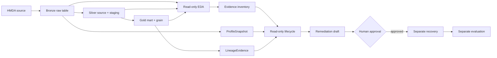

# Foundation Readiness Dashboard

> **Snapshot:** 2026-08-03 · **Status:** Draft

> [!IMPORTANT]
> **현재 판단:** 핵심 data plane과 reliability 실행 경계는 코드와 테스트 근거가 있다. EDA runtime evidence와 최종 readiness 기준이 남아 있어 Foundation 전체는 아직 `ready`가 아니다.

## 한눈에 보기

| 신호 | 현재 상태 |
| --- | --- |
| 🟡 전체 readiness | `Partial` |
| 🧪 pytest test case | `95/95` 통과 |
| 🧪 dbt test case | `18/18` 통과 |
| 📝 OpenSpec task | `7/18` 완료 |
| ⚠️ 주요 blocker | EDA fixture invariant, notebook smoke, 실제 source report, readiness evidence inventory |

```text
Test cases  ██████████  113/113 passed
pytest      ██████████   95/95 passed
dbt         ██████████   18/18 passed
OpenSpec    ████░░░░░░   7/18 task complete
```

진행바는 실행한 test case의 통과 수와 전체 수를 표시한다.[^progress]

## Capability 흐름



`Data plane`의 변환, read-only evidence, lifecycle 판단, 승인 후 side effect를 서로 다른 readiness capability로 확인한다.[^boundary]

## 세부 readiness 신호

각 행은 별도로 확인할 수 있는 capability다. `🟡 Draft`는 아직 `ready` evidence가 없음을 뜻한다.

| Capability | 상태 | 테스트 진행도 | 확인할 내용 | 근거 |
| --- | --- | --- | --- | --- |
| HMDA source 입력 | ✅ Ready | ██████████ 7/7 | CSV·Parquet 입력 경로와 source row 보존 | [Bronze](data-pipeline-bronze.md) |
| Bronze raw table | ✅ Ready | ██████████ 7/7 | raw table, metadata, 핵심 column | [Bronze](data-pipeline-bronze.md) |
| Partition ingestion | ✅ Ready | ██████████ 5/5 | 같은 partition 재실행 시 중복 없음 | [Bronze](data-pipeline-bronze.md) |
| Silver source contract | ✅ Ready | ██████████ 18/18 | required column과 source 품질 test | [Silver](data-pipeline-silver.md) |
| Silver staging | ✅ Ready | ██████████ 18/18 | 타입 변환과 raw 보존 경계 | [Silver](data-pipeline-silver.md) |
| Gold mart grain | ✅ Ready | ██████████ 18/18 | mart grain과 grouping 확정 | [Gold](data-pipeline-gold.md) |
| Gold analysis metrics | ✅ Ready | ██████████ 18/18 | approval·denial과 downstream metric 보존 | [Gold](data-pipeline-gold.md) |
| EDA schema·volume | ✅ Ready | ██████████ 11/11 | schema, 전체 row, `activity_year` volume | [EDA](eda.md) |
| EDA quality baseline | 🟡 Partial | ██████████ 11/11 | required column null과 freshness | [EDA](eda.md) |
| EDA domain observation | 🟡 Partial | ██████████ 25/25 | code 분포, numeric summary, 의심 값, grain | [EDA](eda.md) |
| Evidence retention | ✅ Ready | ██████████ 13/13 | `Evidence`, `ProfileSnapshot`, `LineageEvidence` 기록 | [Observability](observability.md) |
| Reliability contracts | ✅ Ready | ██████████ 7/7 | `Incident`, `Approval`과 관련 contract 경계 | [Reliability](reliability.md) |
| Read-only lifecycle | ✅ Ready | ██████████ 15/15 | 관찰·판단이 approval과 side effect를 만들지 않음 | [Reliability](reliability.md) |
| Recovery boundary | ✅ Ready | ██████████ 4/4 | 승인 뒤 별도 backfill·validation 실행 | [Reliability](reliability.md) |
| Evaluation boundary | ✅ Ready | ██████████ 2/2 | lifecycle과 분리된 evaluation report | [Reliability](reliability.md) |
| Pipeline execution | 🟡 Partial | ██████████ 5/5 | Bronze 뒤 dbt 실행 순서와 asset 경계 | [Orchestration](orchestration.md) |
| Foundation decision | ⚠️ Blocked | N/A | 완료 기준과 `ready` 판정 조건 | 이 dashboard |

## 세부 gap

| Capability | 현재 gap | 필요한 결정 또는 증거 |
| --- | --- | --- |
| EDA quality baseline | 실제 source observation을 현재 snapshot으로 재실행·기록하지 않음 | source path, 실행 시점, 결과 evidence 기록 |
| EDA domain observation | deterministic fixture의 exact invariant task가 미완료 | distribution, numeric summary, anomaly, grain expected values 고정 |
| EDA notebook smoke | runtime smoke task와 실행 command가 미완료 | valid·malformed fixture smoke command 확정 |
| Evidence inventory | capability별 OpenSpec·spec·test 근거가 한 표에 연결되지 않음 | evidence inventory와 archive/spec 경로 연결 |
| Pipeline execution | orchestration 관련 task와 실제 pipeline evidence가 분리됨 | Bronze→dbt 실행 evidence와 제외 범위 확인 |
| Foundation decision | 최소 완료 기준이 미확정 | capability별 `ready` 판정 checklist 확정 |

## 다음 행동

| 우선순위 | 행동 | 완료 조건 |
| --- | --- | --- |
| P1 | EDA fixture invariant 완료 | task 2.1이 체크되고 exact expected values가 고정됨 |
| P1 | Notebook smoke 고정 | task 3.1·3.2가 완료되고 실행 command가 문서화됨 |
| P1 | 실제 source observation 기록 | task 5.4 결과에 source path·시점·주요 결과가 남음 |
| P1 | Evidence inventory 연결 | capability별 OpenSpec·spec·test 근거가 연결됨 |
| P1 | Foundation 완료 기준 결정 | capability별 `ready` 판정 조건이 문서에 고정됨 |
| P2 | Pipeline evidence 연결 | Bronze→dbt 실행 결과와 제외 범위가 확인됨 |

## 확인 명령

```bash
uv run pytest tests/hmda_data/ tests/reliability/
uv run dbt test --project-dir dbt
uv run ruff check src tests
uv run rumdl check docs/development/foundation
```

## 근거

- OpenSpec: `hmda-eda-foundation-extension`, 18 tasks 중 7 completed
- Focused tests: 95 passed (`tests/hmda_data/`, `tests/reliability/`, `tests/dbt/`, `tests/orchestration/`)
- dbt tests: 18 passed, 0 warning, 0 error
- Ruff: `uv run ruff check src tests` passed
- Runtime boundary: `docs/ARCHITECTURE.md`

실제 source observation, notebook smoke와 미완료 OpenSpec task는 다음 snapshot에서 갱신한다.

## 부록: 시각화 읽는 법

- 🟡 `Partial`: 테스트는 통과했지만 OpenSpec task 또는 실행 evidence가 남아 있음
- ✅ `Ready`: 연결된 test case가 모두 통과하고 현재 판정 조건을 충족함
- ⚠️ `Blocker`: 다음 판단을 막는 미결정 사항 또는 evidence gap

[^progress]: capability별 진행도는 연결된 test case의 `passed/collected`다. 현재 aggregate는 pytest 95/95와 dbt 18/18이며, Foundation decision처럼 test case로 판정하지 않는 항목은 `N/A`로 표시한다.

[^boundary]: Bronze·Silver·Gold의 data plane, EDA와 profile의 read-only evidence, reliability lifecycle의 판단, approval 이후 recovery·evaluation의 side effect를 서로 다른 책임 경계로 본다.
