# Project Pivot MVP

> **Goal:** 로컬 HMDA 데이터로 최소 Data Lake를 end-to-end로 실행하고,
> 그 위에서 evidence-first Reliability와 제한된 Agentic review가 안전하게 동작함을 증명한다.

Project Pivot MVP는 단순한 ETL 데모도, LLM을 붙인 anomaly demo도 아니다.
**신뢰할 수 있는 데이터 상태를 만들고 → 문제를 결정론적으로 증명하고 → AI가 그
근거를 검토 가능한 형태로 해석하며 → 사람의 승인 뒤에만 복구하는 작은 완결 시스템**을
증명한다.

## MVP Value

MVP는 두 capability가 함께 존재해야 한다.

### Minimal Data Lake

HMDA Data가 local source를 검증해 DuckDB Bronze까지 적재하고, Data Platform이 그 Bronze를
dbt staging/mart로 변환한다. 결과는 downstream Reliability가 다시 추적할 수 있는 data와
dbt evidence를 남긴다.

### Agentic Reliability

데이터 이상에 대한 deterministic truth layer를 먼저 만들고, 제한된 Agentic reviewer가
그 evidence와 기존 `RemediationDraft`를 설명·검토한다. AI 판단은 관찰·평가 가능해야 하며
실제 state change 권한은 갖지 않는다.

**Data Lake만 있거나 Agentic demo만 있어서는 Project Pivot MVP가 아니다.**

## System Proof

```mermaid
flowchart LR
    source["HMDA source"] --> bronze["Bronze"]
    bronze --> analytical["dbt staging / marts"]
    analytical --> evidence["Data + dbt evidence"]
    evidence --> reliability["Deterministic Reliability"]
    reliability --> incident["Incident + RemediationDraft"]

    incident --> agent["Bounded Agentic Review"]
    agent --> review["Review Evidence"]
    review --> guard["Deterministic Review Validation"]

    incident --> proposal["Validated RecoveryProposal"]
    proposal --> human["Human Approval"]
    guard -. advisory .-> human
    human --> recovery["Approved Recovery"]
    recovery --> verify["Deterministic Re-validation"]

    dagster["Dagster"] -. data plane .-> bronze
    dagster -. data plane .-> analytical
```

Dagster는 최소 Data Lake의 data plane을 실행한다. Reliability control-plane, Agentic
review와 approval을 data plane에 암묵적으로 자동 결합하지 않는다. Agentic review는 MVP에서
반드시 증명하지만 기존 deterministic `RecoveryProposal`/approval/recovery contract의 권한
조건을 대체하거나 새로운 authorization prerequisite를 만들지 않는다.

## System Invariants

구현 방식이나 tool이 달라져도 다음 경계는 유지한다.

1. **Deterministic truth first** — detection과 핵심 safety 판단을 LLM에 맡기지 않는다.
2. **Evidence-bound AI** — Agentic 판단은 저장소가 제공한 evidence와 deterministic
   `RemediationDraft`를 근거로 한다.
3. **Proposal-bound approval** — human approval은 검증된 `RecoveryProposal`에 결합되며
   `RemediationDraft`나 Agentic output 자체를 승인하는 것이 아니다.
4. **Advisory, not authoritative** — Agentic review는 human decision을 보조하지만 기존
   approval/recovery authority를 획득하거나 변경하지 않는다.
5. **Human-controlled mutation** — AI output만으로 데이터 state를 변경할 수 없다.
6. **Locally reproducible core** — Data Lake, Reliability와 safety contract는 외부 model
   호출 없이도 로컬에서 반복 검증할 수 있다.
7. **Observable live judgment** — 실제 Agentic invocation은 입력 근거, model/prompt 조건,
   결과와 실행 비용·성능을 비교·검토할 evidence를 남긴다.
8. **Acceptance over feature count** — incident type이나 기능 수가 아니라 완결된 proof로
   MVP를 판단한다.

## Domain Completion Gates

Domain gate는 개발 순서가 아니다. 각 canonical domain이 MVP에서 제공해야 하는 책임의
완료 경계다.

| Domain | MVP contribution | Completion signal |
| --- | --- | --- |
| [HMDA Data](hmda-data.md) | local source validation, Source→Bronze 적재와 재현 가능한 synthetic case | 같은 입력에서 동일한 logical Bronze state와 case identity를 다시 만들 수 있다. |
| [Data Platform](data-platform.md) | DuckDB/dbt analytical layer와 artifact/lineage primitives | Bronze → staging → mart와 채택된 dbt evidence를 다시 추적할 수 있다. |
| [Data Operations](data-operations.md) | ingestion/dbt/reliability의 실행·채택 boundary와 failure evidence | candidate/current artifact가 분리되고 mutation 가능 failure의 실제 결과와 reconciliation이 명시된다. |
| [Reliability](reliability.md) | deterministic reliability, bounded Agentic review와 proposal-bound recovery | 대표 incident가 evidence → advisory review + validated proposal/approval → recovery → re-validation으로 닫힌다. |
| [Orchestration](orchestration.md) | 최소 Data Lake data plane의 반복 실행 | Bronze와 dbt analytical layer를 Dagster dependency로 재실행할 수 있다. |

## MVP Acceptance

MVP는 하나의 current revision에서 다음 **system proof**가 모두 성립하면 완료한다.

- **Data Lake proof** — HMDA source가 Bronze와 dbt analytical layer까지 재현 가능하게 흐른다.
- **Reliability proof** — 대표 synthetic incident를 deterministic evidence로 탐지·설명하고
  recovery 뒤 같은 기준으로 다시 검증한다.
- **Agentic contract proof** — structured review contract, evidence binding, forbidden-action
  guardrail과 evaluation을 deterministic하게 반복 검증할 수 있다.
- **Live Agentic proof** — 같은 revision에서 실제 model invocation이 evidence와
  `RemediationDraft`를 기반으로 structured review를 최소 한 번 만들고, model/config,
  prompt identity, evidence refs, output, latency와 제공 가능한 usage(token/cost)를 invocation
  evidence로 남긴다. 이 proof는 외부 model availability를 요구할 수 있으며 deterministic
  regression과 동일하게 취급하지 않는다.
- **Safety proof** — Agentic output은 deterministic guardrail과 proposal-bound human approval을
  우회해 mutation을 일으킬 수 없고, LLM availability 자체가 recovery authority를 부여하거나
  변경하지 않는다.
- **Reproducibility proof** — 정상, incident, recovery와 주요 failure/retry의 deterministic
  결과를 같은 revision에서 다시 설명할 수 있고 live invocation 결과는 evidence로 보존된다.

각 proof의 세부 완료 조건은 owning domain 문서가 소유한다.

## Scope

**In scope**

- 로컬 HMDA CSV/Parquet와 Source→DuckDB Bronze 적재
- dbt staging/marts와 artifact evidence
- Dagster local data plane
- deterministic profiling, incident, impact, `RemediationDraft`, recovery와 evaluation
- 대표 synthetic incident를 사용하는 최소 Agentic review
- Agentic contract evaluation과 최소 한 번의 observable live model proof
- validated `RecoveryProposal`, human approval, recovery와 re-validation

**Out of scope**

- cloud deployment와 distributed lakehouse
- 범용 multi-dataset ingestion platform
- 모든 incident type의 완전한 기능 parity
- LLM 기반 anomaly detection 또는 승인 없는 automatic recovery
- autonomous RCA, multi-agent workflow와 approval UI
- production SLO, security-grade authorization와 multi-host coordination
- 특정 LLM provider 또는 LLMOps vendor를 MVP의 canonical source로 고정하는 것

## Status

현재 구현 상태의 canonical axis는 domain이다. [`status.yml`](status.yml)은 domain state와
blocker를 소유하고, [`status.md`](status.md)는 이를 사람이 판단하기 쉽게 설명한다.
System proof 상태는 domain state와 blocker에서 파생하며 별도의 독립 progress 축으로
중복 관리하지 않는다.

## Reading Order

1. 이 문서에서 MVP 가치, invariants와 전체 acceptance를 확인한다.
2. 작업 대상 domain 문서에서 해당 domain의 completion gate를 확인한다.
3. [`status.md`](status.md)에서 현재 evidence와 blocker를 확인한다.
4. 세부 contract는 [`docs/domains`](../../domains/OVERVIEW.md), OpenSpec과 tests에서 확인한다.

## References

- [`../../ARCHITECTURE.md`](../../ARCHITECTURE.md): 시스템과 execution boundary
- [`../../domains/OVERVIEW.md`](../../domains/OVERVIEW.md): canonical domain ownership
- [`../../../DEVELOPMENT.md`](../../../DEVELOPMENT.md): 현재 개발 환경과 active tool choices
