# Project Pivot MVP

> **Goal:** 로컬 HMDA 데이터로 최소한의 Data Lake를 end-to-end로 실행하고,
> 그 위에서 evidence-first Reliability와 제한된 LLM reviewer가 함께 동작함을 증명한다.

Project Pivot MVP는 단일 incident recovery 데모가 아니다. **작지만 실제로 실행되는
Data Lake**와 **안전 경계 안에서 판단을 보조하는 Agentic capability**를 하나의
검증 가능한 시스템으로 연결하는 것이 완료 기준이다.

## MVP System

```mermaid
flowchart LR
    source["HMDA CSV / Parquet"] --> bronze["DuckDB Bronze"]
    bronze --> transform["dbt staging / marts"]
    transform --> artifacts["dbt evidence"]
    bronze --> reliability["Deterministic Reliability"]
    artifacts --> reliability
    reliability --> draft["Incident + RemediationDraft"]
    draft --> reviewer["Bounded LLM Reviewer"]
    reviewer --> review["Structured Review"]
    review --> human["External Human Approval"]
    human --> recovery["Approved Recovery API"]
    recovery --> verify["Re-validation"]

    dagster["Dagster"] -. data plane .-> bronze
    dagster -. data plane .-> transform
```

Reliability 판단과 recovery는 Dagster data plane에 자동으로 결합하지 않는다.
LLM은 deterministic evidence와 draft를 검토하지만 detection, approval 또는 mutation
권한을 소유하지 않는다.

## Domain Milestones

| Domain | MVP에서 증명하는 것 | 완료 경계 |
| --- | --- | --- |
| [HMDA Data](hmda-data.md) | 로컬 원천을 재현 가능하게 발견·검증·적재하고 synthetic case를 만들 수 있다. | 같은 입력이 안정적인 Bronze evidence를 만들고 원천을 훼손하지 않는다. |
| [Data Platform](data-platform.md) | DuckDB Bronze를 dbt staging/mart로 변환하고 artifact identity를 보존한다. | raw → staging → mart와 dbt evidence를 다시 추적할 수 있다. |
| [Data Operations](data-operations.md) | ingestion과 dbt 실행을 하나의 명시적 실행 계약으로 조합한다. | 실패한 candidate가 current state를 오염시키지 않고 성공 결과만 채택된다. |
| [Reliability](reliability.md) | deterministic incident/recovery와 최소 LLM review를 안전하게 연결한다. | synthetic incident가 evidence → LLM review → approval → recovery → verification으로 이어진다. |
| [Orchestration](orchestration.md) | 최소 Data Lake data plane을 Dagster에서 실행한다. | Bronze와 dbt asset graph를 로컬에서 재실행할 수 있다. |

Domain milestone은 순차적인 프로젝트 phase가 아니다. 각 domain이 MVP에서 맡는
책임의 완료 gate이며, 구체적인 contract는 canonical domain 문서와 OpenSpec이 소유한다.

## Minimal Agentic Capability

MVP의 Agentic 기능은 하나의 bounded reviewer로 제한한다.

입력:

- deterministic `Incident`
- incident evidence와 impact
- deterministic `RemediationDraft`

출력:

- 사고와 evidence 요약
- 사용한 evidence 식별자
- 가능한 원인 설명
- 기존 draft 검토 결과
- 위험 또는 불확실성

최소 acceptance는 실제 model invocation이 structured output을 만들고, 어떤 evidence,
prompt/version, model과 결과를 사용했는지 재현 가능한 실행 evidence가 남는 것이다.

LLM은 새로운 recovery 권한을 만들지 않는다. 최종 state change는 기존 approval과
recovery contract가 계속 소유한다.

## Scope

**In scope**

- 로컬 HMDA CSV/Parquet
- DuckDB Bronze
- dbt staging/marts와 artifact evidence
- Dagster local data plane
- deterministic Reliability detection, impact, remediation, approved recovery와 evaluation
- 최소 한 개 synthetic incident를 사용하는 bounded LLM review
- Agentic invocation의 최소 trace와 deterministic safety check

**Out of scope**

- cloud deployment와 distributed lakehouse
- multi-dataset 또는 범용 ingestion platform
- 네 incident type의 완전한 기능 parity를 MVP 조건으로 강제
- LLM 기반 detection 또는 승인 없는 automatic recovery
- multi-agent workflow, autonomous RCA, approval UI
- 특정 LLMOps vendor를 canonical source로 사용하는 운영 체계

## Done

MVP는 다음을 **한 current revision에서** 함께 증명하면 완료한다.

1. HMDA 원천이 Bronze → dbt staging/mart까지 재현 가능하게 흐른다.
1. Dagster가 최소 Data Lake data plane을 로컬에서 실행한다.
1. synthetic incident가 deterministic evidence와 `RemediationDraft`를 만든다.
1. LLM reviewer가 그 evidence와 draft만을 근거로 structured review를 만든다.
1. LLM 출력만으로 mutation할 수 없고 외부 approval 뒤에만 recovery가 실행된다.
1. recovery 뒤 deterministic verification과 failure/retry evidence를 확인할 수 있다.

현재 상태와 남은 gap은 [`status.md`](status.md)에서 확인한다.

## Reading Order

1. 이 문서에서 MVP 전체 목표와 domain milestone을 확인한다.
1. 작업 domain의 MVP 문서에서 완료 경계와 비목표를 확인한다.
1. [`status.md`](status.md)에서 현재 구현과 검증 gap을 확인한다.
1. 세부 동작은 [`docs/domains`](../../domains/OVERVIEW.md), OpenSpec Spec과 tests에서 확인한다.

## References

- [`../../ARCHITECTURE.md`](../../ARCHITECTURE.md): 시스템과 execution boundary
- [`../../domains/OVERVIEW.md`](../../domains/OVERVIEW.md): canonical domain ownership
- [`../../../DEVELOPMENT.md`](../../../DEVELOPMENT.md): 개발 환경과 active tool choices
