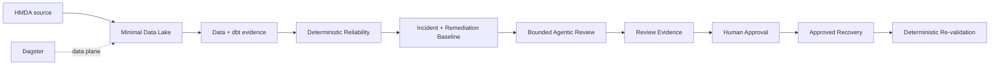

# Project Pivot MVP

> **Goal:** 로컬 HMDA 데이터로 최소 Data Lake를 end-to-end로 실행하고,
> 그 위에서 evidence-first Reliability와 제한된 Agentic review가 안전하게 동작함을 증명한다.

Project Pivot MVP는 단순한 ETL 데모도, LLM을 붙인 anomaly demo도 아니다.
**신뢰할 수 있는 데이터 상태를 만들고 → 문제를 결정론적으로 증명하고 → AI가 그
근거를 검토 가능한 형태로 해석하며 → 사람의 승인 뒤에만 복구하는 작은 완결 시스템**을
증명한다.

## MVP Value

MVP는 두 capability가 함께 존재해야 한다.

### Minimal Data Lake

HMDA 원천을 로컬에서 재현 가능하게 수집·적재·변환하고, downstream 판단이 신뢰할 수
있는 데이터 state와 dbt evidence를 제공한다.

### Agentic Reliability

데이터 이상에 대한 deterministic truth layer를 먼저 만들고, 제한된 Agentic reviewer가
그 evidence를 설명·검토한다. AI 판단은 관찰·평가 가능해야 하며 실제 state change
권한은 갖지 않는다.

**Data Lake만 있거나 Agentic demo만 있어서는 Project Pivot MVP가 아니다.**

## System Proof

Dagster는 최소 Data Lake의 data plane을 실행한다. Reliability control-plane, Agentic
review와 approval을 data plane에 암묵적으로 자동 결합하지 않는다.

## System Invariants

구현 방식이나 tool이 달라져도 다음 경계는 유지한다.

1. **Deterministic truth first** — detection과 핵심 safety 판단을 LLM에 맡기지 않는다.
2. **Evidence-bound AI** — Agentic 판단은 저장소가 제공한 evidence와 deterministic
   remediation baseline을 근거로 한다.
3. **Human-controlled mutation** — AI output만으로 데이터 state를 변경할 수 없다.
4. **Reproducible locally** — 핵심 proof는 cloud infrastructure 없이 다시 실행할 수 있다.
5. **Observable judgment** — Agentic invocation은 입력 근거와 실행 조건, 결과를 비교·재현할
   evidence를 남긴다.
6. **Acceptance over feature count** — incident type이나 기능 수가 아니라 완결된 proof로
   MVP를 판단한다.

## Domain Completion Gates

Domain gate는 개발 순서가 아니다. 각 canonical domain이 MVP에서 제공해야 하는 책임의
완료 경계다.

| Domain | MVP contribution | Completion signal |
| --- | --- | --- |
| [HMDA Data](hmda-data.md) | 신뢰할 수 있는 local source와 재현 가능한 synthetic case | 같은 입력에서 안정적인 Bronze-ready data와 case identity를 다시 만들 수 있다. |
| [Data Platform](data-platform.md) | DuckDB + dbt 기반 최소 analytical lake와 artifact evidence | raw → staging → mart와 그 evidence를 다시 추적할 수 있다. |
| [Data Operations](data-operations.md) | ingestion, dbt와 reliability 사이의 안전한 execution boundary | 실패한 실행이 current state를 오염시키지 않고 성공 결과만 명시적으로 채택된다. |
| [Reliability](reliability.md) | deterministic reliability, bounded Agentic review와 human-controlled recovery | 대표 incident가 evidence → review → approval → recovery → re-validation으로 닫힌다. |
| [Orchestration](orchestration.md) | 최소 Data Lake data plane의 반복 실행 | Bronze와 dbt analytical layer를 Dagster dependency로 재실행할 수 있다. |

## MVP Acceptance

MVP는 하나의 current revision에서 다음 **system proof**가 모두 성립하면 완료한다.

- **Data Lake proof** — HMDA source가 Bronze와 dbt analytical layer까지 재현 가능하게 흐른다.
- **Reliability proof** — 대표 synthetic incident를 deterministic evidence로 탐지·설명하고
  recovery 뒤 같은 기준으로 다시 검증한다.
- **Agentic proof** — 실제 Agentic invocation이 deterministic evidence를 기반으로 검토
  가능한 structured result와 invocation evidence를 남긴다.
- **Safety proof** — Agentic output은 deterministic guardrail과 human approval을 우회해
  mutation을 일으킬 수 없다.
- **Reproducibility proof** — 정상, incident, recovery와 주요 failure/retry 결과를 같은
  revision에서 다시 설명할 수 있다.

각 proof의 세부 완료 조건은 owning domain 문서가 소유한다.

## Scope

**In scope**

- 로컬 HMDA CSV/Parquet
- DuckDB Bronze와 dbt staging/marts
- Dagster local data plane
- deterministic profiling, incident, impact, remediation, recovery와 evaluation
- 대표 synthetic incident를 사용하는 최소 Agentic review
- Agentic invocation evidence와 deterministic safety evaluation
- human approval 뒤의 recovery와 re-validation

**Out of scope**

- cloud deployment와 distributed lakehouse
- 범용 multi-dataset ingestion platform
- 모든 incident type의 완전한 기능 parity
- LLM 기반 anomaly detection 또는 승인 없는 automatic recovery
- autonomous RCA, multi-agent workflow와 approval UI
- production SLO, security-grade authorization와 multi-host coordination
- 특정 LLM provider 또는 LLMOps vendor를 MVP의 canonical source로 고정하는 것

## Status

현재 구현과 검증 gap은 [`status.md`](status.md)에서 관리한다. Domain 문서에는 일시적인
진행 상태를 복제하지 않는다.

## Reading Order

1. 이 문서에서 MVP 가치, invariants와 전체 acceptance를 확인한다.
2. 작업 대상 domain 문서에서 해당 domain의 completion gate를 확인한다.
3. [`status.md`](status.md)에서 현재 evidence와 blocker를 확인한다.
4. 세부 contract는 [`docs/domains`](../../domains/OVERVIEW.md), OpenSpec과 tests에서 확인한다.

## References

- [`../../ARCHITECTURE.md`](../../ARCHITECTURE.md): 시스템과 execution boundary
- [`../../domains/OVERVIEW.md`](../../domains/OVERVIEW.md): canonical domain ownership
- [`../../../DEVELOPMENT.md`](../../../DEVELOPMENT.md): 현재 개발 환경과 active tool choices
