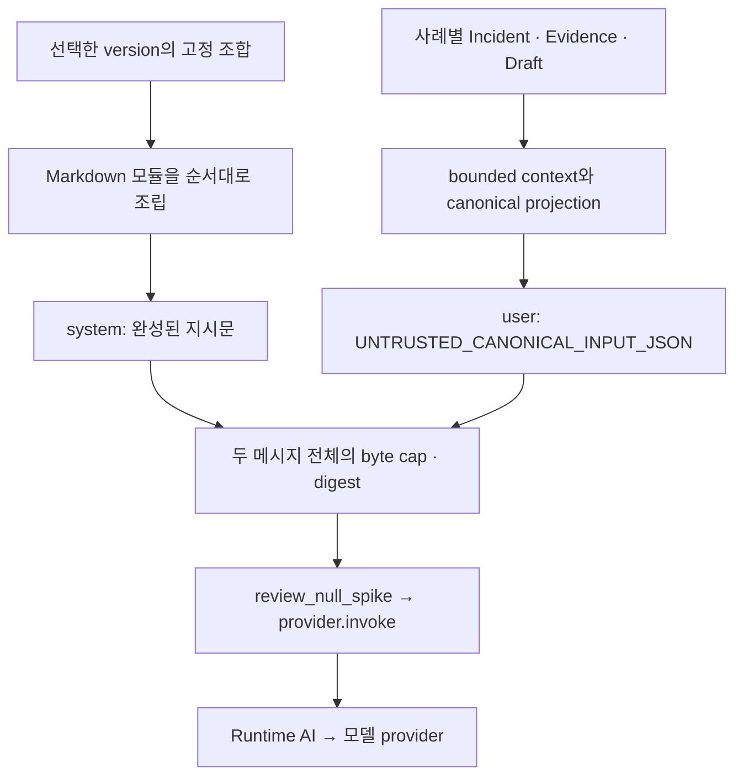

# Review AI Prompt Composition

**프롬프트는 역할이 분명한 Markdown 모듈로 관리하고, 선택한 조합을 system 메시지 하나로 조립해 전달한다. 사례 데이터는 별도 user 메시지에 넣는다.** `v1~v3`는 사용할 모듈과 순서를 정하는 완성된 조합의 식별자다. 같은 규칙을 버전마다 복사하지 않고 같은 파일을 참조해 수정과 재사용의 범위를 분명히 한다.

이 문서는 분할 이유와 편집·확인 절차를 설명한다. 불변 조건은 [Prompt Engineering Spec](../../openspec/specs/review-ai-prompt-engineering/spec.md)이, 실제 모듈 선택·순서는 [`_PROMPT_PARTS`](../../src/hmda_reliability/review_ai/prompt/__init__.py)가 소유한다. 모델 출력의 비교·채택 절차는 [Review AI Evaluation](review-ai-evaluation.md)을 따른다.

## Module Responsibilities

아래 경로는 [prompt/](../../src/hmda_reliability/review_ai/prompt/) 기준이다. 각 모듈은 지시문을 제공하며 사례별 값을 받거나 다른 모듈을 로드하지 않는다. 필드 이름과 전제는 module 작성·재사용 시 확인할 의존 관계다.

| Module | Owns | Reuse assumptions |
| --- | --- | --- |
| [tasks/null_spike.md](../../src/hmda_reliability/review_ai/prompt/tasks/null_spike.md) | HMDA 검토 역할, `null_spike` 범위, 입력을 데이터로 취급하는 규칙 | 같은 사고 유형과 Incident·Evidence·Draft를 검토하는 조합 |
| [policies/language.md](../../src/hmda_reliability/review_ai/prompt/policies/language.md) | 한국어 설명, 식별자·수치 원문 보존 | 현재 Review AI의 네 종류 설명 필드를 사용하는 조합 |
| [policies/advisory.md](../../src/hmda_reliability/review_ai/prompt/policies/advisory.md) | 자문과 실행·승인 권한의 경계 | 같은 자문 경계를 갖는 Review AI 조합 |
| [output/](../../src/hmda_reliability/review_ai/prompt/output/) | 출력 필드·타입·열거값과 JSON 응답 방식 설명 | 같은 [typed output 계약](../../src/hmda_reliability/review_ai/contracts.py). 간략/상세 설명 중 하나를 선택 |
| [guidance/numeric_fidelity.md](../../src/hmda_reliability/review_ai/prompt/guidance/numeric_fidelity.md) | 비율·증감·threshold의 수치 해석 | 같은 deterministic facts와 단위를 사용하는 작업 |
| [guidance/evidence_review.md](../../src/hmda_reliability/review_ai/prompt/guidance/evidence_review.md) | 근거 충실성, 누락·미확정 맥락과 실제 초안 검토 | 제공된 근거 ID, `review_context.gaps`와 Draft가 있는 작업 |
| [guidance/review_value.md](../../src/hmda_reliability/review_ai/prompt/guidance/review_value.md) | 사람 판단에 도움이 되는 검토 기여 | 같은 `utility_contributions` 계약을 사용하는 작업 |
| [examples/utility_contributions.md](../../src/hmda_reliability/review_ai/prompt/examples/utility_contributions.md) | 검토 기여의 형식 예시 | 선택한 출력 필드·열거값과 호환되는 조합. 실제 사례의 사실을 제공하지 않음 |
| [titles/](../../src/hmda_reliability/review_ai/prompt/titles/) | 조합의 표시 제목 | 해당 조합에만 사용 |

정책 모듈도 현재는 **Review AI 안에서 공유**한다. 특히 한국어 정책은 Review AI 출력 필드를 알고 있으므로 다른 agent에 재사용할 때 그 계약을 먼저 확인한다. 출력 설명은 [contracts.py](../../src/hmda_reliability/review_ai/contracts.py)와 [validator.py](../../src/hmda_reliability/review_ai/validator.py)에 맞춰 유지한다. 프롬프트 지시만으로 schema 검증이나 권한 경계가 강제되지는 않는다.

## Choosing A Boundary

**따로 수정하거나 조합에서 따로 선택할 이유가 있을 때 나눈다.** 한 모듈은 인접 파일을 모두 읽지 않아도 목적과 전제를 이해할 수 있는 하나의 책임을 맡는다. 같은 목적의 짧은 규칙은 함께 둔다. 예를 들어 근거와 초안의 충실성을 함께 다루는 현재 검토 지침을 문장마다 파일로 나누지 않는다.

동일한 의미와 전제를 가진 규칙은 기존 파일을 그대로 참조한다. 적용 범위나 의미가 다르면 별도 모듈을 만들고 이름에 차이를 드러낸다. 새 사고 유형이 생기면 작업 모듈부터 분리하고, 출력·정책·수치 지침은 계약이 맞는 것만 재사용한다. 두 번째 실제 consumer의 요구가 생기기 전에는 범용 agent package로 이동하지 않는다.

모듈의 제목·설명에 사례 ID, 현재 관측 수치, 특정 실행의 원인 추정이나 기대 답변을 넣지 않는다. 사례와 정답 oracle은 입력 fixture와 평가 영역에서 관리한다. 형식 예시는 출력 계약을 설명하며 모델이 그대로 복사할 실제 답변을 제공하지 않는다.

## Composition And Delivery

조합은 **표시 제목 → 검토 작업 → 언어 정책 → 출력 설명 → 선택한 검토 지침·예시 → 자문 정책** 순서다. 현재 `v1`은 간략 출력 설명, `v2`는 상세 출력 설명과 형식 예시, `v3`는 상세 출력 설명과 수치·근거·검토 가치 지침을 선택한다. 정확한 파일 목록은 [조합 정의](../../src/hmda_reliability/review_ai/prompt/__init__.py)에서 확인한다.

출력 설명은 조합마다 하나를 선택하고 각 모듈은 한 번만 포함한다. 지침과 예시는 선택한 출력 계약에 맞춘다. 규칙이 충돌하면 작성 단계에서 해결한다. 뒤에 배치했다는 이유로 앞의 규칙을 덮어쓰도록 설계하지 않는다.



[`render_review_prompt()`](../../src/hmda_reliability/review_ai/prompt/__init__.py)는 사례별 입력으로 bounded context와 canonical JSON을 만들고 다음 두 메시지를 반환한다.

| Message | Content |
| --- | --- |
| `system` | 선택한 조합의 Markdown 본문 전체 |
| `user` | `UNTRUSTED_CANONICAL_INPUT_JSON\n` 뒤에 canonical JSON |

[`review_null_spike()`](../../src/hmda_reliability/review_ai/service.py)는 이 `rendered.messages`를 `review_provider.invoke()`에 그대로 전달한다. [Runtime AI adapter](../../src/hmda_reliability/runtime_ai/provider.py)는 같은 메시지로 JSON 객체 응답을 요청한다. 모델은 조립된 텍스트를 받는다. 파일 경로, 이 안내서와 README를 모델이 직접 읽을 필요가 없다.

모듈 선택은 코드의 고정된 조합에서만 수행한다. 원본 데이터 안의 경로·지시문·include 문자열은 user 데이터로 남는다. 모듈 안의 include, 디렉터리 자동 탐색, 사례 값의 system 치환이나 동적 템플릿 엔진은 사용하지 않는다.

## Inspect The Final Messages

Repository root에서 다음 예제를 실행하면 기존 합성 사례 하나에 `v3`를 적용한 최종 지시문, 주입 데이터와 digest를 확인할 수 있다. 모델 호출과 데이터 적재는 수행하지 않는다.

```bash
uv run python - <<'PY'
import json
from pathlib import Path

from hmda_reliability.review_ai.contracts import AgenticReviewInput
from hmda_reliability.review_ai.prompt import render_review_prompt

corpus = json.loads(
    Path("tests/review_ai/evaluation/fixtures/output_quality_v1.json")
    .read_text(encoding="utf-8")
)
case = corpus["cases"][0]
review_input = AgenticReviewInput.model_validate(
    case["review_input"] | {"prompt_identity": {"version": "v3"}}
)
rendered = render_review_prompt(review_input, max_prompt_bytes=65_536)

for message in rendered.messages:
    print(f"=== {message.role} ===")
    print(message.content)
print(rendered.prompt_digest, rendered.prompt_bytes)
PY
```

이 예제의 fixture revision은 로컬 메시지 확인용이다. 실제 모델 실행과 사람 평가에는 [평가 가이드](review-ai-evaluation.md)의 동일 조건·revision 연결 절차를 사용한다. 저장된 실행에 주입된 데이터는 invocation의 `canonical_input`에서 확인하고, 과거 프롬프트는 기록된 `project_revision`의 renderer와 모듈로 재현한다.

## Editing And Reusing A Module

1. 변경 목적에 해당하는 모듈을 고른다. 한국어 규칙은 정책, 검토 판단은 지침, 필드 설명은 출력, 예시 수정은 예시 모듈을 편집한다.
1. [조합 정의](../../src/hmda_reliability/review_ai/prompt/__init__.py)에서 해당 파일을 참조하는 조합을 확인한다. 공통 파일 수정은 모든 참조 조합에 영향을 준다. 일부 후보에만 다른 의미를 실험하면 별도 모듈을 선택한다.
1. 모듈은 UTF-8 Markdown으로 작성하고 마지막 LF 하나를 유지한다. 로더는 조각 사이에 LF 하나만 추가하며 `strip()`하거나 Markdown을 변환하지 않는다. 현재 import 시 리소스를 읽으므로 편집 후 새 process에서 확인한다.
1. 위 예제로 system/user 메시지를 확인한다. `prompt_bytes`와 `prompt_digest`는 **system 본문과 user JSON을 포함한 전체 메시지 배열**의 canonical UTF-8 직렬화를 기준으로 한다.
1. [프롬프트·전달 회귀](../../tests/review_ai/test_prompt_provider.py)를 실행한다. 구조만 바꿨으면 본문과 기존 digest를 보존한다. 내용이 바뀌면 변경 근거와 새 digest를 기록하고 공유 조합 전체의 영향, 출력 계약과 예시의 호환성을 확인한다. 리소스를 이동·추가했다면 checkout 밖에서 wheel의 리소스 로딩도 확인한다.
1. 실제 출력이 달라지는 변경은 [평가 절차](review-ai-evaluation.md#baseline-and-candidate-comparison)에 따라 비교한다. 조립 성공과 offline 회귀 통과는 모델의 검토 품질을 증명하지 않는다.

검증·채택 후 일반 실행의 기본 조합은 하나로 통일한다. 기본값의 전환과 과거 조합의 비교·재현은 [lifecycle 정본](../../openspec/specs/review-ai-prompt-engineering/spec.md#requirement-prompt-lifecycle-and-active-default)을 따른다.
