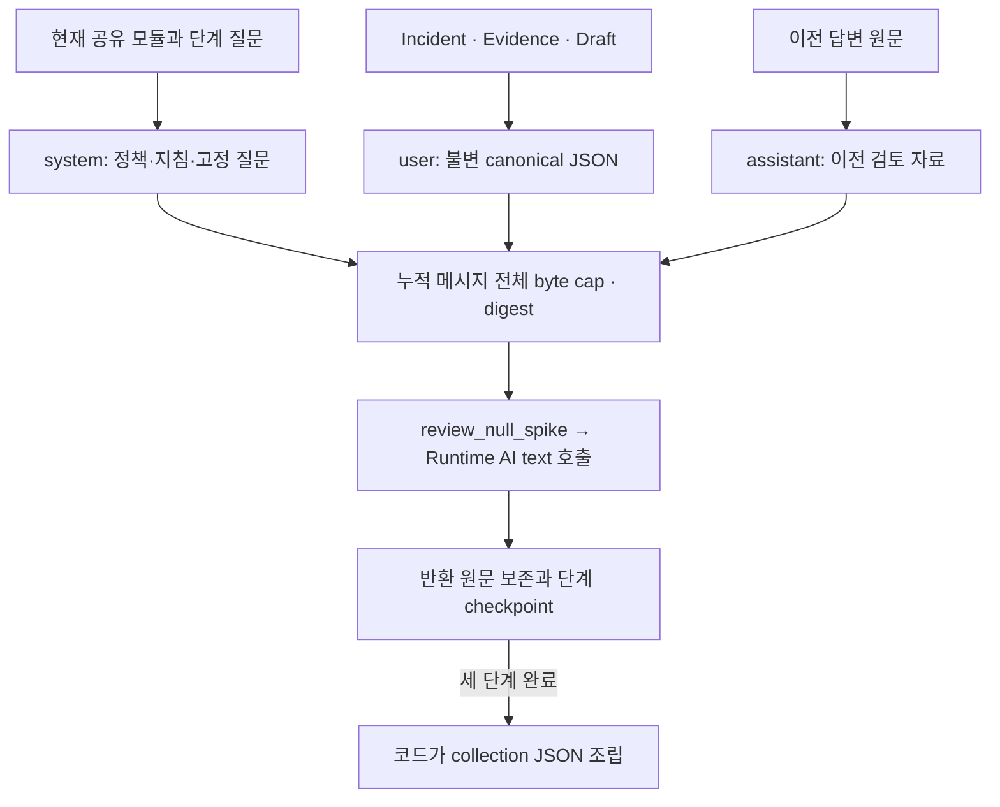

# Review AI Prompt Composition

**일반 API와 live CLI는 현재 한국어 단계별 프롬프트 하나를 사용한다.** 같은 사례에서 근거 검토 → 초안 비판 → 종합 순서로 일반 텍스트를 요청하고, 코드가 원입력 식별자·수치와 세 원문을 JSON으로 조립한다. 실행 모드나 프롬프트 version을 선택하지 않는다.

요구사항은 [Prompt Engineering Spec](../../openspec/specs/review-ai-prompt-engineering/spec.md)이, 정확한 모듈 선택·순서는 [staged renderer](../../src/hmda_reliability/review_ai/staged/prompt.py)가 소유한다. 실행과 사람 평가 절차는 [Review AI Evaluation](review-ai-evaluation.md)을 따른다.

## Staged Text Workflow

일반 API [`review_null_spike()`](../../src/hmda_reliability/review_ai/service.py)와 live CLI는 [같은 단계 실행](../../src/hmda_reliability/review_ai/staged/service.py)을 사용한다. 매 호출에 같은 canonical input과 완료된 이전 답변을 넣는다. 이전 고정 질문과 현재 질문은 신뢰된 system 지시이며, 모델 답변은 assistant 자료다. 이전 답변을 새로운 근거나 확정된 사실로 승격하지 않는다.

매 호출 직전 system·user·assistant를 포함한 누적 메시지 전체의 UTF-8 byte 한도와 digest를 확인한다. 모델에는 JSON 생성을 요구하지 않는다. 코드가 [StagedReviewOutput](../../src/hmda_reliability/review_ai/staged/contracts.py)에 원입력 facts와 고정 순서의 `stages[{stage_id,text}]`를 담는다. 공백·개행을 보존하며 prose에서 분류·priority·근거 참조를 추측해 채우지 않는다.

`completed`는 세 답변의 수집·저장 완료다. 문장의 사실성, 검토 가치나 사람의 승인을 뜻하지 않는다. 빈 답변·알려진 잘림·provider 실패·누적 입력 초과·저장 실패는 후속 단계를 멈추고 반환된 원문과 이미 저장한 checkpoint를 유지한다.

## Module Responsibilities

아래 경로는 [prompt/](../../src/hmda_reliability/review_ai/prompt/) 기준이다. 각 모듈은 한 가지 책임의 지시문을 제공하며 사례 값을 받거나 다른 모듈을 로드하지 않는다.

| Module | Responsibility | Reuse assumptions |
| --- | --- | --- |
| [tasks/null_spike.md](../../src/hmda_reliability/review_ai/prompt/tasks/null_spike.md) | HMDA 검토 역할, 사고 범위와 입력 취급 | 같은 Incident·Evidence·Draft 계약 |
| [output/prose.md](../../src/hmda_reliability/review_ai/prompt/output/prose.md) | 한국어 텍스트, 원문 보존과 이전 답변 취급 | JSON 생성 없이 답하는 단계별 검토 |
| [policies/advisory.md](../../src/hmda_reliability/review_ai/prompt/policies/advisory.md) | 승인·실행 권한의 경계 | 같은 자문 경계를 갖는 작업 |
| [guidance/numeric_fidelity.md](../../src/hmda_reliability/review_ai/prompt/guidance/numeric_fidelity.md) | 비율·변화량·threshold 해석 | 같은 deterministic facts와 단위 |
| [guidance/evidence_review.md](../../src/hmda_reliability/review_ai/prompt/guidance/evidence_review.md) | 근거 충실성, 누락 맥락과 실제 초안 검토 | 제공 근거 ID, context gap과 Draft |
| [staged/](../../src/hmda_reliability/review_ai/prompt/staged/) | 근거 검토·초안 비판·종합의 고정 질문 | 고정된 세 단계와 이전 assistant 이력 |

정책과 지침은 현재 Review AI 안에서 공유한다. 다른 agent에 재사용할 때 입력·대화 역할·출력 전제를 먼저 확인한다. 동일한 의미와 전제를 가진 규칙은 그대로 참조하고, 다르면 별도 모듈로 나눈다. 두 번째 실제 consumer의 요구가 생기기 전에는 범용 agent package로 옮기지 않는다.

## Composition And Delivery

각 단계는 공유 작업·텍스트 출력·해당 수치/근거 지침·자문 정책과 고정 질문을 선택한다. 각 모듈은 한 번만 포함한다. 단계나 모듈 경로는 코드가 선택하며 원본 사례의 문자열이 선택하지 않는다. Include 지시, 디렉터리 자동 탐색, 사례 값의 system 치환이나 동적 템플릿 엔진을 사용하지 않는다.



모델은 조립된 텍스트를 받으며 파일 경로, 이 안내서와 README를 직접 읽지 않는다. 프롬프트가 금지한 행동을 설명하지 않았다는 이유만으로 문장의 사실성이나 실행 권한을 검증했다고 판단하지 않는다.

## Timeouts And Execution Budgets

HTTP timeout과 실행 예산은 다르다. Connect/read/write/pool timeout은 각 네트워크 작업의 비활동 대기를 제한한다. Read timeout은 읽기 대기 한도이며 전체 생성 시간이나 workflow wall time의 상한이 아니다. `TIMEOUT_SECONDS`는 세부값을 지정하지 않은 HTTP phase의 fallback이다.

단계 예산은 렌더링·호출·retry·backoff·원문 보존에, workflow 예산은 전체 실행에 적용한다. Monotonic clock으로 후속 시작과 응답 채택 여부를 확인한다. 진행 중 동기 HTTP 요청이나 파일 저장을 강제 취소하는 hard deadline이 아니다. 늦게 반환된 bounded 원문도 저장한 뒤 예산 실패로 처리하며 후속 단계나 `completed`로 채택하지 않는다.

| Environment | CLI 선택 규칙 |
| --- | --- |
| `HMDA_AGENTIC_REVIEW_TIMEOUT_SECONDS` | HTTP fallback. 미지정 시 30초 |
| `HMDA_AGENTIC_REVIEW_CONNECT_TIMEOUT_SECONDS` | 명시값 우선. 미지정 시 10초 |
| `HMDA_AGENTIC_REVIEW_READ_TIMEOUT_SECONDS` | 명시값 → 명시한 `TIMEOUT_SECONDS` → 300초 |
| `HMDA_AGENTIC_REVIEW_MAX_RETRIES` | 명시값 우선. 미지정 시 0 |
| `HMDA_AGENTIC_REVIEW_STAGE_BUDGET_SECONDS` | 기본 360초 |
| `HMDA_AGENTIC_REVIEW_WORKFLOW_BUDGET_SECONDS` | 기본 1,200초 |

[`.env.example`](../../.env.example)의 값은 로컬 운영 예제이며 실제 모델에서 검증한 최적값이나 완료 보장이 아니다. Python 설정 객체는 환경을 직접 읽지 않는다. CLI가 [Runtime 설정](../../src/hmda_reliability/runtime_ai/settings.py)과 [단계 설정](../../src/hmda_reliability/review_ai/staged/settings.py)에 명시적으로 전달한다.

SDK hidden retry는 0이고 Runtime만 retry를 소유한다. 물리 호출 상한은 `3 * (max_retries + 1)`이며 예산이 먼저 소진되면 실제 호출 수는 더 적다. 본문 없이 timeout이 발생하면 원문 파일이 없다. 단계 `elapsed_ms`는 checkpoint 쓰기 전까지, workflow `elapsed_ms`는 최종 manifest 쓰기 전까지 측정한다. 마지막 진단 metadata 저장·flush를 강제로 종료하지 않으므로 CLI process 종료까지의 시간과 다를 수 있다.

## Inspect The Final Messages

Repository root에서 다음 예제로 첫 단계의 실제 메시지와 digest를 확인한다. 모델 호출과 데이터 적재는 수행하지 않는다. 후속 단계의 전체 메시지는 이전 답변 원문을 함께 넣어 [render_stage_prompt()](../../src/hmda_reliability/review_ai/staged/prompt.py)로 확인한다.

```python
import json
from pathlib import Path

from hmda_reliability.review_ai.context import build_bounded_review_context
from hmda_reliability.review_ai.contracts import AgenticReviewInput
from hmda_reliability.review_ai.prompt import build_canonical_input
from hmda_reliability.review_ai.staged.prompt import render_stage_prompt

corpus = json.loads(
    Path('tests/review_ai/evaluation/fixtures/output_quality_staged_v1.json')
    .read_text(encoding='utf-8')
)
review_input = AgenticReviewInput.model_validate(corpus['cases'][0]['review_input'])
canonical = build_canonical_input(
    review_input, context=build_bounded_review_context(review_input)
)
rendered = render_stage_prompt(
    canonical, 'evidence_review', (), max_prompt_bytes=65_536
)
for message in rendered.messages:
    print(message.role, message.content)
print(rendered.prompt_digest, rendered.prompt_bytes)
```

Fixture revision은 메시지 확인용이며 현재 clean commit의 live 증거가 아니다. 실제 호출 입력은 workflow record의 `canonical_input`에서 확인한다.

## Editing And Reusing A Module

1. 변경 목적에 맞는 작업·출력·정책·지침·질문 모듈을 고른다. 따로 수정하거나 선택할 이유가 있을 때 나누며 문장마다 파일을 만들지 않는다.
1. [현재 조합](../../src/hmda_reliability/review_ai/staged/prompt.py)에서 참조 단계를 확인한다. 공통 파일 변경은 모든 참조 단계에 영향을 준다.
1. UTF-8 Markdown과 마지막 LF 하나를 유지한다. 로더는 조각 사이에 LF 하나를 추가하고 strip·Markdown 변환을 하지 않는다. 편집 후 새 process에서 확인한다.
1. 단계별 전체 메시지를 확인한다. `prompt_bytes`와 `prompt_digest`는 system·user·assistant 전체 배열의 canonical UTF-8 직렬화 기준이다.
1. [프롬프트 회귀](../../tests/review_ai/test_staged_prompt.py)를 실행한다. 구조만 바꾸면 본문과 digest를 보존하고, 내용을 바꾸면 변경 근거와 새 digest를 기록한다. 리소스 변경 시 checkout 밖의 wheel 로딩도 확인한다.
1. 실제 출력이 바뀌면 같은 입력·모델·실행 조건으로 비교하고 [사람 평가 절차](review-ai-evaluation.md#baseline-and-candidate-comparison)를 따른다. 조립 성공과 offline 회귀 통과는 모델 품질을 증명하지 않는다.
