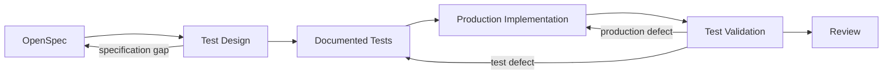

# Test Design and Implementation

## Purpose

이 문서는 OpenSpec requirement를 사람이 읽을 수 있는 pytest test로 설계하고 구현하는 기준을 정의한다.

`tests/`는 검증 코드이면서 변경 의도를 설명하는 **executable specification**이다. Test design은 기본적으로 `test_*.py`의 module docstring과 필요한 test function docstring에 둔다. 별도 문서는 docstring만으로 의도를 유지하기 어려운 복잡한 test module에만 같은 위치의 `test_*.design.md`로 둔다.

## Operating Model



| Layer | Responsibility | Durable evidence |
| --- | --- | --- |
| OpenSpec | 의도한 behavior, design constraint, task scope | proposal, spec, design, tasks |
| Test design | 무엇을 어떤 boundary와 oracle로 검증할지 결정 | module docstring, 필요한 function docstring, 선택적 `test_*.design.md` |
| Test implementation | scenario를 실행 가능한 pytest code로 표현 | test, fixture, assertion |
| Production implementation | requirement와 test를 만족하는 code 작성 | source change와 validation |
| Review | artifact, code, evidence를 독립 대조 | review artifact |

## Responsibilities

Test design과 test implementation은 같은 agent가 수행할 수 있지만 서로 다른 판단이다.

| Activity | Question | Output |
| --- | --- | --- |
| Test design | 무엇을 검증해야 신뢰할 수 있는가? | contract, scenario, boundary, oracle, exclusions |
| Test implementation | 그 설계를 어떻게 반복 가능하게 실행할 것인가? | pytest test, fixture, data, assertion |

Production implementer는 requirement test를 통과시키는 code를 작성한다. Test가 잘못되었다고 판단하면 조용히 약화하지 않고 OpenSpec과 observed evidence를 근거로 문제를 반환한다.

## Source of Truth

Test는 다음 우선순위로 artifact를 사용한다.

| Priority | Artifact | Test에서 사용하는 내용 |
| ---: | --- | --- |
| 1 | Spec | requirement, scenario, observable behavior |
| 2 | Design | public boundary와 기술 제약 |
| 3 | Tasks | 이번 implementation scope |
| 4 | Proposal | 목적과 범위 해석 |

Spec은 **what**, Design은 필요한 **how와 boundary**, Tasks는 이번 실행 범위를 소유한다. Tasks나 기존 code가 requirement의 의미를 조용히 변경하지 않는다. OpenSpec은 behavior를 code가 아니라 관찰 가능한 결과로 표현해야 한다.

## Readiness Check

다음 질문에 답할 수 있을 때 test implementation을 시작한다.

- 어떤 requirement와 scenario를 검증하는가?
- 입력, 동작, 결과 중 외부에서 관찰 가능한 것은 무엇인가?
- 기존 stable boundary 또는 Design이 지정한 public boundary가 있는가?
- expected result가 production algorithm을 복제하지 않고 결정되는가?
- 이번 task scope에서 반드시 보호할 risk는 무엇인가?

다음 상황에서는 test로 결정을 대신하지 않는다.

- requirement 또는 scenario가 서로 충돌한다.
- expected behavior가 모호하다.
- test를 쓰려면 새 API나 architecture를 먼저 결정해야 한다.
- 필요한 dependency나 environment가 project contract에 없다.

이때는 누락된 decision과 영향을 `blocked`로 반환한다.

## Design Method

각 requirement를 다음 흐름으로 변환한다.

```text
requirement → observable contract → risk → scenario → oracle → test level
```

### Observable Contract

입력, 반환값, persisted state, emitted event, error, side effect처럼 caller나 운영자가 확인할 수 있는 결과를 우선한다. Private call 순서나 내부 자료구조는 그것 자체가 contract인 경우가 아니면 검증하지 않는다.

### Risk

모든 경우를 나열하지 않는다. 다음 중 실패 영향이나 가능성이 큰 것을 고른다.

| Scenario | Design question |
| --- | --- |
| Normal | 대표 사용에서 requirement가 성립하는가? |
| Boundary | 빈 값, 임계값, 전환점에서 contract가 유지되는가? |
| Failure | invalid input과 dependency failure가 관찰 가능하게 처리되는가? |
| Regression | 이번 변경이 깨뜨리기 쉬운 기존 behavior는 무엇인가? |
| Invariant | 입력이 달라도 항상 유지되어야 하는 성질은 무엇인가? |
| Integration | 둘 이상의 실제 boundary가 연결되어야만 입증되는가? |

Happy path, boundary, failure를 모두 기계적으로 추가하지 않는다. Acceptance value와 risk가 있는 scenario만 선택한다.

### Oracle

Oracle은 expected result를 판정하는 기준이다.

- OpenSpec에 명시된 결과를 직접 비교한다.
- 단순하고 독립적인 invariant를 사용한다.
- production algorithm을 test 안에 복사하지 않는다.
- mock call보다 public result와 state를 먼저 검증한다.

## Test Documentation Boundary

테스트 파일 구성, docstring, fixture, marker, mock, assertion, validation 규칙은 [`tests/AGENTS.md`](../../tests/AGENTS.md)가 소유한다. 이 문서는 OpenSpec requirement를 observable contract와 scenario로 변환하는 설계만 다룬다.

## Design Completion

test를 작성하기 전에 다음을 결정하면 설계가 완료된다.

- requirement와 observable contract의 연결
- 핵심 risk와 scenario
- production algorithm과 독립적인 oracle
- test boundary와 필요한 exclusion

구현, 실행, failure 분류와 completion 규칙은 [`tests/AGENTS.md`](../../tests/AGENTS.md)를 따른다.

## Related Guides

- [`docs/development/testing.md`](testing.md): pytest command, marker, report, observability
- [`DEVELOPMENT.md`](../../DEVELOPMENT.md): local development와 package convention
- [`pyproject.toml`](../../pyproject.toml): pytest defaults와 marker registration
