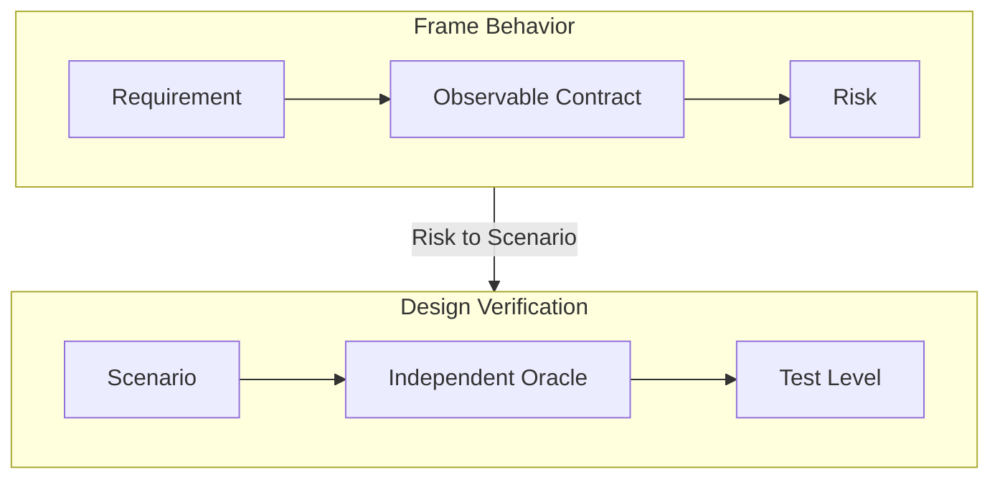

# Test Design

이 문서는 requirement 또는 기존 observable behavior contract를 사람이 읽고 유지할 수 있는 pytest test로 바꾸는 방법을 설명한다. 목표는 implementation detail을 고정하는 것이 아니라, 사용자가 관찰할 수 있는 behavior를 빠르고 신뢰성 있게 보호하는 것이다.

Test command와 marker 선택은 [Testing Guide](testing.md)를 따른다. `tests/` file의 agent write boundary는 [`tests/AGENTS.md`](../../tests/AGENTS.md)가 소유한다.

## What A Good Test Proves

좋은 test는 “이 내부 함수가 호출되었다”보다 “이 입력에서 이 결과가 관찰된다”를 증명한다. 따라서 test를 쓰기 전에 다음 연결을 먼저 만든다.



| Element | Answer | Example |
| --- | --- | --- |
| Requirement | 무엇이 필요하나 | row count 감소를 incident로 식별한다. |
| Observable contract | 외부에서 무엇을 확인하나 | 반환된 evidence에 incident와 measured count가 있다. |
| Risk | 무엇이 깨지기 쉬운가 | threshold 경계에서 false positive가 난다. |
| Scenario | 어떤 조건으로 확인하나 | 변화율이 threshold와 정확히 같은 입력이다. |
| Oracle | 성공·실패를 무엇으로 판정하나 | incident가 없고 measured value가 보존된다. |
| Test level | 가장 싼 신뢰성 있는 경계는 무엇인가 | `unit` |

## Start From The Behavior Contract

먼저 test가 증명할 requirement 또는 observable behavior contract를 확인한다. OpenSpec change가 현재 작업을 소유하면 artifact를 다음 순서로 읽는다.

| Priority | Artifact | Test에서 확인할 내용 |
| ---: | --- | --- |
| 1 | Spec | requirement, scenario, observable behavior |
| 2 | Design | public boundary, constraint, intentional exclusion |
| 3 | Tasks | 이번 구현에서 다룰 범위 |
| 4 | Proposal | 목적과 용어의 맥락 |

OpenSpec에서는 Spec이 **무엇을** 해야 하는지, Design이 필요한 **경계와 제약**을, Tasks가 **이번 작업 범위**를 정한다. 기존 code나 test가 governing contract를 조용히 바꾸는 근거가 되지는 않는다.

다음 질문에 답할 수 없으면 test가 아니라 decision이 먼저 필요하다.

- requirement와 scenario가 서로 충돌하는가?
- expected behavior가 아직 모호한가?
- 새 public API나 architecture를 먼저 결정해야 하는가?
- 필요한 dependency나 environment가 project contract에 없는가?

이 경우 추측으로 test를 만들지 말고, 빠진 결정과 영향을 `blocked`로 보고한다.

## Design A Scenario

각 in-scope contract에 최소 하나의 scenario 또는 명시적인 exclusion을 연결한다. Happy path를 기계적으로 복제하지 말고 실패 영향과 회귀 위험이 있는 case를 선택한다.

| Scenario kind | 확인할 질문 |
| --- | --- |
| Normal | 대표 입력에서 contract가 성립하는가? |
| Boundary | 빈 값, 임계값, 전환점에서 규칙이 유지되는가? |
| Failure | invalid input 또는 dependency failure가 관찰 가능하게 처리되는가? |
| Regression | 이번 변경이 깨뜨리기 쉬운 기존 behavior는 무엇인가? |
| Invariant | 다양한 입력에도 항상 성립해야 하는 성질은 무엇인가? |
| Integration | 실제 boundary를 연결해야만 입증할 수 있는가? |

Scenario는 다음 문장으로 적을 수 있어야 한다.

> Given 이 setup, when 이 action을 수행하면, then 이 observable result가 나타난다.

## Choose An Independent Oracle

Oracle은 test가 기대 결과를 판정하는 기준이다. Production algorithm을 test 안에 다시 구현하면 두 구현이 같은 실수를 공유할 수 있다.

다음 oracle을 우선한다.

- Governing contract에 명시된 반환값, error, event, persisted state를 직접 비교한다.
- 작은 고정 입력에는 사람이 계산할 수 있는 exact expected value를 둔다.
- count 합계, 정렬, 보존, 단조성처럼 단순하고 독립적인 invariant를 확인한다.
- Mock call 횟수보다 public result와 externally visible state를 먼저 확인한다.

Mock은 network, clock, file system, external service처럼 test가 통제해야 하는 boundary에만 사용한다. Mock이 domain behavior를 대신 구현하면 그 test는 실제 contract를 검증하지 못한다.

## Choose The Lowest Useful Level

가장 낮은 비용으로 contract를 신뢰성 있게 입증하는 primary level marker 하나를 선택한다.

| Level | Best for | Avoid when |
| --- | --- | --- |
| `unit` | real I/O가 없는 isolated rule, calculation, validation | 실제 resource boundary가 contract일 때 |
| `component` | 하나의 component와 real local file, database 또는 tool boundary | 여러 project component를 반드시 연결해야 할 때 |
| `integration` | 여러 project component 또는 system을 연결한 behavior | 더 낮은 경계에서 같은 contract를 입증할 수 있을 때 |

Resource contract가 있으면 primary level을 유지한 채 별도 marker를 추가한다.

| Resource marker | Best for |
| --- | --- |
| `memory` | 대표 input의 process memory-budget contract |
| `stress` | 의도적으로 고비용인 worst-case resource behavior |

실행 방법과 marker의 전체 설명은 [Testing Guide](testing.md)에 있다.

## Turn Design Into Test Code

Test file은 executable specification이기도 하다. 기본적으로 module docstring에 contract, scope, 중요한 risk와 exclusion을 짧게 남긴다. Test 이름이 충분히 설명하지 못하는 threshold, policy, regression 이유에만 function docstring을 추가한다.

```python
"""Tests for incident profile comparison.

Contract:
    - Detect material row-count decreases.
    - Preserve measured values in incident evidence.

Scope:
    Unit-level comparison rules only.
"""


def test_ignores_change_at_exact_threshold() -> None:
    """The configured threshold is exclusive."""
```

여러 contract, 복잡한 상태 전이, scenario matrix, 긴 exclusion 또는 data flow가 있는 module에만 대응하는 `test_<subject>.design.md`를 같은 directory에 둔다. 이 문서는 scenario와 실제 test function을 연결하고, `.py`의 behavior가 바뀌면 함께 갱신한다. 일시적인 pass count와 실행 log는 design document에 넣지 않는다.

```markdown
| Scenario | Test |
| --- | --- |
| 여러 incident를 독립적으로 보존 | `test_preserves_multiple_incidents` |
| threshold와 동일한 값은 무시 | `test_ignores_change_at_exact_threshold` |
```

Test 하나는 하나의 논리적 behavior가 실패하도록 작성한다. 의미 있는 반복만 parameterize하고, shared mutable state, test order dependency, 실제 network service 의존은 피한다. 넓은 입력 공간에서 invariant가 핵심일 때만 Hypothesis를 사용한다.

## Use Red Tests Carefully

Production implementation 전에 intentional red test를 만들 수 있다. 좋은 red test는 collection에 성공하고 observable behavior assertion에서 실패한다.

다음은 contract 불일치를 입증하는 red test가 아니다.

- syntax, import path, fixture, marker 오류
- 합의되지 않은 API를 test가 가정한 경우
- environment 또는 unrelated dependency failure
- cleanup과 isolation failure

Red test가 governing contract가 아니라 test 설계의 빈틈을 드러내면, production code를 고치기 전에 scenario와 oracle을 다시 확인한다.

## Finish With Evidence

구현 뒤에는 가장 좁은 focused test부터 실행하고, 필요할 때만 관련 package 또는 전체 suite로 넓힌다. 실행 절차는 [Testing Guide](testing.md)를 따른다.

완료 전에 다음을 확인한다.

- in-scope contract가 scenario 또는 exclusion에 연결되어 있다.
- scenario마다 observable result와 independent oracle이 있다.
- test가 production algorithm을 복제하거나 false green을 만들지 않는다.
- 필요한 module docstring과 optional design document가 현재 code와 일치한다.
- 실제 실행한 validation, 발견한 failure, 남은 risk를 구분해 기록한다.

## Related Guides

- [Testing Guide](testing.md): command, marker, report, debugging
- [`tests/AGENTS.md`](../../tests/AGENTS.md): test file 작업을 위한 agent context
- [`pyproject.toml`](../../pyproject.toml): pytest defaults와 marker 등록
