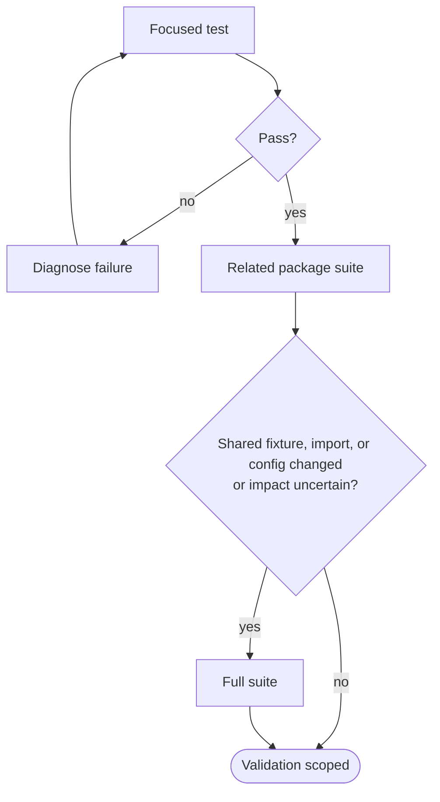

# Testing Guide

이 문서는 local runtime에서 pytest를 선택하고 실행하는 방법을 설명한다. 사람과 local runtime을 사용할 수 있는 agent 모두에 적용할 수 있다. Local runtime을 사용할 수 없는 기여자는 이 command를 필수 절차로 간주하지 않고, 병합에 필요한 repository-side evidence는 [Continuous Integration](ci.md)을 따른다. 어떤 behavior를 test로 설계할지는 [Test Design](test-design.md)을, `tests/` file을 수정하는 agent 규칙은 [`tests/AGENTS.md`](../../tests/AGENTS.md)를 참고한다.

## Start Here

가장 좁은 범위의 command부터 실행한다. 실패 원인이 현재 변경과 관련 있는지 빠르게 알 수 있고, 실행 시간도 짧다.

| Context | Command |
| --- | --- |
| 현재 suite 전체 | `uv run pytest` |
| domain directory | `uv run pytest tests/data_platform` |
| test module | `uv run pytest tests/data_platform/test_sql.py` |
| 한 test | `uv run pytest tests/data_platform/test_sql.py::test_name` |
| 이름으로 선택 | `uv run pytest -k "keyword"` |
| marker로 선택 | `uv run pytest -m unit` |



변경한 test가 통과하면 관련 package suite를 실행한다. 전체 suite는 shared fixture, import 또는 configuration을 바꿨거나 영향 범위를 확신할 수 없을 때 실행한다.

## Default Behavior

`pyproject.toml`의 pytest `addopts`는 모든 일반 실행에 필요한 correctness와 safety 기본값만 제공한다.

| Default | Meaning |
| --- | --- |
| `--timeout=60` | test 하나가 60초를 넘기면 실패시킨다. |
| `--strict-markers` | 등록되지 않은 marker를 오류로 처리한다. |
| `-m 'not memory and not stress'` | 비용이 큰 resource test를 기본 실행에서 제외한다. |

병렬 실행과 report 생성은 전역 기본값이 아니다. 넓은 suite에서 실행 시간을 줄일 때 `-n auto`를 명시하고, HTML report가 실제 evidence로 필요할 때만 `--html`을 사용한다.

## Git Hooks

Lefthook은 local Git hook을 실행할 수 있는 환경에서 빠른 feedback만 담당한다. Commit 전에는 staged file을 자동 수정하고, push 전에는 pushed Python의 정적 검사와 affected test, dbt test만 빠르게 확인한다. Hook을 사용할 수 없는 기여자에게 이를 병합 필수 검증의 유일한 실행 경로로 요구하지 않는다. `main` admission에서 CI가 소유하는 책임 경계는 [Continuous Integration](ci.md)을 따른다.

| Hook | Trigger | Action |
| --- | --- | --- |
| `pre-commit` | staged Markdown | changed file rumdl fix 후 자동 stage |
| `pre-commit` | staged Python | changed file Ruff fix + format 후 자동 stage |
| `pre-push` | pushed Python | 존재하는 changed file Ruff check + format check, testmon affected tests |
| `pre-push` | pushed dbt SQL/YAML | `tests/dbt` |

`pre-commit`과 `pre-push`에는 project-wide type check나 full unit suite를 넣지 않는다. Project tool은 이미 준비된 `.venv`에서 `uv run --no-sync`로 실행해 매 hook마다 dependency sync를 확인하거나 별도 tool environment를 만드는 비용을 피한다. 삭제된 file은 fixer와 linter 대상에서 제외한다.

Python push에서는 `--testmon --testmon-forceselect`로 local `.testmondata`가 알고 있는 실제 dependency를 기준으로 affected tests를 선택한다. `.testmondata`는 Git에서 제외된 local selection cache이며 validation evidence가 아니다. Cache가 없으면 첫 testmon 실행의 선택 이점이 작고, 실행하면서 dependency data가 생성·갱신된다.

Git에는 모든 `git pull`을 실행 전에 차단하는 `pre-pull` hook이 없다. Pull 안전성은 불완전한 local hook 조합을 추가하는 대신 merge 대상 branch가 CI를 통과한 clean state라는 invariant로 관리한다.

## Pull Request CI

이 section은 `CI Lite`의 현재 validation behavior를 설명한다. Merge admission policy와 validation responsibility는 [Continuous Integration](ci.md)이 소유한다.

`CI Lite`는 `main` 대상 Pull Request마다 항상 시작하고 내부 step만 변경 범위에 따라 선택한다. Workflow-level path filter를 사용하지 않아 required check로 사용할 때 workflow 자체가 생성되지 않는 상태를 피한다. 검증 대상은 PR head 단독이 아니라 현재 base와 합쳐진 prospective merge다.

- Markdown은 prospective change set에 포함된 현재 존재하는 changed file만 formatting한다. `docs/**`의 changed Markdown만 formatter 이후 `rumdl check`까지 수행한다. 일반 Inbox artifact를 포함한 `docs/**` 밖의 Markdown은 Markdown lint를 merge admission 조건으로 사용하지 않는다.
- Python, `.python-version`, `pyproject.toml`, `uv.lock` 변경은 locked environment를 준비하고 changed Python file의 Ruff check + format check를 실행한다. Type check는 source domain의 current reverse dependency closure와 직접 대응 test까지 넓히고, shared/common/runtime config 또는 unknown Python path처럼 영향 범위를 안정적으로 좁히기 어려우면 project-wide `ty check`로 fallback한다.
- Direct-mapped repository Python script는 해당 wrapper 또는 workflow contract test를 실행한다. 여러 wrapper가 소비하는 shared script helper는 consumer script까지 type-check하고 관련 contract test를 함께 실행하며, 미매핑 script는 전체 `unit` suite와 project-wide `ty check`로 fallback한다.
- CI workflow와 [`scripts/ci/`](../../scripts/ci/) helper 변경은 classifier와 CI step contract test를 실행한다. CI 파일이라는 이유만으로 Tach나 domain runtime suite를 선택하지 않으며 source·dependency 변경이 함께 있으면 해당 검증은 독립적으로 유지한다. 전체 `unit` fallback과 CI 변경이 겹치면 선택된 CI 계약의 non-unit test를 이어서 실행하며 전체 non-resource suite에서는 중복 실행하지 않는다. CI 계약 test 자체의 변경도 같은 보완 규칙을 따른다.
- Domain source는 own test와 현재 reverse dependency에 따른 consumer test directory를 선택한다.
- Python source, Tach configuration과 dependency state 변경은 [Tach](tooling/tach.md) runtime dependency check와 negative-path regression, source-level AST guard를 실행한다. Tach configuration 단독 변경도 locked environment를 준비한다.
- Scoped domain test는 `unit`, `component`, `integration`을 유지하고 `memory`, `stress`만 제외한다.
- 선택된 test directory가 3개 이상이면 xdist를 사용한다.
- Domain test 자체의 변경은 해당 test directory만 실행한다.
- dbt SQL/YAML은 dbt와 runtime consumer test를 실행한다.
- shared package, 공통 package surface, Python/dependency runtime config처럼 영향 범위를 안정적으로 좁히기 어려운 변경은 전체 `unit` suite로 fallback한다.
- Lefthook 설정 변경은 `lefthook validate`로 configuration을 확인한다.
- Python dependency setup은 Python/test/dependency boundary validation이 필요할 때만 수행하고 uv cache를 재사용한다.

Markdown formatting은 `rumdl fmt`를 현재 changed Markdown 전체에 대해 CI의 disposable workspace에서 실행한다. 자동 수정 가능한 formatting 차이는 병합을 막지 않고 diff를 log와 step summary에 남긴다. Formatting 이후 `rumdl check`는 `docs/**`의 changed Markdown에만 실행하며 남는 lint 위반은 실패한다. `docs/**` 밖의 Markdown에는 `rumdl check`를 실행하지 않는다. CI는 formatting 결과를 branch에 write-back하지 않으며 별도의 post-merge Markdown autofix workflow도 두지 않는다. Local runtime이 없는 기여자도 출력된 diff를 수정 근거로 사용할 수 있다.

### Local CI Steps

변경 경로 분류와 긴 step 분기는 [`scripts/ci/`](../../scripts/ci/)에서 Bash script로 실행한다. [`classify_changes.sh`](../../scripts/ci/classify_changes.sh)는 OpenSpec 분류 helper를 불러오며, [`changed_files.sh`](../../scripts/ci/changed_files.sh)는 step들이 공유하는 파일 수집 helper다. 두 helper는 직접 실행하지 않는다. Actions setup과 step 조건은 workflow에 유지한다. 필요한 도구와 locked Python 환경을 먼저 준비한 뒤 repository root에서 호출한다.

```bash
set -o pipefail
git -c core.quotePath=false diff --name-only <base> <head> | bash scripts/ci/classify_changes.sh --stdin
bash scripts/ci/markdown.sh <base> <head>
FULL_TYPE=false TYPE_TARGETS="src/hmda_reliability/review_ai tests/review_ai" bash scripts/ci/python.sh <base> <head>
BULK=false SPEC_TARGETS="reliability-agentic-review" bash scripts/ci/openspec.sh
FULL_TESTS=false FULL_UNIT=false TARGETS="tests/scripts/ci" bash scripts/ci/pytest.sh
```

파일을 수집하는 step의 기본 비교는 CI prospective merge의 `HEAD^1`과 `HEAD`다. Local branch의 전체 PR 변경을 확인하려면 적절한 base/head를 명시한다. Git 비교 실패와 필수 도구 실패는 nonzero이며, Markdown formatter의 정보성 진단과 non-blocking diff는 docs lint 실패와 별도로 표시한다.

## Select Tests

### Markers

`unit`, `component`, `integration`은 test가 연결하는 경계를 나타내는 primary level marker다. 일반 test는 requirement를 입증하는 가장 낮은 유효 경계 하나를 선택한다.

| Marker | Usage |
| --- | --- |
| `unit` | real I/O나 다른 component 연결 없이 isolated behavior를 검증할 때 |
| `component` | 하나의 component를 real local I/O 또는 tool boundary와 함께 검증할 때 |
| `integration` | 둘 이상의 project component 또는 system을 연결한 behavior를 검증할 때 |

`memory`와 `stress`는 test level을 대체하지 않는 resource marker다. 해당 contract를 검증하는 test의 primary level marker와 함께 사용할 수 있다.

| Marker | Usage |
| --- | --- |
| `memory` | 대표 input에서 process memory-budget contract를 검증할 때 |
| `stress` | 의도적으로 고비용인 worst-case resource behavior를 검증할 때 |

```bash
uv run pytest -m unit
uv run pytest -m integration
uv run pytest -m memory
uv run pytest -m stress
uv run pytest -m "not integration"
```

`memory`와 `stress`는 기본 filter에서 제외되므로 의도적으로 marker를 지정해야 한다.

### Rerun And Debug

직전 실패만 다시 실행하려면 다음 command를 사용한다.

```bash
uv run pytest --lf
```

병렬 실행 중 실패를 조사할 때는 병렬 실행을 끄고 상세 output을 확인한다.

```bash
uv run pytest -n 0 -vv -s tests/data_platform/test_sql.py
```

이 command는 빠른 기본 실행이 아니라 조사용이다. 문제를 확인한 뒤에는 원래의 focused command로 다시 검증한다.

## Additional Evidence

HTML report, coverage와 trace는 필요한 evidence가 있을 때만 수집한다.

```bash
mkdir -p artifacts
uv run pytest -n auto \
  --html=artifacts/pytest.html \
  --self-contained-html
```

```bash
uv run pytest --cov=src/hmda_reliability
```

Test별 trace가 필요하면 `--trace-per-test`를 사용한다. OTLP collector로 export할 때는 endpoint와 export option을 함께 지정한다.

```bash
uv run pytest --trace-per-test tests/data_platform/test_sql.py

OTEL_EXPORTER_OTLP_ENDPOINT=http://localhost:4317 \
	uv run pytest --export-traces
```

`artifacts/pytest.html`과 같은 generated report는 local 실행 결과물이며 authored source가 아니다.

## HMDA EDA

HMDA EDA는 six-core descriptive evidence, YAML export, static chart와 controlled
actual-source evidence를 검증한다. 작은 deterministic correctness suite부터 실행한다.

```bash
uv run pytest tests/hmda_data/eda/
```

실제 source의 portable JSON 및 Markdown evidence는 다음 command로 함께 생성한다.

```bash
uv run python scripts/run_actual_source.py
```

> [!WARNING]
> 이 observation은 성능 또는 OOM 안전성 보장이 아니다. source fingerprint, revision과 실행 시각이 일치하는지 확인한다.

## Review AI And Runtime AI

Review AI의 default suite는 fake transport와 temporary artifact root만 사용하며 network provider를 호출하지 않는다. Runtime AI의 settings와 provider-neutral contract도 함께 검증한다.

```bash
uv run pytest tests/review_ai tests/runtime_ai
```

Review AI utility 계약은 `tests/review_ai`에서 provider/network 없이 검증한다. 다섯 human rubric criterion, test-only positive/restatement/hedging fixtures, evaluation identity와 baseline/candidate comparison을 확인한다. 이 deterministic suite는 사람의 실제 utility assessment를 대신하지 않는다. Live provider proof는 아래 opt-in command와 분리해 판정한다.

실제 Ollama proof는 default suite와 분리된 명시적 opt-in command다. `.env.example`의 `HMDA_AGENTIC_REVIEW_*` 값을 local `.env`에 설정한 뒤 실행한다. `HMDA_AGENTIC_REVIEW_API_KEY`는 OpenAI-compatible client에 필요한 값이지만 invocation evidence에는 저장되지 않는다.

```bash
uv run --env-file .env python scripts/run_agentic_review_live.py
```

`HMDA_AGENTIC_REVIEW_LIVE=true`와 non-empty base URL, API key, model이 있어야 provider를 호출한다. `HMDA_AGENTIC_REVIEW_PROJECT_REVISION`은 기본 `auto`에서 현재 Git HEAD를 사용하며, 잘못된 provenance를 피하기 위해 tracked worktree가 clean해야 한다. 필요하면 non-empty revision을 명시적으로 제공할 수 있다. 결과는 `accepted` 또는 typed failure이며, provider-started call은 `HMDA_RELIABILITY_ARTIFACTS_DIR/agentic-review/invocations/`에 sanitized evidence를 남긴다. Live proof는 approval, recovery 또는 data mutation을 수행하지 않는다.

### Optional Langfuse Projection

기존 synthetic live proof를 Langfuse에도 표시하려면 선택 dependency를 설치하고 별도 export opt-in을 설정한다. Provider opt-in만으로는 전송하지 않는다.

```bash
uv sync --extra langfuse
uv run --extra langfuse --env-file .env python scripts/run_agentic_review_live.py
```

Local `.env`에 `HMDA_LANGFUSE_EXPORT=true`, `LANGFUSE_BASE_URL`, `LANGFUSE_PUBLIC_KEY`, `LANGFUSE_SECRET_KEY`를 설정한다. Endpoint/project는 사용자가 선택하고 합성 사례 전송을 허용한 대상이어야 한다. Key는 commit하거나 로그에 복사하지 않는다. 전체 연동 대기는 `HMDA_LANGFUSE_TIMEOUT_SECONDS`로 조절하며 기본 5초, 최대 60초다. 기존 `HMDA_AGENTIC_REVIEW_*` 설정도 필요하다.

Harness는 local provenance 검증 후 현재 합성 사례와 일치하는 record만 projection한다. Provider URL/trace ID, rendered prompt, raw error와 전체 환경 변수는 전송하지 않는다. Accepted input/output은 허용된 필드만 보내며 크기 상한을 넘으면 자르지 않고 생략한다. SDK는 단기 child에서만 초기화한다. Child는 [`LANGFUSE_MEDIA_UPLOAD_ENABLED`](https://github.com/langfuse/langfuse-python/blob/v4.15.6/langfuse/_client/environment_variables.py)를 `false`로 고정한다. SDK는 기본적으로 base64 data URI를 media로 바꾸고 별도 업로드를 시도하므로, 이를 꺼서 structured output과 digest가 같은 문자열을 가리키게 한다. `timeout`, `export_failed`, `projection_failed`, `invalid_config`, `skipped_*` 상태는 stderr에 표시하며 core result와 exit code를 바꾸지 않는다. 종료 코드 0만으로 export 성공을 판단하지 않는다.

`submitted_unverified`는 SDK 반환만 뜻한다. 실제 프로젝트에서 `review-ai-post-hoc-projection` observation을 찾아 invocation/revision/output digest와 input/output을 확인해야 한다. Span duration은 projection 시간이며 model 실행 시간은 `recorded_latency_ms`다. 동일 payload 재전송은 같은 trace로 묶이고 observation이 추가될 수 있으므로 정확한 observation 하나를 채점한다.

Human setup은 다음 순서로 수행한다.

1. `rubric_v1`의 `added_value`, `actionability`, `evidence_awareness`, `uncertainty_handling`, `prioritization`별 score config를 만든다. 각 config는 categorical option 0/1/2에 대응하는 값만 사용하고, 이름·설명에 rubric과 criterion을 식별한다.
1. Accepted observation의 input, draft, evidence/context gaps와 output을 읽고 다섯 score 각각에 근거 comment를 남긴다. 실패 observation은 채점 대상이 아니다.
1. `invocation_id + output_digest + rubric_v1`이 일치하는지 확인한다. 항목 누락·중복, 0/1/2 밖의 값 또는 빈 comment가 있으면 incomplete다. UI의 완료 표시는 repository completeness를 보장하지 않는다.
1. 필요하면 `review_ai.langfuse_projection.annotation_complete()`에 수동 score snapshot을 넘겨 accepted structured output의 canonical JSON 값/타입, metadata digest, `rubric_v1` target과 score shape의 일치를 검사한다. 각 score는 `criterion`, integer `score`, `rationale`다. 이 helper는 human authorship나 판단 품질을 증명하지 않으며 evaluation을 저장하거나 import하지 않는다.

선택 SDK의 data URI media 변환 차단도 project 없이 확인하려면 다음 network-free test를 실행한다.

```bash
uv run --extra langfuse pytest tests/review_ai/test_langfuse_projection.py::test_pinned_langfuse_media_processor_keeps_data_uri_when_disabled
```

점수 판단은 사람이 수행한다. Annotation queue는 수동 setup으로 충분하며 importer, automatic judge, prompt 관리와 candidate/recovery 승인은 포함하지 않는다. Offline tests와 SDK smoke는 실제 ingestion, 배포 UI와 사람의 utility 판단을 증명하지 않는다. 실제 proof가 필요하면 동일 implementation revision에서 원격 observation 확인과 다섯 항목 채점을 수행하고 별도 evidence로 기록한다.

## Interpret Results

실행하지 않은 test는 통과했다고 기록하지 않는다. 실패가 나면 test 자체의 오류, production behavior 불일치, requirement의 빈틈, environment 문제, 현재 작업과 무관한 baseline failure를 구분한다. Test를 약화하거나 무조건 skip해 실패를 숨기지 않는다.

## Related Guides

- [Continuous Integration](ci.md): `main` merge admission과 CI validation responsibility
- [Test Design](test-design.md): requirement를 scenario와 oracle로 바꾸는 방법
- [`tests/AGENTS.md`](../../tests/AGENTS.md): `tests/` 파일을 수정할 때의 agent context
- [`pyproject.toml`](../../pyproject.toml): pytest correctness/safety defaults와 marker 등록
- [`lefthook.yml`](../../lefthook.yml): commit/push 실행 정책
