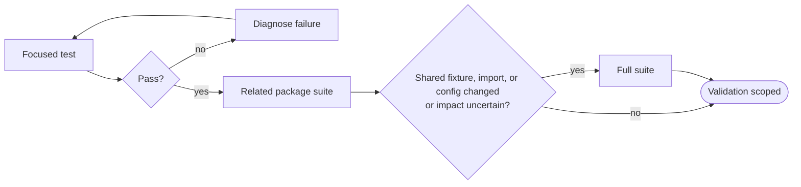

# Testing Guide

이 문서는 사람이 local terminal에서 pytest를 선택하고 실행하는 방법을 설명한다. 어떤 behavior를 test로 설계할지는 [Test Design and Implementation](test-design-and-implementation.md)을, `tests/` file을 수정하는 agent 규칙은 [`tests/AGENTS.md`](../../tests/AGENTS.md)를 참고한다.

## Start Here

가장 좁은 범위의 command부터 실행한다. 실패 원인이 현재 변경과 관련 있는지 빠르게 알 수 있고, 실행 시간도 짧다.

| 상황 | Command |
| --- | --- |
| 현재 suite 전체 | `uv run pytest` |
| domain directory | `uv run pytest tests/data_platform` |
| test module | `uv run pytest tests/data_platform/test_sql.py` |
| 한 test | `uv run pytest tests/data_platform/test_sql.py::test_name` |
| 이름으로 선택 | `uv run pytest -k "keyword"` |
| marker로 선택 | `uv run pytest -m unit` |



변경한 test가 통과하면 관련 package suite를 실행한다. 전체 suite는 shared fixture, import 또는 configuration을 바꿨거나 영향 범위를 확신할 수 없을 때 실행한다.

## Default Behavior

`pyproject.toml`의 pytest `addopts`는 모든 일반 실행에 필요한 correctness와 safety 기본값만 제공한다.

| Default | Meaning |
| --- | --- |
| `--timeout=60` | test 하나가 60초를 넘기면 실패시킨다. |
| `--strict-markers` | 등록되지 않은 marker를 오류로 처리한다. |
| `-m 'not memory and not stress'` | 비용이 큰 resource test를 기본 실행에서 제외한다. |

병렬 실행과 report 생성은 전역 기본값이 아니다. 넓은 suite에서 실행 시간을 줄일 때 `-n auto`를 명시하고, HTML report가 실제 evidence로 필요할 때만 `--html`을 사용한다.

## Git Hooks

Lefthook은 commit의 자동 수정과 push 전 검증을 분리한다. Commit hook은 변경 파일만 고치고, push hook은 이미 고쳐진 상태와 영향 범위 test를 확인한다.

| Hook | Trigger | Action |
| --- | --- | --- |
| `pre-commit` | staged Markdown | changed file에 `rumdl check --fix` 후 자동 stage |
| `pre-commit` | staged Python | changed file에 Ruff fix + format 후 자동 stage |
| `pre-push` | pushed Markdown | changed file `rumdl check` |
| `pre-push` | pushed Python | changed file Ruff check + format check, project `ty check`, testmon affected tests |
| `pre-push` | pushed dbt SQL/YAML | `tests/dbt` |
| `pre-push` | Python/dependency runtime config | full `unit` fallback |

`pre-commit`에는 type check나 pytest를 넣지 않는다. 파일을 저장하고 commit하는 짧은 feedback loop에서는 deterministic auto-fix만 수행한다.

Python push에서는 `--testmon --testmon-forceselect`로 local `.testmondata`가 알고 있는 실제 dependency를 기준으로 affected tests를 선택한다. `.testmondata`는 Git에서 제외된 local selection cache이며 validation evidence가 아니다. Cache가 없으면 첫 testmon 실행의 선택 이점이 작고, 실행하면서 dependency data가 생성·갱신된다.

Git에는 모든 `git pull`을 실행 전에 차단하는 `pre-pull` hook이 없다. Pull 안전성은 불완전한 local hook 조합을 추가하는 대신 merge 대상 branch가 CI를 통과한 clean state라는 invariant로 관리한다.

## Pull Request CI

`CI Lite`는 `main` 대상 Pull Request마다 항상 시작하고 내부 step만 변경 범위에 따라 선택한다. 이렇게 하면 required check로 사용할 때 workflow 자체가 path filter 때문에 생성되지 않는 상태를 피할 수 있다.

- Markdown 변경은 현재 존재하는 changed Markdown file만 `rumdl check`한다.
- Domain source 변경은 해당 domain test와 직접 consumer test만 실행한다.
- Domain test 변경은 해당 test directory만 실행한다.
- dbt 변경은 `tests/dbt`를 실행한다.
- shared package, 공통 package surface, Python/dependency runtime config 변경은 전체 `unit` suite로 fallback한다.
- Lefthook 설정 변경은 `lefthook validate`로 configuration을 확인한다.
- Python dependency setup은 Python/test validation이 필요할 때만 수행하고 uv cache를 재사용한다.

CI는 Markdown을 자동 수정해 통과시키지 않는다. 수정이 필요한 Markdown은 PR에서 실패해야 하며, `main`에 들어간 뒤 bot commit으로 고치는 post-merge autofix workflow는 사용하지 않는다.

## Select Tests

### Markers

`unit`, `component`, `integration`은 test가 연결하는 경계를 나타내는 primary level marker다. 일반 test는 requirement를 입증하는 가장 낮은 유효 경계 하나를 선택한다.

| Marker | 언제 사용하나 |
| --- | --- |
| `unit` | real I/O나 다른 component 연결 없이 isolated behavior를 검증할 때 |
| `component` | 하나의 component를 real local I/O 또는 tool boundary와 함께 검증할 때 |
| `integration` | 둘 이상의 project component 또는 system을 연결한 behavior를 검증할 때 |

`memory`와 `stress`는 test level을 대체하지 않는 resource marker다. 해당 contract를 검증하는 test의 primary level marker와 함께 사용할 수 있다.

| Marker | 언제 사용하나 |
| --- | --- |
| `memory` | 대표 input에서 process memory-budget contract를 검증할 때 |
| `stress` | 의도적으로 고비용인 worst-case resource behavior를 검증할 때 |

```bash
uv run pytest -m unit
uv run pytest -m integration
uv run pytest -m memory
uv run pytest -m stress
uv run pytest -m "not integration"
```

`memory`와 `stress`는 기본 filter에서 제외되므로 의도적으로 marker를 지정해야 한다.

### Rerun And Debug

직전 실패만 다시 실행하려면 다음 command를 사용한다.

```bash
uv run pytest --lf
```

병렬 실행 중 실패를 조사할 때는 병렬 실행을 끄고 상세 output을 확인한다.

```bash
uv run pytest -n 0 -vv -s tests/data_platform/test_sql.py
```

이 command는 빠른 기본 실행이 아니라 조사용이다. 문제를 확인한 뒤에는 원래의 focused command로 다시 검증한다.

## Additional Evidence

HTML report, coverage와 trace는 필요한 evidence가 있을 때만 수집한다.

```bash
mkdir -p artifacts
uv run pytest -n auto \
  --html=artifacts/pytest.html \
  --self-contained-html
```

```bash
uv run pytest --cov=src/project_pivot
```

Test별 trace가 필요하면 `--trace-per-test`를 사용한다. OTLP collector로 export할 때는 endpoint와 export option을 함께 지정한다.

```bash
uv run pytest --trace-per-test tests/data_platform/test_sql.py

OTEL_EXPORTER_OTLP_ENDPOINT=http://localhost:4317 \
	uv run pytest --export-traces
```

`artifacts/pytest.html`과 같은 generated report는 local 실행 결과물이며 authored source가 아니다.

## HMDA EDA

HMDA EDA는 six-core descriptive evidence, YAML export, static chart와 controlled
actual-source evidence를 검증한다. 작은 deterministic correctness suite부터 실행한다.

```bash
uv run pytest tests/hmda_data/eda/
```

실제 source의 portable JSON 및 Markdown evidence는 다음 command로 함께 생성한다.

```bash
uv run python scripts/run_actual_source.py
```

> [!WARNING]
> 이 observation은 성능 또는 OOM 안전성 보장이 아니다. source fingerprint, revision과 실행 시각이 일치하는지 확인한다.

## Interpret Results

실행하지 않은 test는 통과했다고 기록하지 않는다. 실패가 나면 test 자체의 오류, production behavior 불일치, requirement의 빈틈, environment 문제, 현재 작업과 무관한 baseline failure를 구분한다. Test를 약화하거나 무조건 skip해 실패를 숨기지 않는다.

## Related Guides

- [Test Design and Implementation](test-design-and-implementation.md): requirement를 scenario와 oracle로 바꾸는 방법
- [`tests/AGENTS.md`](../../tests/AGENTS.md): `tests/` 파일을 수정할 때의 agent context
- [`pyproject.toml`](../../pyproject.toml): pytest correctness/safety defaults와 marker 등록
- [`lefthook.yml`](../../lefthook.yml): commit/push 실행 정책
