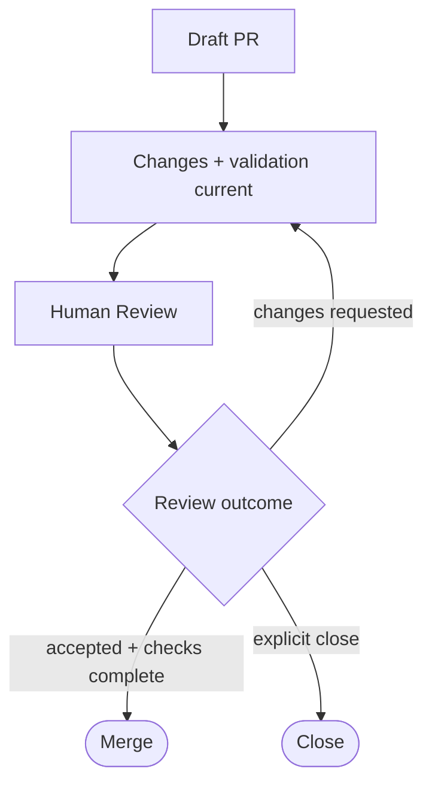

# Pull Requests

Pull Request는 branch의 변경을 검토하고 repository에 반영할지 결정하는 경계다.

## Scope

하나의 Pull Request는 하나의 변경 목적을 가진다. 같은 목적의 변경은 함께 다루고, 독립적인 새 목적은 별도의 branch와 Pull Request로 분리한다.

변경 단위와 branch naming은 [Branches](branch.md)를 따른다.

## Description

본문에는 **현재 변경을 판단하는 데 필요한 정보만** 남긴다. Section 구성, optional section과 validation 표시 형식은 [Pull Request Template](../../../.github/templates/pull-request.md)을 따른다.

- `Summary`는 변경 이유와 기대 결과를 먼저 설명한다.
- `Changes`는 시행착오나 파일 목록이 아니라 최종 동작, 계약 또는 구조의 변화를 기록한다.
- `Validation`은 실제 수행한 검증과 evidence를 기록하고, 실패하거나 확인하지 못한 결과를 숨기지 않는다.

다음 정보는 PR description에 복제하지 않는다.

- Agent의 작업 과정, 상세 reasoning, RPI 단계별 진행 기록과 시행착오
- commit별 변경 내역
- 판단에 필요한 추가 맥락 없이 GitHub UI나 CI가 이미 충분히 제공하는 정보
- OpenSpec change, inbox artifact 또는 canonical document가 소유하는 요구사항과 acceptance criteria

관련 OpenSpec change, inbox artifact 또는 canonical document가 있으면 `References`로 연결한다. 과정 자체를 보존할 가치가 있으면 owning artifact에 기록하고 PR에서는 최종 결과나 필요한 reference만 남긴다.

Optional metadata의 사용 조건과 형식은 [GitHub Templates](../../../.github/templates/README.md)에 위임한다.

## Review And Validation

Validation과 review 범위는 변경의 위험과 영향에 비례한다. 수행한 검증과 수행하지 못한 검증을 구분하고, 기존 review의 근거를 바꾸는 수정은 다시 검토한다.

Pull Request review의 기록 형식과 finding 기준은 [Pull Request Reviews](pull-request-review.md)를 따른다.

필요한 review와 required check가 완료되고 중요한 conflict가 해결된 뒤 merge한다.

## Lifecycle

수정 요청이 있으면 변경과 validation을 갱신한 뒤 인간 검토를 반복한다. 동일한 변경 목적은 기존 Draft PR을 이어가고, 목적이나 접근 방식이 달라지면 새 branch와 Pull Request를 사용한다.

## Agent Instructions

- Repository content 변경은 Draft Pull Request로 전달한다. [Branches](branch.md)의 `Standalone Inbox Delivery` 조건을 충족하는 standalone artifact delivery만 direct-push 예외다.
- 인간의 명시적 요청 없이 Ready 전환, 승인, merge, close 또는 auto-merge를 수행하지 않는다.
- 인간의 판단 없이 review thread를 해결 처리하지 않는다.
- 실패하거나 수행하지 못한 validation을 숨기지 않으며, 불명확한 응답을 승인으로 해석하지 않는다.

## Related

- [Branches](branch.md): Pull Request가 소유하는 변경 목적과 branch 기준
- [Commits](commit.md): Pull Request history를 구성하는 commit 기준
- [Pull Request Reviews](pull-request-review.md): Pull Request review 기준과 기록 방식
- [Pull Request Template](../../../.github/templates/pull-request.md): PR body의 section 구성과 작성 형식
- [GitHub Templates](../../../.github/templates/README.md): 공통 metadata 규칙
