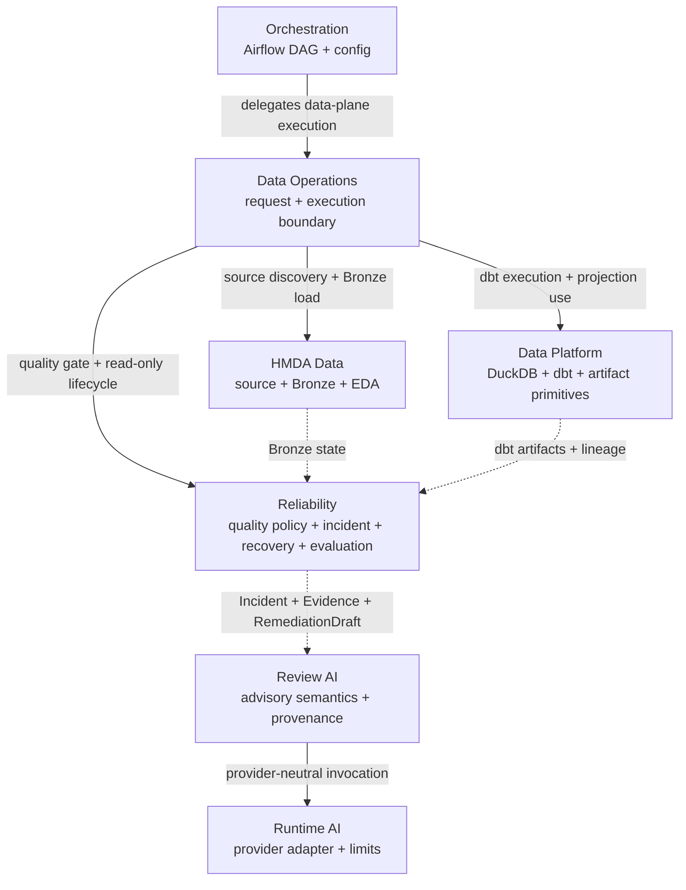

# Domain Guides: Ownership And Reading Paths

이 directory는 각 domain의 책임, 비책임과 주요 reading path를 사람이 빠르게 이해하도록 설명한다. **Normative capability contract의 canonical source는 [`../../openspec/specs/`](../../openspec/specs/)다.** Domain guide는 OpenSpec Spec을 대체하거나 독립적으로 override하지 않는다.

## Ownership Map

| Domain | Owns | Main input and output | Does not own |
| --- | --- | --- | --- |
| [HMDA Data](hmda-data.md) | 원천 파일 발견·검증, Bronze 적재, descriptive EDA, 합성 결함 파일 | CSV/Parquet → `raw.hmda_loans`, EDA evidence, synthetic Parquet | 실행 조합, dbt 변환, incident 판단 |
| [Data Operations](data-operations.md) | 독립 application entry point의 request·domain 호출 조합·결과, 전체 Bronze quality profile, lock-bound dbt execution/promotion, 오류 경계 | request → stage별 result, quality gate, lifecycle result | full-pipeline 순서, 파일 파싱, DuckDB 세부 구현, incident/quality 규칙 |
| [Data Platform](data-platform.md) | DuckDB helper, dbt source·model·test·lineage, artifact projection primitive | `raw.hmda_loans` → staging/mart, dbt artifact pair identity | 원천 적재, dbt subprocess 실행, promotion 결정, orchestration |
| [Reliability](reliability.md) | profile, quality policy, incident, 영향 분석, remediation, recovery, evaluation | profile/raw table + dbt artifacts → gate/lifecycle/recovery/evaluation result | AI review/provider runtime, 외부 approval 결정과 Airflow orchestration |
| [Review AI](review-ai.md) | review contract, prompt projection, deterministic validation, review provenance | Reliability evidence + remediation draft → advisory review result | deterministic truth, provider SDK mechanics, approval/recovery authority |
| [Runtime AI](runtime-ai.md) | provider-neutral message/settings/response contract와 OpenAI-compatible adapter | rendered messages + explicit settings → provider response/typed runtime failure | review policy, Reliability contract, provenance meaning |
| [Orchestration](orchestration.md) | Airflow DAG dependency와 config 변환 | `load_raw_hmda_loans` → `evaluate_quality_gate` → `build_dbt_loan_analytics` | domain business logic, quality policy, reliability control-plane |

이 표와 그림은 architecture/domain ownership을 설명하는 guide다. 실선은 application-level delegation/use를, 점선은 state/evidence 관계를 나타낸다. Source dependency는 `review_ai -> reliability`와 `review_ai -> runtime_ai` 방향이며 data-flow arrow와 구분한다. Normative behavior나 capability requirement가 필요하면 대응 `openspec/specs/**`를 확인하고, 실제 구현 상태는 source/tests와 matching-revision evidence로 검증한다.

## Goal-Based Reading Paths

| Goal | Read in order |
| --- | --- |
| 원천 파일부터 분석 mart까지 이해 | [HMDA Data](hmda-data.md) → [Data Platform](data-platform.md) → [Data Operations](data-operations.md) |
| HMDA descriptive EDA 이해 | [HMDA Data](hmda-data.md) |
| 품질 incident와 recovery 이해 | [Reliability](reliability.md) → [Data Operations](data-operations.md) → [Data Platform](data-platform.md) |
| AI advisory review 이해 | [Review AI](review-ai.md) → [Reliability](reliability.md) → [Runtime AI](runtime-ai.md) |
| Provider 호출 경계 이해 | [Runtime AI](runtime-ai.md) → [Review AI](review-ai.md) |
| Airflow 실행 경계 이해 | [Orchestration](orchestration.md) → [Data Operations](data-operations.md) |

시스템 흐름과 공통 경계는 [`ARCHITECTURE`](../ARCHITECTURE.md)에서 확인한다.
