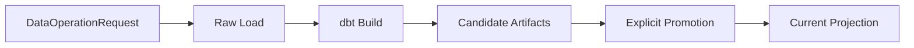
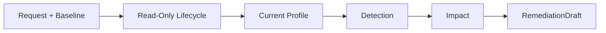

# Data Operations: Application Execution Boundary

**`data_operations`는 application-level request, 실행 순서와 결과를 조합한다.** 파일 파싱, DuckDB primitive, dbt model과 reliability rule은 owning domain에 위임한다.

> [!IMPORTANT]
> Reliability lifecycle은 domain state를 변경하지 않는 read-only analysis다. Data-plane 실행과 artifact promotion은 별도 mutation boundary를 가진다.

## Scope

| In scope | Out of scope |
| --- | --- |
| `DataOperationRequest`와 실행 결과 model | HMDA parsing·validation algorithm |
| raw load와 dbt build 호출 순서 | DuckDB helper와 dbt model 구현 |
| candidate/current artifact adoption boundary | reliability detection/remediation rule |
| read-only reliability lifecycle 조합 | approval, recovery와 evaluation 실행 |

Normative stage execution과 lifecycle contract는 [`data-operations-stage-execution`](../../openspec/specs/data-operations-stage-execution/spec.md)과 [`data-operations-incident-lifecycle`](../../openspec/specs/data-operations-incident-lifecycle/spec.md)이 소유한다.

## Flows

Data plane과 reliability analysis는 서로 다른 side-effect 경계를 가진다. Incident lifecycle은 approval, recovery 또는 evaluation을 암묵적으로 연결하지 않는다.

## Public Entry Points

| API | Role |
| --- | --- |
| `load_raw_data()` | HMDA ingestion owner를 호출하고 raw load result를 반환한다. |
| `run_dbt_build()` | run-scoped candidate dbt build를 실행하고 artifact identity를 반환한다. |
| `promote_dbt_artifacts()` | 검증된 candidate를 current projection으로 명시적으로 채택한다. |
| `run_incident_lifecycle()` | baseline/current evidence를 연결해 read-only reliability analysis를 실행한다. |

정확한 request field, return shape, threshold/default와 failure semantics는 canonical Spec과 public source를 확인한다.

## Safety Boundaries

- `run_dbt_build()` 성공과 current artifact adoption은 같은 사건이 아니다.
- Candidate identity가 기대 상태와 다르면 current projection을 변경하지 않는다.
- dbt target mutation과 HMDA/recovery managed writer는 같은 database-level serialization boundary를 공유한다.
- Incident lifecycle은 raw partition, approval state, recovery/evaluation output을 변경하지 않는다.
- Baseline/current가 같은 asset·partition을 식별하지 않으면 비교를 중단한다.
- Incident가 없으면 recovery proposal 입력을 만들지 않는다.

## Contracts And Evidence

- Stage execution: [`data-operations-stage-execution`](../../openspec/specs/data-operations-stage-execution/spec.md)
- Incident lifecycle: [`data-operations-incident-lifecycle`](../../openspec/specs/data-operations-incident-lifecycle/spec.md)
- Public source: [`src/hmda_reliability/data_operations`](../../src/hmda_reliability/data_operations)
- Executable specification: [`tests/data_operations`](../../tests/data_operations)

## Reading Order

1. [`data_operations/__init__.py`](../../src/hmda_reliability/data_operations/__init__.py)에서 public surface를 확인한다.
2. [`request.py`](../../src/hmda_reliability/data_operations/request.py)에서 한 실행의 입력을 읽는다.
3. Data plane은 [`runner.py`](../../src/hmda_reliability/data_operations/runner.py), reliability analysis는 [`incident_lifecycle.py`](../../src/hmda_reliability/data_operations/incident_lifecycle.py)를 읽는다.
4. 세부 domain rule이 필요하면 HMDA Data, Data Platform 또는 Reliability guide와 canonical Spec으로 이동한다.
