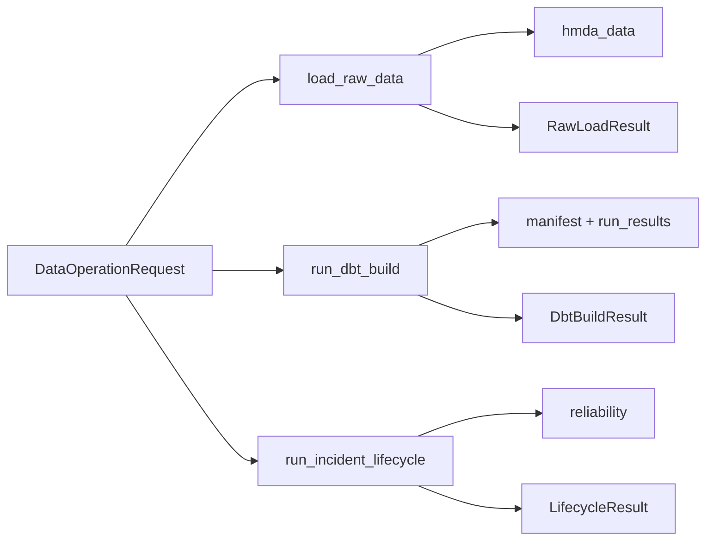

# Data Operations

`data_operations`는 데이터 작업의 **입력, 실행 순서, 결과**를 묶는 application boundary다. 파일 파싱, DuckDB 세부 구현, incident 규칙 자체는 각 도메인에 위임한다.

## 역할

- `DataOperationRequest`로 실행 설정을 검증한다.
- HMDA raw 적재와 dbt build를 호출한다.
- reliability 분석 단계를 순서대로 조합한다.
- 실행 결과를 Pydantic 모델로 반환한다.
- 외부 실행자가 다룰 수 있는 오류를 `DataOperationError`로 통일한다.

## 공개 진입점

| API | 책임 | 결과 |
| --- | --- | --- |
| `load_raw_data()` | HMDA 원천 파일을 DuckDB raw table에 적재 | `RawLoadResult` |
| `run_dbt_build()` | `dbt build` 실행과 artifact 검증 | `DbtBuildResult` |
| `run_incident_lifecycle()` | current 측정, 탐지, 영향 분석, 조치 초안 생성 | `LifecycleResult` |

공개 API와 모델은 [`__init__.py`](../../src/project_pivot/data_operations/__init__.py)에서 확인한다.

## 실행 흐름



### Raw 적재

[`runner.py`](../../src/project_pivot/data_operations/runner.py)의 `load_raw_data()`가 파일 발견과 파티션 적재를 `hmda_data`에 위임한다. 반환값에는 처리 파일 수와 적재 행 수가 포함된다.

### dbt build

`run_dbt_build()`는 다음 경계를 책임진다.

1. 이전 artifact 삭제
1. `dbt build` subprocess 실행
1. 종료 코드와 제한 시간 확인
1. 새 `manifest.json`, `run_results.json` 존재 확인

artifact가 없으면 종료 코드가 0이어도 성공으로 처리하지 않는다.

### Incident lifecycle

[`incident_lifecycle.py`](../../src/project_pivot/data_operations/incident_lifecycle.py)의 실행 순서:

```text
current profile 측정
→ baseline 호환성 확인
→ incident 전체 탐지
→ dbt downstream 영향 분석
→ remediation draft 생성
→ 중복 제거 후 요약 반환
```

lifecycle은 read-only다. backfill, approval, recovery, evaluation을 실행하지 않는다.

## 핵심 계약

[`request.py`](../../src/project_pivot/data_operations/request.py)의 `DataOperationRequest`가 공통 입력이다.
기본값은 로컬 HMDA·DuckDB·dbt 경로를 가리키며, 알 수 없는 필드는 거부된다.

결과 모델은 모두 변경 불가다.

- [`RawLoadResult`](../../src/project_pivot/data_operations/raw_result.py)
- [`DbtBuildResult`](../../src/project_pivot/data_operations/dbt_result.py)
- [`LifecycleResult`](../../src/project_pivot/data_operations/lifecycle_result.py)

## 사용 위치

Dagster resource가 설정을 `DataOperationRequest`로 변환하고, asset이 공개 진입점을 호출한다.

- [`resource.py`](../../src/project_pivot/orchestration/defs/resource.py)
- [`assets.py`](../../src/project_pivot/orchestration/defs/assets.py)

동작 계약은 [`tests/data_operations`](../../tests/data_operations)에서 확인한다.

## 읽는 순서

1. [`__init__.py`](../../src/project_pivot/data_operations/__init__.py)
1. [`request.py`](../../src/project_pivot/data_operations/request.py)
1. [`runner.py`](../../src/project_pivot/data_operations/runner.py)
1. [`incident_lifecycle.py`](../../src/project_pivot/data_operations/incident_lifecycle.py)
1. [`tests/data_operations`](../../tests/data_operations)
