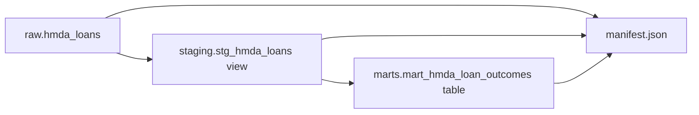

# Data Platform

`data_platform`은 DuckDB 연결·SQL 식별자 처리와 dbt 기반 Bronze-to-Gold 데이터 계약을 제공한다. 원천 파일 적재, dbt subprocess 실행, orchestration은 이 도메인 책임이 아니다.

## Scope

| In scope | Out of scope |
| --- | --- |
| DuckDB 연결·schema·table metadata 헬퍼 | HMDA 원천 파일 발견과 적재 |
| DuckDB 식별자·문자열 literal quoting | `dbt build` subprocess 실행과 artifact 수명 관리 |
| `raw.hmda_loans` source 선언 | 실행 요청, 실행 결과 모델, orchestration |
| staging view와 mart table, schema tests | reliability incident 판단 |

원천 Bronze 적재 계약은 [`hmda-data.md`](hmda-data.md), 실행 경계는 [`data-operations.md`](data-operations.md)에 있다.

## DuckDB Utilities

[`duckdb.py`](../../src/project_pivot/data_platform/duckdb.py)는 연결 수명과 raw schema, table metadata를 지원한다.

| API | Contract |
| --- | --- |
| `DuckDBConnectionManager(database_path=None, read_only=False, cleanup_on_close=False)` | context manager로 DuckDB 연결을 열고 항상 닫는다. 경로가 없으면 in-memory DB를 사용한다. |
| `ensure_schema(connection, schema_name="raw")` | schema가 없으면 생성한다. |
| `table_row_count(connection, table_name)` | table 전체 행 수를 `int`로 반환한다. 결과가 없으면 `DuckDBMetadataError`다. |
| `table_columns(connection, table_name)` | table 컬럼명을 `set[str]`로 반환한다. |

파일 DB 연결은 상위 디렉터리를 생성한다. `cleanup_on_close=True`면 DB와 `.wal` 파일을 연결 종료 후 제거한다. `read_only=True`는 DuckDB 연결 옵션으로 그대로 전달된다.

[`sql.py`](../../src/project_pivot/data_platform/sql.py)는 SQL 문자열을 구성할 때 사용한다.

| API | Contract |
| --- | --- |
| `quote_identifier(value)` | double quote를 escape한 DuckDB 식별자를 반환한다. 빈 값과 null 문자는 거부한다. |
| `qualify_table_name(value)` | `schema.table` 각 조각을 개별 식별자로 quote한다. 빈 조각은 거부한다. |
| `quote_string_literal(value)` | single quote를 escape한 SQL 문자열 literal을 반환한다. |

값은 parameter binding을 우선 사용한다. 위 helper는 schema·table·column 같은 parameter로 바인딩할 수 없는 SQL 식별자 또는 고정 literal을 위한 도구다.

## dbt Project

dbt project는 [`dbt_project.yml`](../../dbt/dbt_project.yml)에서 `project_pivot`으로 정의한다. 기본 profile은 [`profiles.yml`](../../dbt/profiles.yml)의 `data/project_pivot.duckdb`를 사용하며, `PROJECT_PIVOT_DUCKDB_PATH` 환경 변수로 대체할 수 있다.

| Layer | Schema | Materialization | Input | Output |
| --- | --- | --- | --- | --- |
| Bronze | `raw` | ingestion 소유 table | HMDA 원천 파일 | `raw.hmda_loans` |
| Staging | `staging` | view | `raw.hmda_loans` | `stg_hmda_loans` |
| Mart | `marts` | table | `stg_hmda_loans` | `mart_hmda_loan_outcomes` |

schema 이름은 [`generate_schema_name.sql`](../../dbt/macros/generate_schema_name.sql) macro가 결정한다. custom schema가 있으면 그 값을, 없으면 target schema를 쓴다. 모델에서 환경별 prefix를 직접 설정하지 않는다.

### Source

[`sources.yml`](../../dbt/models/sources.yml)은 유일한 Bronze source `raw.hmda_loans`를 선언한다. 다음 컬럼은 `not_null` test 대상이다.

- `activity_year`
- `loan_purpose`
- `action_taken`
- `source_file`
- `source_year`

`state_code`, `county_code`의 null 허용은 raw 계약을 보존한다.

### Staging

[`stg_hmda_loans.sql`](../../dbt/models/staging/stg_hmda_loans.sql)은 분석용 타입을 명시한다.

| Column group | Transformation |
| --- | --- |
| `activity_year`, `loan_purpose`, `action_taken`, `source_year` | `INTEGER` cast |
| `state_code`, `county_code`, `source_file` | `VARCHAR` cast |
| `loan_amount`, `income` | `try_cast(... AS DOUBLE)` |

Staging은 모든 raw 행을 유지한다. `state_code`, `county_code`, `loan_amount`, `income`은 null을 보존하며, 수치 형식 오류는 `try_cast` 결과 null로 표현한다.

### Mart

[`mart_hmda_loan_outcomes.sql`](../../dbt/models/marts/mart_hmda_loan_outcomes.sql)의 grain은 `activity_year + state_code + loan_purpose`다. 세 grain 컬럼이 모두 존재하는 staging 행만 집계한다.

| Metric | Definition |
| --- | --- |
| `application_count` | grain 내 전체 행 수 |
| `approval_count` | `action_taken IN (1, 2)` 행 수 |
| `denial_count` | `action_taken IN (3, 7)` 행 수 |
| `approval_rate` | `approval_count / application_count`, 소수점 여섯 자리 반올림 |
| `average_loan_amount` | `loan_amount` 평균 |
| `average_income` | `income` 평균 |

`mart_grain_key`는 `activity_year:state_code:loan_purpose`다. [`marts/schema.yml`](../../dbt/models/marts/schema.yml)은 이 키에 `not_null`, `unique` test를 적용하고 각 grain과 count metric의 `not_null`을 검증한다.

## Lineage And Execution Boundary

dbt lineage는 다음과 같다.

`data_operations.run_dbt_build()`가 `dbt build`를 실행하고 이전 artifact 제거, 종료 코드 확인, 새 `manifest.json`·`run_results.json` 존재 검증을 책임진다. `data_platform`은 모델·source·test와 lineage 계약만 소유한다.

통합 계약은 [`tests/dbt/test_analytics_foundation.py`](../../tests/dbt/test_analytics_foundation.py)에서 raw source, 두 모델의 manifest dependency, mart 멱등성과 metric 결과를 검증한다. Python helper 계약은 [`tests/data_platform`](../../tests/data_platform)에서 확인한다.

## Reading Order

1. [`duckdb.py`](../../src/project_pivot/data_platform/duckdb.py)
2. [`sql.py`](../../src/project_pivot/data_platform/sql.py)
3. [`sources.yml`](../../dbt/models/sources.yml)
4. [`stg_hmda_loans.sql`](../../dbt/models/staging/stg_hmda_loans.sql)
5. [`mart_hmda_loan_outcomes.sql`](../../dbt/models/marts/mart_hmda_loan_outcomes.sql)
6. [`tests/dbt/test_analytics_foundation.py`](../../tests/dbt/test_analytics_foundation.py)
