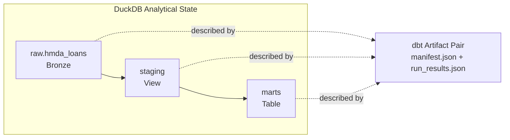

# Data Platform: DuckDB, dbt And Artifact Contracts

**`data_platform`은 DuckDB 공통 primitive, dbt Bronze-to-Gold 구조와 dbt artifact projection primitive를 소유한다.** 원천 파일 적재, dbt subprocess 실행, candidate 선택과 promotion 결정, orchestration은 이 domain의 책임이 아니다.

## Scope

| In scope | Out of scope |
| --- | --- |
| DuckDB connection·schema·metadata helper | HMDA source discovery와 ingestion |
| file DuckDB mutation serialization primitive | external/multi-host writer coordination |
| SQL identifier/literal helper | application-level execution sequencing |
| dbt source·staging·mart·test·lineage | `dbt build` subprocess 실행 |
| dbt artifact pair identity와 projection lock | candidate selection과 promotion policy |

Normative behavior는 [`../../openspec/specs/data-platform-duckdb-access/spec.md`](../../openspec/specs/data-platform-duckdb-access/spec.md)와 [`../../openspec/specs/data-platform-dbt-analytics/spec.md`](../../openspec/specs/data-platform-dbt-analytics/spec.md)가 소유한다.

## Data Flow

Bronze는 ingestion owner가 만들고, dbt는 분석용 staging/mart와 lineage/test artifact를 정의한다. 어떤 run artifact를 current로 채택할지는 `data_operations`가 결정한다.

## Public Surface

| Area | Surface |
| --- | --- |
| DuckDB | connection manager, schema/table metadata, database mutation lock |
| SQL | identifier qualification과 literal quoting helper |
| dbt analytics | source, staging, mart, schema tests와 lineage |
| Artifact projection | artifact pair identity와 shared/exclusive projection lock |

정확한 API signature, model column, metric formula와 failure scenario는 canonical Spec, source와 tests에서 확인한다.

## Safety Boundaries

- `data_platform`은 HMDA source를 적재하지 않는다.
- `data_platform`은 dbt subprocess를 실행하거나 successful candidate를 current로 promotion할 시점을 결정하지 않는다.
- Candidate artifact와 current last-known-good projection은 다른 상태다.
- Artifact identity는 manifest/run-results pair를 하나의 projection으로 식별한다.
- File DuckDB mutation lock은 project-managed single-host writer를 위한 cooperative boundary이며 external/multi-host writer를 과보장하지 않는다.

## Contracts And Evidence

- DuckDB access: [`data-platform-duckdb-access`](../../openspec/specs/data-platform-duckdb-access/spec.md)
- dbt analytics: [`data-platform-dbt-analytics`](../../openspec/specs/data-platform-dbt-analytics/spec.md)
- Implementation: [`src/project_pivot/data_platform`](../../src/project_pivot/data_platform)
- dbt project: [`dbt/`](../../dbt)
- Executable specification: [`tests/data_platform`](../../tests/data_platform), [`tests/dbt`](../../tests/dbt)

## Reading Order

1. [`data_platform/__init__.py`](../../src/project_pivot/data_platform/__init__.py)에서 public surface를 확인한다.
2. DuckDB primitive가 필요하면 [`duckdb.py`](../../src/project_pivot/data_platform/duckdb.py)와 [`sql.py`](../../src/project_pivot/data_platform/sql.py)를 읽는다.
3. Artifact adoption boundary를 이해하려면 [`artifacts.py`](../../src/project_pivot/data_platform/artifacts.py) 뒤 [`data-operations.md`](data-operations.md)로 이동한다.
4. 분석 layer는 [`dbt/models`](../../dbt/models)와 corresponding canonical Spec을 확인한다.
