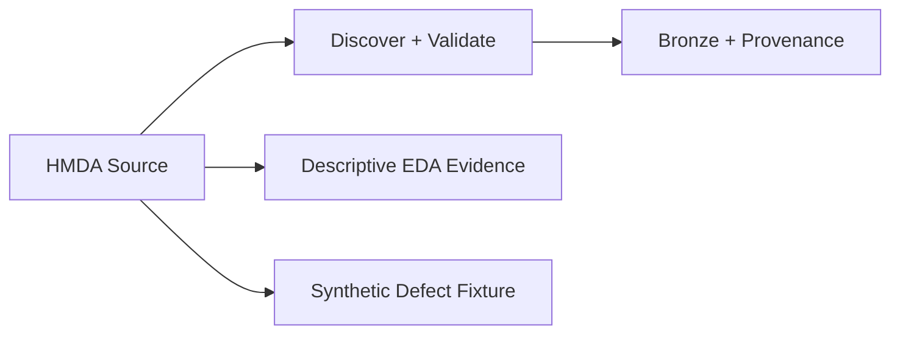

# HMDA Data: Source to Bronze

**`hmda_data`는 HMDA 원천을 발견·검증해 DuckDB Bronze로 적재하고, read-only descriptive EDA와 결정론적 synthetic defect 입력을 제공한다.** 원천 의미를 해석하거나 incident를 판정하지 않는다.

> [!IMPORTANT]
> **Boundary:** 실행 설정·순서·결과 조합은 `data_operations`가 소유한다. Bronze 이후 dbt 변환은 `data_platform`, incident 판단과 recovery/evaluation은 `reliability`가 소유한다.

## Scope

| In scope | Out of scope |
| --- | --- |
| CSV/Parquet source discovery와 structural validation | 원천 데이터 다운로드와 publication freshness |
| `raw.hmda_loans` 전체·partition 적재와 provenance | dbt Silver/Gold 변환 |
| read-only descriptive EDA evidence | incident verdict와 remediation |
| deterministic synthetic defect fixture | approval, recovery와 evaluation orchestration |

Normative ingestion, EDA와 synthetic behavior는 [`../../openspec/specs/`](../../openspec/specs/)의 corresponding HMDA capability Spec이 소유한다.

## Flow

Bronze는 원천의 null, code와 outlier를 reliability 판단으로 정제하지 않고 downstream 분석이 다시 확인할 수 있게 보존한다. Freshness vertical slice는 source schema를 바꾸는 synthetic helper가 아니라 isolated Bronze state의 `ingested_at` evidence를 사용한다.

## Public Surface

| Area | Public surface |
| --- | --- |
| Discovery / load | `discover_hmda_files`, `load_hmda_loans`, `load_hmda_loans_partition` |
| Target state | `partition_content_identity`, `partition_max_ingested_at`, `validate_required_columns` |
| Descriptive EDA | `hmda_data.eda` public exports |
| Synthetic fixtures | `row_count_drop`, `null_spike`, `schema_drift` |

정확한 signature, required field, default와 failure scenario는 public code와 canonical Spec을 확인한다. 공개 import surface는 [`hmda_data/__init__.py`](../../src/hmda_reliability/hmda_data/__init__.py)다.

## Safety Boundaries

- Source file은 ingestion/EDA/synthetic 작업의 mutation target이 아니다.
- Partition replacement는 partial delete/mixed state를 남기지 않는 expected-state boundary를 가진다.
- File DuckDB를 변경하는 project-managed writer는 공통 mutation serialization을 사용한다.
- Content identity와 temporal freshness state는 서로 다른 evidence이며 필요할 때 함께 검증한다.
- EDA와 synthetic fixture 생성은 quality incident를 스스로 확정하지 않는다.

## Contracts And Evidence

- Ingestion: [`hmda-data-ingestion`](../../openspec/specs/hmda-data-ingestion/spec.md)
- Descriptive EDA: [`hmda-data-eda-descriptive-evidence`](../../openspec/specs/hmda-data-eda-descriptive-evidence/spec.md)
- Synthetic defects: [`hmda-data-synthetic-defects`](../../openspec/specs/hmda-data-synthetic-defects/spec.md)
- Executable specification: [`tests/hmda_data`](../../tests/hmda_data)
- Actual-source observation: [`../references/hmda_eda.md`](../references/hmda_eda.md)

## Reading Order

1. [`hmda_data/__init__.py`](../../src/hmda_reliability/hmda_data/__init__.py)에서 public surface를 확인한다.
2. 원천 적재는 [`ingestion`](../../src/hmda_reliability/hmda_data/ingestion/), descriptive evidence는 [`eda`](../../src/hmda_reliability/hmda_data/eda/), defect fixture는 [`synthetic`](../../src/hmda_reliability/hmda_data/synthetic/)으로 이동한다.
3. Normative behavior가 필요하면 corresponding OpenSpec Spec을 읽는다.
4. Boundary와 regression oracle은 [`tests/hmda_data`](../../tests/hmda_data)에서 확인한다.
