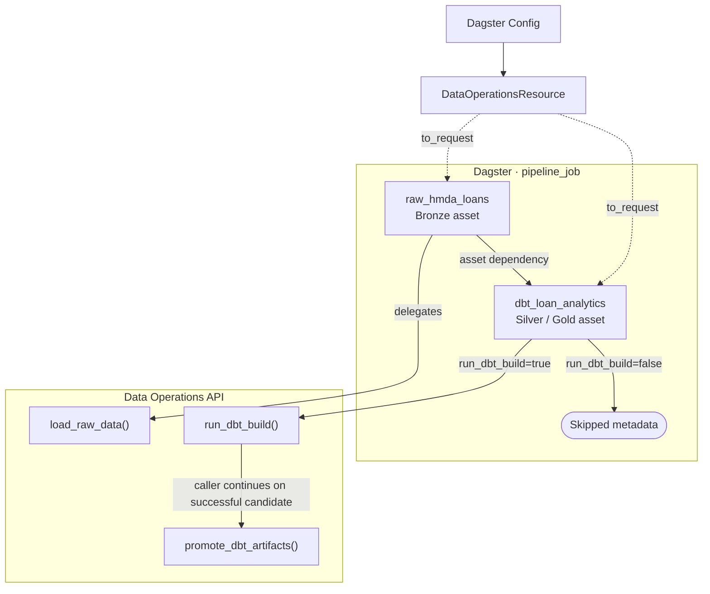

# Orchestration: Dagster Data Plane

**`orchestration`은 Bronze 적재와 dbt 분석만 연결한다.** Domain business logic은 공개 API로 위임하며, reliability lifecycle과 recovery/evaluation은 Dagster graph에 넣지 않는다.

> [!IMPORTANT]
> **`pipeline_job`은 data plane 전용이다.** approval이나 승인된 side effect를 암묵적으로 실행하지 않는다.

## Scope

| In scope | Out of scope |
| --- | --- |
| Dagster `Definitions`, asset, `pipeline_job` 등록 | 원천 파일 파싱과 DuckDB 적재 구현 |
| 설정을 `DataOperationRequest`로 변환 | dbt 모델 구현과 artifact 검증 |
| asset 의존성과 materialization metadata | reliability lifecycle, approval, backfill, evaluation |
| Bronze → Silver/Gold 실행 순서 | schedule, sensor, asset check, 별도 CLI runner |

데이터 실행의 application boundary는 [`data-operations.md`](data-operations.md)다. data 계약은 [`hmda-data.md`](hmda-data.md), [`data-platform.md`](data-platform.md)에 있다.

## Entry Point And Asset Graph

[`definitions.py`](../../src/project_pivot/orchestration/definitions.py)가 package entry point다. `defs`에는 두 asset, `pipeline_job`, `data_operations` resource가 등록된다.

`pipeline_job`의 asset selection은 `raw_hmda_loans`, `dbt_loan_analytics`뿐이다. Dagster가 전체 pipeline의 유일한 orchestrator이며, 독립 pipeline runner와 CLI는 제공하지 않는다.

## Assets

| Asset | Group / kinds | Delegated API | Materialization metadata |
| --- | --- | --- | --- |
| `raw_hmda_loans` | `bronze`, `duckdb`·`python` | `load_raw_data()` | database path, source root, file count, year, HMDA row count |
| `dbt_loan_analytics` | `silver_gold`, `dbt` | `run_dbt_build()` | success, skipped, return code, manifest path, run results path, projection identity |

`dbt_loan_analytics`는 `raw_hmda_loans`에 의존한다. `run_dbt_build=False`이면 dbt 실행을 건너뛰고 `skipped=true`, `succeeded=false`, 사유 `run_dbt_build=false`를 기록한다. 건너뜀은 성공으로 표시하지 않는다.

성공한 dbt materialization의 `projection_id`는 promotion gate가 검증한 run-scoped candidate artifact pair의 identity다.

## Resource Configuration

`DataOperationsResource`는 Dagster 설정을 [`DataOperationRequest`](../../src/project_pivot/data_operations/request.py)로 변환한다.

| Field | Default | Meaning |
| --- | --- | --- |
| `database_path` | `data/project_pivot.duckdb` | DuckDB 파일 경로 |
| `source_root` | `data/raw/hmda` | HMDA 원천 디렉터리 |
| `source_year` | `2025` | 적재 partition |
| `source_file` | `None` | 선택 원천 파일명 |
| `run_dbt_build` | `true` | dbt asset 실행 여부 |

resource는 config conversion만 담당한다. 파일 발견, 적재, dbt subprocess, 오류 변환은 `data_operations`와 하위 도메인의 책임이다.

## Graph Boundaries

`pipeline_job`은 data plane만 실행한다. 다음 항목은 graph 밖에 둔다.

- schedule, sensor, asset check
- `run_incident_lifecycle()`
- approval과 `execute_approved_backfill()`
- evaluation과 report 파일 작성

이 분리는 pipeline 실행이 데이터 변환만 수행하고 reliability control plane의 read-only lifecycle 또는 승인된 side effect를 암묵적으로 실행하지 않게 한다.

## Reading Order

1. [`definitions.py`](../../src/project_pivot/orchestration/definitions.py)
1. [`assets.py`](../../src/project_pivot/orchestration/defs/assets.py)
1. [`resource.py`](../../src/project_pivot/orchestration/defs/resource.py)
1. [`tests/orchestration/test_dagster_definitions.py`](../../tests/orchestration/test_dagster_definitions.py)
1. [`tests/orchestration/test_pipeline_materialization.py`](../../tests/orchestration/test_pipeline_materialization.py)
